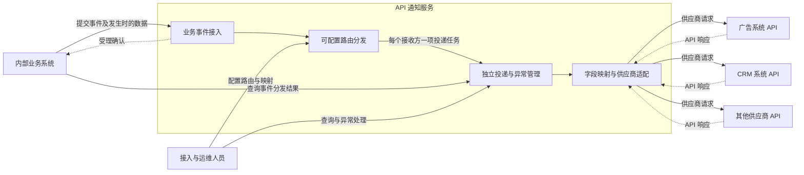
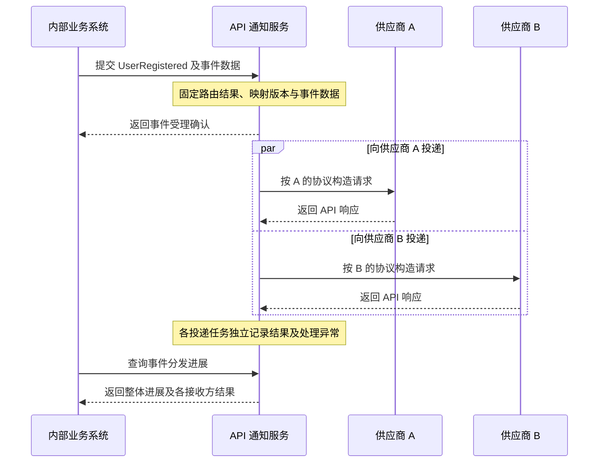

# API 通知服务产品需求文档

| 项目 | 内容 |
| --- | --- |
| 文档版本 | v0.3 |
| 更新日期 | 2026-11-09 |
| 文档状态 | 产品需求草案 |
| 产品定位 | 面向企业内部业务事件的统一路由与供应商通知服务 |

## 1. 产品背景

企业内部的多个业务系统需要在关键事件发生后，通知不同的外部供应商。例如，用户注册后通知广告系统，订阅付款后通知 CRM，商品购买后通知库存系统。

一次业务事件可能需要通知多个供应商。供应商不仅请求地址、Header 和 Body 不同，鉴权、签名、结果判定和运行约束也存在差异。由各业务系统分别维护接收方和供应商协议，会造成重复建设、接入规则分散及异常难以追踪。

API 通知服务统一接收业务事件，通过可配置的路由确定接收方，并通过供应商适配能力完成通知。业务系统负责表达发生了什么，服务负责确定通知谁以及如何通知。

## 2. 产品目标

| 目标 | 期望价值 |
| --- | --- |
| 统一事件接入 | 业务系统按约定提交事件及发生时的数据，复用一致的接入方式 |
| 集中路由 | 通过配置管理事件与供应商之间的关系，支持一项事件通知多个接收方 |
| 屏蔽供应商差异 | 由通知服务完成字段映射和供应商协议适配 |
| 业务解耦 | 业务流程无需等待外部供应商完成处理 |
| 可靠投递 | 已受理事件及其投递任务可恢复、可追踪，异常能够继续处理或人工介入 |
| 语义一致 | 后续重试保持原事件的数据含义和已确定的分发关系 |

## 3. 使用角色与业务场景

### 3.1 使用角色

| 角色 | 核心诉求 |
| --- | --- |
| 业务系统 | 提交业务事件并取得受理确认，无需逐个选择供应商或组装供应商请求 |
| 业务系统开发者 | 定义事件含义和数据约定，按业务事件关联查询分发结果 |
| 接入与运维人员 | 配置路由和映射、维护供应商接入、观察运行情况并处理异常 |
| 外部供应商系统 | 通过自身 API 接收通知并处理对应业务 |

### 3.2 典型业务场景

下表用于说明分发关系，具体接收方由发布的路由配置决定。

| 业务事件 | 发起方 | 可能的通知接收方 | 业务目的 |
| --- | --- | --- | --- |
| `UserRegistered` | 用户系统 | 广告系统、CRM 系统 | 同步转化结果及新客户信息 |
| `SubscriptionPaid` | 订阅或支付系统 | CRM 系统、营销系统 | 同步订阅状态及付款事件 |
| `ProductPurchased` | 订单系统 | 库存系统 | 通知商品购买情况 |

业务事件表达已经发生的事实，携带该时刻所需的数据。服务依据事件内容与路由配置生成各接收方的通知。

## 4. 总体通信架构

### 4.1 系统关系

业务系统与通知服务通过 HTTP(S) 提交和查询事件。通知服务与供应商通过其约定的 HTTP(S) API 通信。图中路由、投递和适配为服务内部的职责划分。

### 4.2 通信关系与同步边界

| 通信关系 | 内容 | 产品含义 |
| --- | --- | --- |
| 业务系统 → 通知服务 | 事件类型、稳定事件标识、发生时间、当时的数据及业务关联信息 | 提交一项需要分发的业务事实 |
| 通知服务 → 业务系统 | 同步返回受理结果及事件关联标识 | 确认事件及其分发计划是否由服务接管 |
| 通知服务 → 供应商 | 根据已确定路由、映射和供应商协议构造的请求 | 在独立的后续流程中通知接收方 |
| 供应商 → 通知服务 | API 响应与供应商关联信息 | 用于判定该接收方的通知结果 |
| 业务系统或运维人员 ↔ 通知服务 | 事件、各接收方进展及异常处理信息 | 查询和管理后续处理过程 |

**受理确认与供应商送达结果分离。** 业务系统等待的是事件被服务接管，不等待所有供应商响应。各供应商的投递独立推进，一个接收方的异常不阻止其他接收方完成。

首版通过主动查询提供事件和各投递任务的进展。供应商的原始业务响应不直接返回给业务系统。

### 4.3 通信时序

### 4.4 各方职责

| 参与方 | 职责 |
| --- | --- |
| 业务系统 | 判断何时产生事件，提供稳定事件标识和发生时的数据，确保事件成功提交 |
| 通知服务 | 根据路由决定接收方，进行映射和协议适配，管理独立投递、异常恢复与追踪 |
| 外部供应商 | 提供接收 API，执行自身业务逻辑，提供相应响应与业务幂等能力 |
| 接入与运维人员 | 管理事件路由、映射和供应商配置，维护协议接入，处理异常 |

业务系统自身的事务完成与事件提交之间的衔接仍由业务系统负责。事件数据约定由双方维护，通知服务不会在重试时回到业务系统读取最新数据来替换原事件内容。

## 5. 产品能力

| 能力 | 产品需求 |
| --- | --- |
| 业务事件接入 | 接收约定类型的事件、事件标识和发生时数据，识别重复提交 |
| 路由分发 | 按调用方、事件类型及有限的事件条件选择一个或多个接收方 |
| 字段映射 | 通过配置完成简单的数据取值、固定值、默认值和字段对应关系 |
| 供应商适配 | 通过代码适配器处理复杂签名、鉴权、序列化及响应解释 |
| 版本与快照 | 保留事件数据及本次采用的路由、映射和供应商接入版本，保持后续投递语义一致 |
| 独立投递 | 每个接收方拥有自己的进展、重试和异常处理过程 |
| 可靠恢复 | 已受理事件和投递任务受到持续管理，中断后可以恢复 |
| 查询与追踪 | 按事件查看分发计划和各接收方结果，进一步追踪每项投递的处理过程 |
| 人工处理 | 对指定异常投递进行处理，避免重复通知已经成功的接收方 |
| 运行管理 | 了解整体积压与异常，保护接入凭证、业务数据及目标访问范围 |

## 6. 数据一致性与责任边界

### 6.1 事件与投递任务

一条事件可以对应多条供应商投递任务。事件受理代表服务接管已确定的分发计划，不代表全部接收方已经收到通知。

查询应同时展示整体进展与各接收方结果，能够表达部分成功和需要介入的情况。人工重投以具体投递任务为单位，不重新向已经成功的接收方发送。

### 6.2 保持事件原意

事件发生时的数据和事件发生时间保持不变。后续路由或映射调整只影响新受理事件；已有事件继续采用首次确定的接收方、映射和接入版本。

重复提交原事件不会重新展开新路由。自动重试和人工重投均沿用原投递任务的数据含义；按新规则重新分发历史事件属于独立管理操作，首版不提供。

每次发送所需的发送时间、签名时间戳和访问凭证按本次请求生成或取得有效值，不改变事件本身发生的时间和业务事实。

### 6.3 送达与外部业务完成

通知已送达表示获得了目标 API 按其协议接收成功的依据。供应商内部的库存变更、客户状态更新等业务是否完成，由双方业务协议确定。首版不将所有供应商的异步业务结果统一纳入跟踪范围。

网络异常可能使发送结果不确定。服务根据供应商的幂等和查询能力采取后续处置，仍需供应商配合防止外部业务重复执行。无法自动完成的任务应保持可见，服务不承诺任意目标无条件成功或外部业务恰好执行一次。

## 7. 首版产品范围

| 范围 | 内容 |
| --- | --- |
| 事件接入 | 约定事件类型与数据结构，通过统一入口提交 |
| 配置分发 | 有版本的路由关系、简单匹配条件和字段映射 |
| 供应商接入 | 已注册的代码适配器、凭证引用及通道运行配置 |
| 投递管理 | 每个接收方独立处理、恢复、查询与人工介入 |
| 访问与数据保护 | 事件接入权限、目标范围约束、配置管理权限和敏感信息保护 |

路由与映射采用受限、可校验的配置。首版不提供任意脚本执行能力，也不扩展为跨系统业务流程编排平台。未支持的事件或无法形成有效分发计划的请求应明确告知调用方。

业务事件生产、供应商内部业务逻辑和跨系统业务事务仍在对应业务系统范围内。

## 8. 产品成功标准

- 业务系统只需提交业务事件，即可按配置通知相应供应商。
- 一个事件的多个接收方可以独立推进，部分失败不导致已成功接收方被整体重发。
- 路由和映射更新后，已受理事件的接收方及业务含义保持一致。
- 开发与运维人员能够回答事件分发给了谁、各项投递的进展、异常原因及后续处置方式。
- 服务中断、消息重投及缓存重建后，已受理事件的数据与分发计划仍可恢复和追踪。
