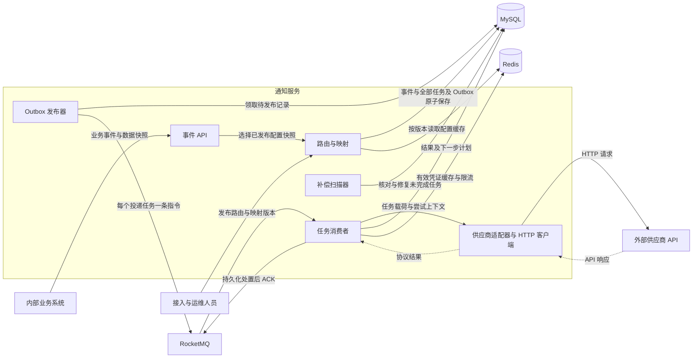
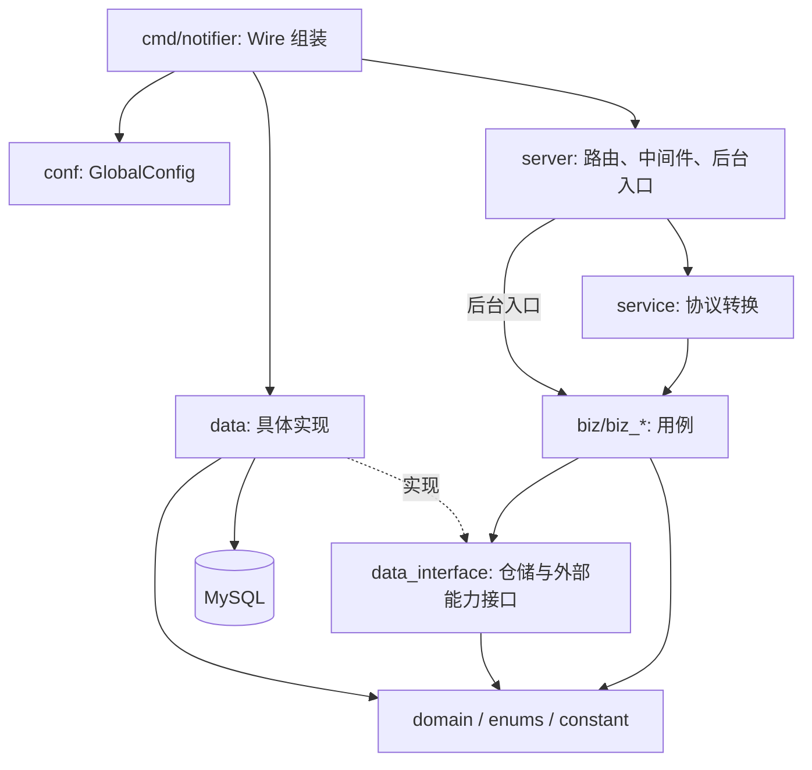

# API 通知服务技术方案

| 项目 | 内容 |
| --- | --- |
| 版本 | v0.5 |
| 状态 | 采用业务事件接入、可配置路由与代码适配；补充全过程追踪与恢复契约，待 review |
| 依据 | [产品需求文档](./PRD.md) |
| 推荐组合 | Go + MySQL + RocketMQ + Redis |

## 1. 总体方案与职责

业务系统提交 `UserRegistered`、`SubscriptionPaid` 等事件及发生时的数据。路由层决定哪些供应商接收，映射层准备每个接收方的业务数据，适配器构造具体 HTTP 请求并解释响应。

一条事件展开为多条独立投递任务。MySQL 保存事件、分发计划和处理进度，RocketMQ 驱动各任务的异步投递，Redis 提供缓存与通道限流。公共投递流程统一处理预算、ACK、重试与补偿。

| 职责 | 输入与输出 | 边界 |
| --- | --- | --- |
| 事件接入 | 业务事件 → 已受理事件及固定分发计划 | 业务方不选择供应商，不提交供应商 URL、Header 或 Body |
| 路由 | 调用方、事件类型及事件数据 → 接收方与操作列表 | 只使用事件快照与选定路由版本 |
| 字段映射 | 事件快照、映射版本 → 每项任务的业务载荷 | 受限的确定性配置，不执行任意脚本 |
| 协议适配 | 固定任务载荷、有效凭证及本次上下文 → 请求与标准化结果 | 处理供应商协议，不自行调度重试 |
| 公共投递 | 独立任务与协议结果 → 状态、后续计划及追踪记录 | 不按供应商名称堆叠协议分支 |

## 2. 技术选型

| 项目 | 初版建议 | 理由与代价 |
| --- | --- | --- |
| 语言与 HTTP | Go 1.26.2、`net/http` | 标准库承载接入与受控 HTTP 投递；并发与退出过程显式管理 |
| 数据库 | MySQL 8.4、InnoDB | 事务保存事件及完整分发计划，唯一约束保证提交和建任务幂等 |
| 数据访问 | `database/sql` + `go-sql-driver/mysql`、手写 SQL | 核心事务、条件更新和领取操作保持清晰 |
| MQ | RocketMQ 5.x、Apache Go v5 客户端、SimpleConsumer | 独立任务消费，显式 ACK、不可见期限及延迟消息 |
| Redis | `go-redis/v9` | 缓存不可变配置、短期 Token 与概览，维护通道限流计数 |
| 迁移与日志 | Goose v3、SQL 迁移、`log/slog` | 显式结构迁移、结构化追踪与脱敏 |
| 本地环境 | Docker Compose | 应用、MySQL、RocketMQ、Redis、独立模拟供应商 |

实施时锁定具体补丁、依赖和镜像版本，验证 Broker、Proxy 与 SDK 的兼容组合。驱动和客户端参考 [MySQL Go 驱动](https://github.com/go-sql-driver/mysql)、[Apache RocketMQ Go 客户端](https://github.com/apache/rocketmq-clients/tree/master/golang)。

RocketMQ 是当前推荐，适用于本次以任务完成、延迟投递和异常恢复为主的链路。Kafka 也可以承载事件；如已有统一 Kafka 基础设施，可重新评估消费进度、重试 Topic 和调度组织方式。外部 HTTP 操作仍需要应用状态及接收方配合，不能靠 MQ 事务保证恰好执行一次。[Kafka 投递语义](https://kafka.apache.org/41/design/design/#message-delivery-semantics)

## 3. 通信与处理架构



首版同一代码库、同一进程运行 API、发布器、消费者与扫描器，模块分别管理生命周期。路由扇出由应用建立独立任务，不依赖 MQ 的订阅关系隐式决定业务接收方。

首次受理时完成有界的路由匹配和映射校验。外部 HTTP 调用在异步流程中执行，不放在受理事务内。后续可拆分进程角色，初版不建设微服务平台。

## 4. 事件、任务与标识

| 对象或标识 | 含义 | 稳定范围 |
| --- | --- | --- |
| 来源业务标识 | 经认证调用方名下的业务系统或业务域 | 由接入配置授权，不能信任任意传入值；与调用方身份分别记录 |
| 来源事件标识 | 业务方为一次已发生事实提供的稳定 ID | 调用方范围内唯一，重复提交沿用 |
| 内部事件标识 | 服务保存的业务事件记录 | 对应一次受理及其固定分发计划 |
| 业务对象标识 | 事件关联的用户、订单或订阅等对象类型与 ID | 使用 `business_object_type + business_object_id`，不能用事件 ID 替代；同一对象可产生多条事件 |
| 路由目标标识 | 路由配置中的一个接收方与操作条目 | 区分同一供应商的不同通知操作 |
| 投递任务标识 | 某事件对应某路由目标的一项通知 | 自动重试与人工重投保持不变 |
| Outbox 消息标识 | 某任务、轮次、调度版本的一条投递指令 | 发布重试与补发保持稳定 |
| 投递尝试标识 | 一次实际业务请求尝试 | 每次尝试新建，用于所有权与结果校验 |

例如，一个 `UserRegistered` 同时匹配广告回传和 CRM 建档，会产生两个任务。广告成功后，CRM 的失败与重试只修改 CRM 任务，不重新运行整个事件的路由。

事件查询聚合各任务的处理中、成功、失败和结果不确定数量，并保留逐项结果。部分成功不能被简化为整个事件成功或重新发送全部目标。

每条通知以投递任务为最小追踪与恢复单位。任务必须能关联 `caller_id`、`source_business`、`source_event_id`、`event_id`、`business_object_type`、`business_object_id`、`provider_id`、`provider_account_id`、`route_target_id` 和 `delivery_id`。事件关联字段在受理后不可变，任务通过事件外键查询这些字段；目标供应商、账号及操作在建任务时固定。供应商或业务对象改名不改变历史标识。

## 5. 事件受理、路由与映射

### 5.1 接入信息与幂等

业务方必须提供来源事件标识、事件类型、事件数据结构版本、发生时间、业务对象类型与 ID、数据快照。来源业务由认证与接入配置确定；同一调用方有多个业务来源时，校验提交的来源是否已获授权。发生时间由业务方提供，不能以服务受理时间替代。缺少必填关联字段时拒绝受理，不能留待发送后再从日志补齐。

调用方身份由凭证确定。事件指纹覆盖事件类型、数据结构版本、发生时间、业务数据与关联信息，不包含当前路由版本、动态凭证或发送时间。

相同来源事件标识与相同内容返回已受理事件及原分发计划；内容不同则冲突。必须先处理已有事件的幂等命中，不能因路由已更新而重新展开任务。并发提交的最终保障由 MySQL 唯一约束提供。

### 5.2 路由配置

首版根据调用方、事件类型与受限条件匹配已发布的路由。条件仅支持明确列出的字段相等、集合匹配和字段存在判断等简单操作，缺失字段与类型不匹配有确定规则。

一个匹配结果包含路由目标标识、通道及供应商账号、操作、映射版本、适配器类型与版本。目标列表是明确的投递计划；按“事件 + 路由目标标识”保证建任务唯一，不能仅按供应商名称去重，否则会合并同一供应商的不同操作。

无匹配路由、未知事件数据版本或不能形成有效映射时，首版明确拒绝受理，返回可定位的原因。调用方可以修复配置或数据后使用同一来源事件标识重试；此前未成功受理的请求不占用成功事件记录。

### 5.3 简单映射与代码适配

简单映射只支持受限字段路径取值、字段重命名、固定值、默认值和明确的枚举对应。缺失、空值、类型和必填规则均可在接入时校验。默认值是配置中的常量，不从当前时间或外部环境隐式取值。

复杂签名、特殊编码、供应商业务码和鉴权通过代码适配器实现。输入校验、请求构造和响应解释构成适配器的主要职责；固定配置与业务数据通过结构化序列化构造请求，不拼接可执行代码。

首版不支持任意脚本、任意表达式执行、动态加载用户代码或通用业务流程编排。

### 5.4 原子保存分发计划

服务选定一个已发布且不可变的路由快照，完成全部匹配与映射校验，再用一个 MySQL 事务保存：

1. 事件发生时的数据、指纹与本次路由版本。
2. 所有匹配目标的独立投递任务，包括各自映射结果和版本引用。
3. 每个任务的首次 Outbox 消息。

全部提交成功后才返回受理成功。任一目标无法形成有效计划时，不返回部分受理。通过限制事件大小和最大扇出数量控制同步计算与事务规模。

路由配置在此期间更新不改变已经选定的不可变版本。若另一个并发请求先受理同一事件，则使用唯一约束命中的原记录及其计划，不合并两次计算的目标列表。

## 6. 数据快照与版本一致性

### 6.1 固定什么，更新什么

| 内容 | 首次受理时固定 | 后续发送时处理 |
| --- | --- | --- |
| 事件事实 | 事件数据、数据结构版本、发生时间与业务关联 | 始终复用，不查询最新业务数据覆盖 |
| 分发结果 | 路由版本、匹配目标、供应商账号与操作 | 不重新匹配新路由，不自动增加或删除目标 |
| 请求业务语义 | 映射版本、映射结果、适配器协议版本、语义相关目标配置 | 使用固定语义构造请求，不重跑新版映射 |
| 供应商幂等标识 | 为投递任务建立稳定标识，按供应商协议映射 | 各次重试沿用，不能换成尝试标识 |
| 动态鉴权与发送信息 | 保存凭证引用及账号归属，不保存过期请求作为重放依据 | 取得当前有效访问凭证，生成本次发送时间、签名时间戳及协议要求的随机值 |
| 当前访问约束 | 保存计划供追溯 | 当前通道停用、调用方权限和目标安全约束始终生效 |

事件发生时间是业务事实，不能随重试更新；签名时间和发送时间属于本次请求上下文，应按协议重新生成。

每项任务同时保存映射版本和已映射的业务载荷。版本用于追溯，固定载荷避免映射引擎升级导致重试结果变化。适配器必须保持所声明协议版本的兼容性，缺少旧版本时阻止任务并暴露原因，不静默套用新实现。

### 6.2 配置发布与保留

路由、映射和语义相关的通道配置作为一份配置发布快照管理。发布前校验事件数据版本、目标、映射、适配器及凭证引用的有效性，发布后内容不可变，以新版本替代修改。

首次受理读取当前发布版本并记录引用。这里冻结的是实际受理所用版本，不根据调用方提供的历史发生时间自动回溯选择配置；按事件发生时刻重放历史规则属于另行定义的能力。

已有任务引用的配置内容必须保留，不能只保存版本号后覆盖或删除版本实体。未完成任务持续持有其版本和事件数据；保留期内的追溯记录也不能形成悬空引用。

自动重试和人工重投都复用原任务载荷与版本。使用新规则重放历史事件、给旧事件新增接收方，是独立的重新分发操作，首版不提供，不能通过重复提交原事件隐式实现。

## 7. 供应商协议与凭证

适配器解释 HTTP 状态、业务码、受理编号、等待建议及结果确定性，返回“已接收、可重试拒绝、永久拒绝、结果不确定”等标准化结论。公共流程统一持久化并决定下一步，不将 HTTP 200 自动视为所有供应商成功。

每个通道明确记录鉴权方式、签名与序列化约定、幂等能力与有效期、限额及结果不确定时的处理方式。供应商幂等可能有时间窗口及参数一致性限制，不能将本地保留期当作供应商去重期限。[Stripe 幂等请求说明](https://docs.stripe.com/api/idempotent_requests)

Access Token 按供应商账号、授权范围和凭证版本缓存。长期凭证使用受保护的持久存储或秘密配置；涉及 Refresh Token 轮换时需持久化并协调并发刷新，Redis 临时锁不能代替凭证一致性。[OAuth 刷新约定](https://www.rfc-editor.org/rfc/rfc6749#section-6)

凭证获取及刷新使用独立超时和有界预算，不隐藏重复业务请求。每次业务请求都记录尝试；过期 Token、签名、时间戳不能直接从前一次请求复制。

供应商返回异步任务编号时，可按其接收协议记录已送达与编号。跟踪外部业务完成、回调验签及业务轮询不是首版通用能力，等待期间不得重复创建同一外部任务。

## 8. Outbox、消费确认与重试

### 8.1 可靠发布

事件、全部投递任务与首次 Outbox 消息在同一个 MySQL 事务中保存。发布器通过短事务领取待发消息，提交后调用 MQ，收到发送成功结果后再标记已发布。确认不确定时，按原消息标识退避重发。

发布领取具有期限与领取标识，使用 MySQL 条件更新及 `FOR UPDATE SKIP LOCKED` 协调。网络调用不占用数据库锁，迟到发布结果不能覆盖新领取者。[MySQL 锁定读说明](https://dev.mysql.com/doc/refman/8.4/en/innodb-locking-reads.html)

本版采用 Outbox，不同时维护另一套事务消息发布协议。MySQL 持久性依赖正常日志同步、持久卷及备份；MQ 的持久性和故障切换保证依赖实际部署。[MySQL 日志同步说明](https://dev.mysql.com/doc/refman/8.4/en/replication-options-binary-log.html#sysvar_sync_binlog)

### 8.2 消费执行

MQ 消息仅携带 Outbox 消息标识、事件标识、任务标识、轮次、调度版本和消息协议版本。消费者读取 MySQL 中的固定任务载荷和版本，不能通过消息中的任意目标地址执行投递。

有空闲 worker 才拉取消息。核对任务状态、版本及到期时间，通过限流并准备有效凭证后，在事务中创建尝试、领取任务并计入预算；提交确认后生成本次请求并发送。领取成功后、请求发出前崩溃，也保守地记为结果不确定。

创建尝试时同时增加本轮与累计尝试次数，写入 `current_attempt_id`、领取标识、领取期限及 `PROCESSING` 状态，并追加生命周期记录。一次尝试最多执行一次供应商业务 HTTP 请求，关闭 HTTP 客户端和适配器的隐式业务重试；重定向不自动跟随。领取后若在请求构造阶段明确失败，也保留该次尝试和预算消耗，标明未发送及具体原因。只有限流、凭证等待等创建尝试之前的等待不计入尝试次数。

已完成、旧轮次或旧版本指令可直接确认；同一版本有有效处理者时不重复执行。结果保存必须匹配当前尝试标识，防止旧 worker 覆盖新状态。

### 8.3 三种重试分工

| 类型 | 原因 | 机制 | 计数 |
| --- | --- | --- | --- |
| 发布重试 | 发送失败、MQ 不可用或确认丢失 | Outbox 退避重发 | 发布次数，不消耗业务尝试预算 |
| 消费重投 | 进程退出、数据库不可用、ACK 失败 | RocketMQ 未确认重投及 Broker DLQ | 消费次数，不直接等同业务尝试 |
| 供应商投递重试 | 协议允许重试的拒绝或不确定结果 | MySQL 持久化下一次计划，由 Outbox 发布延迟指令 | 消耗该任务本轮预算 |

SimpleConsumer 通过显式 ACK 与不可见期限处理消息；未确认消息可能重新可见，达到配置限制后可进入 DLQ。[RocketMQ 消费重试](https://rocketmq.apache.org/docs/featureBehavior/10consumerretrypolicy/)

### 8.4 ACK 与下一步计划

| 处置 | ACK 前的持久化要求 |
| --- | --- |
| 供应商确认接收 | 尝试结果、供应商关联信息与任务成功状态 |
| 允许再次发送 | 尝试结果、下次时间、新调度版本与新 Outbox，同一事务提交 |
| 限流或暂时无法取得凭证 | 有界的等待计划及新指令；不将单纯等待计为 HTTP 尝试 |
| 永久拒绝、预算耗尽或无法安全重发 | 可见的最终状态，区分明确失败与结果不确定 |
| 无法确认状态已保存 | 不 ACK，等待重投或恢复 |

ACK 表示当前指令已有持久化处置，不代表整个事件或该供应商一定成功。产生新的业务重试计划后确认旧指令，避免两套重试同时放大请求。

即时与延迟指令使用对应类型 Topic，时间受 Broker 范围限制；消费者仍以 MySQL 计划时间为准。[RocketMQ 延迟消息](https://rocketmq.apache.org/docs/featureBehavior/02delaymessage/)

### 8.5 任务状态与时间语义

| 状态 | 含义 | 后续处置 |
| --- | --- | --- |
| `PENDING` | 已受理，等待首次执行或人工重投后的执行 | 到 `scheduled_at` 后领取 |
| `PROCESSING` | 已创建尝试，由有效领取者处理 | 保存结果；领取超时由补偿处理 |
| `RETRY_WAIT` | 已持久化下一次自动执行计划，包括限流或凭证等待 | 到 `next_retry_at` 后领取 |
| `BLOCKED` | 通道停用、旧适配器不可用等条件阻止执行 | 记录阻塞原因，由扫描器核验条件或人工恢复，不在阻塞期间发送 |
| `SUCCEEDED` | 有供应商按协议确认接收的依据 | 本轮完成，不再自动发送 |
| `FAILED` | 明确永久拒绝，或预算/等待期限耗尽且不存在未决结果 | 停止自动执行，可对该任务人工重投 |
| `UNKNOWN` | 无法确定对方是否已接收，且当前不能安全自动重发 | 暂停自动发送，核对供应商结果后人工处理 |

主路径为 `PENDING / RETRY_WAIT → PROCESSING → SUCCEEDED / RETRY_WAIT / FAILED / UNKNOWN`。执行前检查可进入 `BLOCKED`；阻塞解除后按原预算与载荷恢复至 `PENDING / RETRY_WAIT` 并创建当前指令。`FAILED / UNKNOWN` 经授权人工处理后才可新开轮次进入 `PENDING`，`UNKNOWN` 也可依据核对证据结案为 `SUCCEEDED / FAILED`。`SUCCEEDED` 不接受重投。

`scheduled_at` 是当前可执行计划的时间，`next_retry_at` 仅在 `RETRY_WAIT` 非空，二者此时相等；领取执行、阻塞或结案时清空下一次计划时间，不能展示已失效的重试时间。阻塞条件的检查时间单独记录为 `next_check_at`，不冒充下次发送时间。所有持久化时间使用 UTC，API 返回带时区的时间。

任务保存本轮次数 `round_attempt_count`、累计次数 `total_attempt_count` 和本轮上限 `max_attempts`；人工重投新增轮次，只重置本轮次数。MQ 消费次数、Outbox 发布次数分别记录。等待另有本轮截止时间 `round_deadline_at`，限流或凭证一直不可用也不能无限等待；到期且没有未决请求时记录 `FAILED`，结果仍不确定时记录 `UNKNOWN`。到期不会强行撤销有效的在途请求，应先完成或恢复该次尝试再结案。

失败信息使用稳定的 `error_code`、脱敏 `error_reason` 和 `retryable`，区分传输超时、供应商拒绝、鉴权等待、配置阻塞及恢复异常。是否可自动重发还必须结合结果确定性、供应商幂等有效期和剩余预算，不能仅靠 `retryable` 决定。任务的状态、原因、计数、计划、尝试结果及对应生命周期记录在同一事务中更新。

任务级 `result_certainty` 汇总各次尝试的未决结果，不能直接复制最近一次结论。前次请求是否接收仍不确定时，后一次明确拒绝不能单独证明通知失败；只有供应商对同一业务幂等标识的确认或核对证据才能消除相关不确定性。自动计划耗尽后仍有未决结果的任务进入 `UNKNOWN`。

## 9. 补偿、死信与人工重投

补偿以未完成的投递任务为基准，不重新执行事件路由或字段映射。

| 异常 | 处理 |
| --- | --- |
| 事件提交成功，尚未发布 | 首次 Outbox 保留，恢复后继续发布每个任务 |
| Broker 已接收但发布确认丢失 | 重复发布原指令，按任务与调度版本去重 |
| 投递进程中断 | 尝试到期后记录不确定结果，按供应商协议决定重发、查询或介入 |
| 对方已处理，结果未保存 | 可能重复发送；由供应商幂等或协议查询控制风险 |
| 结果已保存、ACK 丢失 | 重投后读取已有处置，确认旧指令，不重复执行 |
| 指令丢失、超过保留期或长期无进展 | 核对当前任务计划及有效尝试，限频修复 Outbox；保留原载荷与全部版本 |
| 同一事件只有部分目标失败 | 只恢复对应任务，其他成功任务不变 |
| Redis 清空 | 配置回源、缓存重建；任务及重试计划仍由 MySQL 恢复 |

补发有宽限期、冷却时间和频率上限，结合 MQ 积压调整，避免把正常排队误判为丢失。消息补发不直接增加 HTTP 尝试次数。

Broker DLQ 独立监控。修复时读取任务现状，通过相同 Outbox 协议恢复当前计划；反复进入死信的消息升级人工处理。已完成任务的死信不再次执行业务请求。

人工重投只操作指定异常任务，在事务中新增轮次和 Outbox，保留原事件、路由目标、映射结果、配置版本与供应商业务幂等标识。结果不确定时，先核对原操作或明确重复执行风险。不能通过重投事件批量重发成功目标。

### 9.1 恢复执行规则

扫描器依据 MySQL 的状态、`scheduled_at`、`lease_expires_at`、`next_check_at` 和本轮截止时间分批领取候选任务，通过当前状态、轮次、调度版本及尝试标识做条件更新。扫描器和 worker 竞争同一任务时只有一个处置生效，不能仅用 Redis 锁防重。

1. 对尚未执行的到期任务，先检查是否已有有效领取者及当前 Outbox。缺失时创建当前版本指令；已有记录则恢复发布或在宽限期后重发原指令，不为同一调度版本另造消息标识。
2. 对领取过期的 `PROCESSING` 任务，结束原尝试并记录 `LEASE_EXPIRED`、结果不确定及恢复时间。供应商允许安全重发且预算有效时，在同一事务中转为 `RETRY_WAIT` 并新增调度版本和 Outbox；否则转为 `UNKNOWN`。不能将无法确认的尝试直接改成“发送失败”。
3. 对 `BLOCKED` 任务，核对原阻塞条件及本轮截止时间；条件解除后创建恢复计划，未解除则记录下次检查时间，到期按第 8.5 节结案。
4. 对每次修复，追加原因、恢复前后状态、原/新调度版本及执行者。处理失败保留候选任务，下次扫描继续，扫描进度不作为任务已修复的依据。

恢复或重投后，旧 worker 的结果更新必须因领取标识或尝试标识不匹配而失效。迟到响应作为原尝试的补充证据追加到生命周期记录，不覆盖已完成的尝试结果或当前任务；若与当前处置冲突，产生人工核对告警。

worker 发起 HTTP 前再次检查领取有效性，并为请求设置早于领取到期的截止时间。数据库领取到期不证明旧请求已停止或供应商未接收，恢复后的再次发送仍须满足供应商幂等或明确的人工处置规则。

### 9.2 人工操作与核对

重投请求携带操作幂等键、期望任务版本和处理原因。服务只允许对无有效领取者的 `FAILED / UNKNOWN` 任务执行，校验当前权限、通道约束和供应商去重窗口；并发重投或请求超时重试只能生成一个新轮次。相同操作幂等键但参数不同返回冲突。事务同时保存审计、轮次、状态变化和 Outbox，响应返回操作标识及更新后的任务。

对 `UNKNOWN`，可根据供应商受理编号、查询结果或人工核对凭据确认送达或明确未接收；记录证据摘要、操作者及时间。没有核对依据且协议不保证安全重发时，维持 `UNKNOWN`；若确需冒险重投，要求具备相应权限的操作者显式确认重复执行风险，并保存确认记录。人工结案不删除或改写原尝试历史。

## 10. Redis 与通道

通道绑定供应商账号、适配器、操作和凭证引用。路由决定使用哪个通道，业务方不传入目标通道。

| Redis 数据 | 策略 | 故障降级 |
| --- | --- | --- |
| 已发布的不可变路由与映射 | 以配置版本为 Key 缓存；受理从 MySQL 确认当前发布版本 | 按所需版本回源，不退回最新或其他版本 |
| 运行参数 | 有版本缓存、短 TTL | 受控回源；当前停用和目标许可约束以 MySQL 为准 |
| 有效 Access Token | 按账号、范围和凭证版本隔离，TTL 留出失效余量 | 按协议重新获取，失败时延后投递 |
| 通道限流计数 | 原子令牌桶或等价实现 | 暂停相关通道新投递，已领取指令先保存延后计划 |
| 运行概览 | 短 TTL，显示统计时间 | 受控查询或标记概览暂不可用 |

提交幂等、固定分发计划、任务状态、重试次数与版本引用不以 Redis 为准。缓存可重建不代表配置可删除，所有被引用的配置实体仍保存在 MySQL。缓存策略参考 [Redis Cache-aside](https://redis.io/docs/latest/develop/use-cases/cache-aside/go/)。

## 11. 数据组织

### 11.1 持久化实体

| 表 | 主要内容 |
| --- | --- |
| `business_events` | 调用方、来源业务、来源事件标识、事件类型及数据版本、发生/受理时间、业务对象类型与 ID、数据快照、指纹和路由发布版本 |
| `delivery_tasks` | 事件外键、路由目标、供应商标识及账号与操作、固定载荷与版本、稳定业务幂等标识；当前状态、轮次、尝试计数、预算、计划时间、领取信息、最近结果与行版本 |
| `outbox_messages` | 稳定消息标识、任务、轮次、调度版本、消息类型、计划时间、发布状态、发布次数、下次发布时间、领取信息、最近发布错误与补发记录 |
| `delivery_attempts` | 每次尝试的标识与序号、发送时间与耗时、请求和响应摘要、错误分类、结果确定性、供应商关联信息、实际部署版本及追踪标识 |
| `delivery_history` | 任务全过程的追加记录：阶段、前后状态、原因、发生/记录时间、轮次、调度版本、尝试/Outbox/操作标识、执行者及脱敏补充证据 |
| `routing_releases` | 不可变发布快照，包含路由规则、映射及语义相关配置；另维护当前发布指针 |
| `channels` | 供应商账号与凭证引用、当前启停和访问约束、运行策略 |
| `management_events` | 配置发布、人工重投、结果核对及死信处理的操作标识、幂等键、请求指纹、期望版本、操作者、原因、时间、关联对象与处理结果 |

唯一约束至少覆盖“调用方 + 来源事件标识”“事件 + 路由目标标识”“任务 + 轮次 + 调度版本”和轮次内尝试序号。字符串标识采用区分大小写的精确比较语义，初始表统一使用 `utf8mb4_0900_bin`，避免事件、业务对象、路由目标及操作幂等键被默认排序规则合并。

人工操作另以“调用方范围 + 操作类型 + 操作幂等键”唯一，并保存请求指纹及结果；`delivery_history` 的写入标识也需唯一，事务重试不能追加重复记录。

### 11.2 任务与逐次发送字段

| 记录 | 必需字段与语义 |
| --- | --- |
| 任务进度 | `status`、`round_no`、`round_attempt_count`、`total_attempt_count`、`max_attempts`、`round_deadline_at`、`scheduled_at`、`next_retry_at`、`next_check_at`、`created_at`、`updated_at`、`round_finished_at`；结案时间在新轮次清空，历史留存 |
| 并发与恢复 | `schedule_version`、`row_version`、`current_attempt_id`、`lease_token`、`lease_expires_at`；尝试结果仅由匹配当前所有权的事务推进任务 |
| 当前及最近结果 | 任务级 `result_certainty`、`last_attempt_id`、`last_error_code`、`last_error_reason`、`last_result_certainty`、`blocked_reason`；任务级确定性与最近尝试结论分别展示，不能替代尝试明细 |
| 尝试关联 | `attempt_id`、`delivery_id`、`round_no`、`attempt_no`、`outbox_id`、`trace_id`、`worker_id`、`deployment_version`；全链路业务关联通过任务、事件外键取得 |
| 尝试时间 | `started_at`、`request_started_at`、`response_received_at`、`finished_at`、`duration_ms`、`attempt_duration_ms`；HTTP 耗时从调用客户端到响应读取结束或错误返回，用单调时钟测量；总尝试耗时包含请求构造及结果处理 |
| 请求信息 | 方法、目标通道与脱敏路径、请求大小、允许记录的请求摘要；`send_state` 区分明确未发送、已进入 HTTP 调用和无法判断，进入 HTTP 调用不证明供应商收到 |
| 响应信息 | `http_status`、`provider_code`、`provider_request_id`、`response_size_bytes`、`response_summary`、`response_truncated`；HTTP 成功与供应商接收成功分别记录 |
| 尝试结果 | 进行中或已结束、`outcome`（接收成功/可重试拒绝/永久拒绝/本地失败/不确定）、`result_certainty`、`error_code`、`error_reason`、`retryable`、供应商等待建议 |

尚未结束的尝试没有完成时间。未收到任何响应时 HTTP 状态和响应摘要为空，结束后必须有错误或未决原因；已收到响应头但读取响应体失败时仍保留 HTTP 状态及读取错误。明确未发送时 HTTP 耗时为空。崩溃恢复无法还原实际耗时，`duration_ms` 和 `attempt_duration_ms` 可为空，并记录 `timing_incomplete`，不能用领取期限伪造请求耗时。恢复记录的 `finished_at` 表示本地结束该尝试记录的时间，不代表供应商处理完成时间。

尝试在发送前落库，结束时写入最终结果；最终结果不可被下一次发送覆盖。若结果事务无法确认提交，不 ACK，恢复时先读取该尝试是否已结束，再决定是否处理领取超时。已有结果与任务、计划在同一事务中提交，不能出现只保存成功日志却未推进任务的正常写入路径。

### 11.3 全过程时间线、查询与保留

时间线至少覆盖受理建任务、创建调度、Outbox 发布成功或失败、领取开始、尝试结束、安排重试、等待或阻塞、领取超时、补发修复、死信处置、人工重投及核对结案。状态变化与时间线同事务提交；Outbox 发布结果与对应时间线同事务提交。MQ ACK 的调用结果记录在结构化日志中，不能将本地 ACK 日志视为 Broker 已确认的可靠证明，重投时仍以数据库处置为准。

时间线按任务递增的 `history_seq` 排序，同时保留实际发生时间与记录时间，迟到证据不会被误认为新的状态推进。业务追踪以持久化事件、任务、尝试和时间线为准，不依赖日志留存或 Trace 采样。结构化日志和 Trace 携带 `event_id / delivery_id / attempt_id / outbox_id / operation_id` 等适用标识，用于进一步定位进程和网络问题。

查询索引至少覆盖事件的“调用方 + 来源业务 + 业务对象类型 + 业务对象 ID + 受理时间 + 事件 ID”、任务的“供应商 + 状态 + 更新时间 + 任务 ID”和“事件 + 任务 ID”，以及按状态分别扫描计划时间、领取期限、检查时间和本轮截止时间的索引。尝试以“任务 + 轮次 + 尝试序号”、时间线以“任务 + history_seq”分页，避免依赖日志全文检索或全表扫描恢复。

任务引用事件快照并保存固定映射结果。版本实体保留实际内容，不只存名称。日志只记录关联标识、脱敏摘要及错误，动态凭证不写入事件或 MQ 消息。

请求、响应和错误摘要按供应商白名单字段提取，默认最多 2 KiB，超出截断并标记；不持久化完整原始报文，不记录 Token、签名、认证 Header 或无关个人信息。响应读取另设大小上限，记录实际已读取字节数，超限作为可定位的协议错误，不能为了追踪无限读取响应。查询按调用方隔离，运维访问需要相应权限。

事件及引用配置的清理由所有子任务共同决定：有未完成任务时不得清理，`BLOCKED / UNKNOWN` 在完成处置前也不得按普通终态清理；已结案任务及对应事件、尝试、时间线、操作审计、幂等和版本引用按保留策略协调处理。保留期从相关任务最后一次结案计算，人工重投后重新计算，不能因事件受理已超过 30 天而提前清理恢复依据。清理后不再保证历史去重。

## 12. 接口与代码组织

入口采用 JSON over HTTP，初版接口面如下，详细字段另形成接口契约：

| 接口 | 用途 |
| --- | --- |
| `POST /v1/events` | 提交业务事件 |
| `GET /v1/events/{id}`、`GET /v1/events` | 查询事件、固定分发计划和各任务聚合进展；调用方仅访问自身数据 |
| `GET /v1/deliveries`、`GET /v1/deliveries/{id}` | 按关联条件检索通知，查询关联信息、当前状态、次数、下一步计划及最近原因 |
| `GET /v1/deliveries/{id}/attempts`、`GET /v1/deliveries/{id}/history` | 分页查询逐次发送明细与全过程时间线 |
| `POST /v1/deliveries/{id}/retry` | 按操作幂等键与期望版本重投指定异常任务，保存处理原因及必要的风险确认 |
| `POST /v1/deliveries/{id}/resolve` | 授权人员依据核对证据将 `UNKNOWN` 结案，采用相同操作幂等与版本检查 |
| 运维配置接口 | 校验、发布和查询路由及映射快照，管理通道 |
| `GET /v1/overview`、`GET /healthz`、`GET /readyz` | 运行概览与健康检查 |

首版不开放原始 HTTP 转发入口，也不要求调用方逐个选择供应商操作。

通知列表支持来源业务、来源事件 ID、内部事件 ID、业务对象类型与 ID、供应商、任务状态及受理时间范围组合过滤；来源事件 ID 与业务对象 ID 按字符串精确匹配。默认按受理时间与任务 ID 稳定游标分页，限制单页数量和查询时间范围；其他排序使用相应字段与任务 ID 作为游标。第 11.3 节列出基础索引，组合查询按执行计划补充索引。

任务详情必须返回第 4 节的完整关联标识，以及状态、任务级结果确定性、本轮/累计次数、本轮预算与截止时间、`next_retry_at`、`next_check_at`、最近错误和 `row_version`。尝试接口返回第 11.2 节的逐次耗时、响应摘要与错误原因；历史接口返回阶段、前后状态、原因、时间和关联操作。空值与状态语义一致，例如 `BLOCKED / UNKNOWN` 的下次重试时间为空，同时明确阻塞或人工介入原因，不能只展示“发送中”。

例如，按订单 ID 查询到某 CRM 通知处于 `RETRY_WAIT`，详情可见第 1 轮已尝试 2 次、累计 2 次、下次执行时间及最近 `HTTP_TIMEOUT`；展开后能分别看到两次请求的耗时、供应商响应或无响应原因，再沿时间线定位发布、领取、退避和补偿记录。若此后未再次发送便因等待期限耗尽进入 `UNKNOWN`，授权人工重投后的第 2 轮从本轮 0 次开始，累计仍为 2 次，之前的发送证据完整保留。

```text
cmd/
  notifier/
    main.go                 # 入口、信号与生命周期
    wire.go                 # 依赖图声明（wireinject 构建标签）
    wire_gen.go             # Wire 生成，普通构建使用
  mockvendor/main.go         # 独立模拟供应商
internal/
  conf/                     # 环境变量、Key Vault、GlobalConfig
  server/
    http.go                 # HTTP 服务、路由和中间件注册
    grpc.go                 # 有实际 protobuf 契约后引入
    worker.go               # 按需增加 MQ 消费和后台任务入口
  service/                  # HTTP JSON / protobuf 与业务对象转换
  biz/
    biz_config/             # 配置发布、路由及映射用例
    biz_event/              # 受理事件与固定分发计划
    biz_delivery/           # 任务执行、尝试、预算和人工处置
    biz_outbox/             # 可靠发布编排
    biz_provider/           # 凭证生命周期、通道和供应商执行编排
    biz_recovery/           # 自动恢复编排
    biz_tracking/           # 查询、概览与保留清理
  data_interface/           # 仓储与外部能力接口；输入输出只用领域类型
  data/
    mysql/                  # SQL、连接池、完整业务事务及条件更新
    redis/                  # 缓存与原子限流实现
    rocketmq/               # 消息生产消费 SDK 实现
    provider/               # 供应商协议适配、受控 HTTP 与凭证存取
  domain/                   # 业务对象、状态机、路由和映射的纯规则
  enums/                    # 共享业务枚举
  constant/                 # 共享常量
  remote_grpc/              # 按需引入的内部 gRPC 客户端
  utils/                    # 无业务或基础设施依赖的内部工具
pkg/                        # 跨模块复用的 errors、metrics、middleware
unit_test/                  # 镜像 internal 目录的黑盒单元测试
migrations/
tests/integration/
compose.yaml
Makefile
```

目录按实现需要创建，不预建空壳。当前已落地 `conf`、`server/http.go`、`service`、Wire 入口与对应黑盒测试，其余为目标位置。保留现有 MySQL、SQL 迁移和 Compose；本次分层调整不切换数据库。`cmd/mockvendor` 是独立测试工具，不为它建立业务分层和依赖图。

### 12.1 分层与依赖规则



图中的实线表示代码依赖，虚线表示接口实现。具体实现通过 Wire 注入接口，业务调用沿接口进入 `data`。

- `server` 创建 HTTP / gRPC 服务、注册路由与中间件，不解析业务字段或编写业务规则。MQ 消费、发布器和扫描器入口也只负责生命周期、并发及调用用例，不自己推进任务状态。
- `service` 处理参数解析、JSON / protobuf 转换和协议错误映射，调用 `biz`；不引用 `data`、数据库驱动或 SDK。不向业务层传递 `http.Request`、protobuf 消息或数据库模型。当前 API 使用 JSON，protobuf 契约建立后再生成 pb 类型并增加 gRPC 服务。
- `biz/biz_*` 编排业务用例。持久化、缓存、MQ、供应商调用和远程服务均经 `data_interface`，不依赖 `data`、`conf`、协议包或驱动；所需运行参数以明确的构造参数注入。共享状态规则位于 `domain`，恢复与人工处置复用它，避免各写一套状态推进逻辑。
- `data_interface` 定义小接口，输入输出使用 `context.Context`、领域类型及稳定错误，不暴露 `sql.Tx`、驱动类型或 protobuf。可生成重复的仓储接口，但应提交生成源与生成命令；涉及跨表原子性的业务操作需要显式契约，不能依赖生成的 CRUD 拼装。
- `data` 是唯一访问数据库的层，同时承载 Redis、RocketMQ、供应商 HTTP 及远程能力的具体实现。`remote_grpc` 只包装内部 RPC 客户端，由 `data` 通过接口适配给业务层，不反向依赖用例。MySQL 模型及行结构保留在实现内部，与 `domain` 显式转换。
- `domain`、`enums`、`constant` 不依赖协议、配置和基础设施；`utils` 保持纯工具。`pkg` 只接纳已有跨模块复用需求的代码，不依赖项目的 `internal`，不提前建立通用框架。

核心事务以“受理事件并创建全部任务”“结束尝试并安排下一步”等完整操作表达。事件、任务、Outbox、审计与时间线需要原子保存时，由一个仓储方法在 `data/mysql` 开启和提交同一个事务。`biz` 决定业务动作，不自行拼接多次独立 CRUD，也不跨外部 HTTP / MQ 调用持有数据库事务。

### 12.2 启动配置与依赖注入

`conf` 在启动时按默认值、环境变量、Key Vault 密钥的顺序汇总为 `GlobalConfig`。默认值和明文环境变量仅用于本地开发；部署时通过环境变量提供 Vault URL 和密钥名称，实际密钥由 Azure SDK 的 `DefaultAzureCredential` 读取，Azure 上使用托管身份。设置 Vault 后要求 MySQL DSN 密钥引用，Redis 使用密码时也要求其密钥引用；读取失败、空密钥或配置无效时启动失败，不回退到本地凭证。密钥读取有统一超时，日志和错误响应不得包含密钥值。

`GlobalConfig` 是构造时注入的只读配置快照，不是包级可变单例。Wire 按字段向组件注入所需配置，例如 HTTP 服务只接收 `conf.HTTP`，不获得数据库凭证。业务路由、映射和轮次策略仍按已发布版本管理，不从启动配置替换；供应商运行凭证通过受保护的引用读取和刷新，不把所有账号凭证加载到全局配置。

`main.go` 管理信号、启动和停止；`wire.go` 声明依赖图并绑定 `data_interface` 与 `data` 的实现；`wire_gen.go` 由 `make wire` 生成并随代码交付，不手写。构造失败应返回错误，拥有外部连接或后台循环的构造函数提供清理函数，后续组装失败时按逆序释放。适配器不隐藏重试，后台循环均可停止。

### 12.3 测试组织

`unit_test/conf`、`unit_test/server`、`unit_test/service`、`unit_test/biz/biz_*` 等与被测目录对应，使用 `conf_test` 等外部包，只调用导出接口。业务单测注入 `data_interface` 的内存替身、受控时钟和供应商结果，不连接真实数据库或远程服务。当前没有实现的模块不建立占位测试。

MySQL 原子性、唯一键、条件更新、RocketMQ 协议和故障恢复在 `tests/integration` 使用真实依赖验证，不能由黑盒单元测试替代。基础检查采用 `gofmt`、`go test ./...`、`go vet ./...` 和适用的 race 检查；修改依赖图后运行 `make wire` 并确认生成文件同步。

## 13. 验证与运行基线

使用真实 MySQL、RocketMQ、Redis 及独立模拟供应商做集成验证，重点检查：

| 场景 | 预期 |
| --- | --- |
| 事件匹配两个供应商 | 保存一条事件、两个任务及各自首次指令 |
| 一个接收方成功、另一个失败 | 失败方独立重试，成功方不再次投递 |
| 重复或并发提交事件 | 返回原事件及原计划，不多建任务 |
| 一个目标映射失败 | 不部分受理，不遗留半套分发计划 |
| 路由或映射发布新版本后重试 | 原接收方、固定映射结果和版本不变 |
| 业务系统的用户或订单数据已变化 | 投递仍使用事件发生时快照，不查询最新值替换 |
| 延迟后重新签名或刷新 Token | 发送信息有效，事件时间和业务幂等标识不变 |
| 删除旧配置缓存或重启 Redis | 按原版本回源，不读取最新映射代替 |
| MQ 发送确认丢失、消费中断及 ACK 失败 | 指令可重投，任务状态不被重复或旧结果覆盖 |
| 供应商返回 HTTP 200 但业务拒绝 | 按适配器协议分类，不误报送达 |
| 请求已执行但响应丢失 | 遵守通道的重发安全规则，明确不确定结果 |
| 前次结果不确定，后次明确拒绝且预算耗尽 | 未决结果未被证据消除时仍为 `UNKNOWN`，不能只用最后一次拒绝判定失败 |
| 旧配置或适配器不可用、通道被禁用 | 任务原因可见，不静默换版本或越权发送 |
| 按来源业务、事件 ID、业务对象及供应商查询 | 定位同一任务、各轮尝试与时间线，查询结果受调用方权限隔离 |
| 同一通知连续超时、业务拒绝后成功 | 每次尝试独立保留时间、耗时、响应摘要与错误；次数、状态及下次时间一致 |
| 限流、凭证等待及长期阻塞 | 不虚增 HTTP 尝试，区分重试时间与检查时间，截止后可见结案 |
| 请求发出前后崩溃、结果提交确认丢失 | 发送前有尝试记录；先核对已存结果；缺失耗时明确标记，未知结果不误报失败 |
| 扫描器、重复消息与旧 worker 并发恢复 | 只有当前领取者推进状态，迟到证据留存，修复记录及 Outbox 不重复生成 |
| 重复或并发人工重投、人工核对结案 | 操作幂等与版本检查有效，原标识和历史不变，不重投成功任务 |
| 响应含凭证、个人信息或超长内容 | 摘要脱敏、截断及响应读取上限生效，保留可定位的错误原因 |
| 日志未采样、过期或系统重启 | 仅依赖 MySQL 仍能查询完整业务进度、发送记录并恢复计划 |
| 事件已超保留期但仍有阻塞/未知任务，或发生人工重投 | 不提前删除事件、尝试、时间线及版本，最后结案后按策略清理 |

Compose 包含具备 Proxy 接入端点的 RocketMQ 环境、MySQL、Redis、应用与模拟供应商。迁移、配置发布和 Topic 初始化显式执行，数据库及 Broker 使用持久卷。故障测试保留事件与任务记录，不能靠清空数据代替恢复。

初始建议：并行投递 10、HTTP 超时 10 秒、任务领取期限 30 秒、MQ 不可见期限 60 秒，每个任务每轮最多 8 次尝试；退避从 5 秒增长并带抖动，本地上限 5 分钟，服务端等待建议上限 1 小时。参数关系需在集成验证中校验，不作为容量承诺。

Outbox 空闲轮询 1 秒，补偿扫描 30 秒，默认额外宽限 5 分钟并结合积压调整。本轮等待期限初始建议 24 小时，阻塞条件初始每 60 秒检查；策略随轮次固定，调整须有审计。配置缓存按版本回源，概览缓存 5 秒。结案记录建议保留 30 天，所有未完成或待核对任务及其事件、尝试、时间线和版本依据持续保留。

运行概览与告警至少覆盖待发布 Outbox 的数量及最老年龄、到期未执行任务、领取过期、各状态数量、`BLOCKED / UNKNOWN` 持续时间、DLQ 数量、补偿失败、投递成功率及耗时分布。告警阈值可配置，详情可关联到具体任务；指标标签只使用来源业务、供应商、状态及错误分类等低基数字段，事件 ID、任务 ID 和业务对象 ID 留在查询与日志中。

API 受理能力以 MySQL 和分发计划构建链路为准。MQ 停机时可在积压保护阈值内接收，超限明确拒绝；运维分别观察事件受理、计划建立、消息发布和供应商投递进展。

下一步评审聚焦事件数据约定、路由与映射配置格式、状态及错误分类、追踪字段与恢复事务、发布和版本保留规则，以及供应商适配器的最小接口。技术栈及运行方式沿用当前组合。
