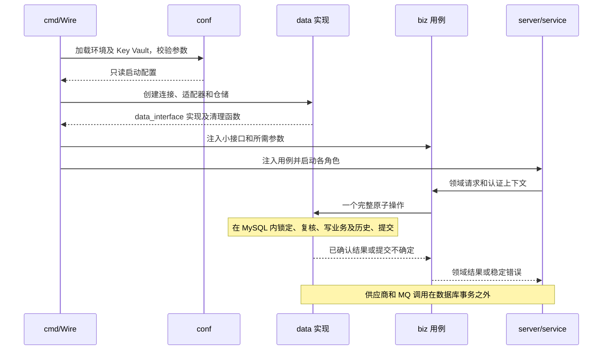

# S00 共享契约

| 项目 | 内容 |
| --- | --- |
| 版本 / 状态 | v0.2 / 批次 0 运行底座已落地，业务用例仍由 S01～S08 实施 |
| 依据 | [技术方案](../TECH_DESIGN.md)第 4～12 节 |
| 使用方 | S01～S08 全部模块 |

## 1. 目的与不变量

本契约统一模块交界处的语义，不要求建立统一大接口、通用 repository 或公共大包。领域规则归所属模块，跨模块事务由明确的完整操作实现。

1. MySQL 是事件、固定计划、任务状态、尝试、操作幂等及历史的事实来源。
2. 一条事件可有多个独立任务；成功目标不会因其他目标失败而重发。
3. 首次受理固定事实与业务语义，动态凭证和发送时间按本次请求生成。
4. MQ 可能重复；应用必须依靠持久化状态和条件更新防止重复推进。
5. 无法确定供应商是否接收时保留不确定性，不以超时或最后一次拒绝直接宣告整体失败。
6. 外部 HTTP 不处于数据库事务内；任何网络调用均有截止时间。

## 2. 标识与序列化

| 字段 | 范围 / 稳定性 |
| --- | --- |
| `caller_id` | 由认证身份确定，不接受请求体自报 |
| `source_business` | 调用方获授权的业务来源；单一来源可从配置推导 |
| `source_event_id` | 在 `caller_id` 内唯一；来源业务不同也不能复用该 ID 表达另一事件 |
| `event_id` | 内部事件标识，受理后不变 |
| `business_object_type / business_object_id` | 关联业务对象；不参与替代事件唯一键 |
| `route_target_id` | 一份发布中唯一的目标条目；同一供应商的不同操作使用不同目标 ID |
| `delivery_id` | 事件与路由目标对应的任务标识；重试及人工重投不变 |
| `message_id` | Outbox 的稳定消息标识；发布重试和同版本补发不变 |
| `attempt_id` | 每次创建尝试新建；不能用作供应商业务幂等键 |
| `operation_id` | 一次管理操作的服务端标识，重复请求返回原值 |
| `idempotency_key` | 任务级供应商业务幂等标识；所有轮次沿用 |

- 外部字符串标识大小写敏感，精确比较；不自动去空格、改大小写或做 Unicode 归一化。空串及不合法标识拒绝受理。
- 数据库字符串比较沿用 `utf8mb4_0900_bin`。内部 BIGINT ID 在 HTTP/MQ JSON 中统一使用十进制字符串，避免客户端数值精度损失。
- `round_no / schedule_version / row_version` 等计数以 JSON 整数表达，并校验数据库范围。
- 时间持久化为 UTC、微秒精度；HTTP 使用带时区的 RFC 3339 时间。入参超过微秒精度时拒绝，不静默截断。相同时刻的不同时区表达在指纹中等价。

## 3. 快照与当前约束

| 首次受理后固定 | 每次发送重新检查或生成 |
| --- | --- |
| 事件数据、版本、发生时间、业务关联 | 当前调用方权限与通道启停 |
| 路由发布、目标、供应商及账号、操作 | 当前目标许可与网络访问约束 |
| 映射版本及映射结果 | 有效凭证与凭证版本 |
| 适配器类型、协议版本、语义相关目标配置 | 本次签名、发送时间和协议随机值 |
| 供应商业务幂等标识 | 预算内的本次截止时间 |

固定语义必须能够从任务或其引用的不可变发布实体完整重建。不得只从可变 `channels` 读取协议类型、操作或业务参数来解释旧任务；凭证更新也不得将任务切换至其他供应商账号。

## 4. 版本与所有权

| 字段 | 首版规则 |
| --- | --- |
| `round_no` | 初始为 1；成功人工重投时加 1；自动重试不变 |
| `schedule_version` | 初始为 1；每次建立替代执行计划或作废当前指令时递增；同计划补发不变；跨轮次不重置 |
| `row_version` | 初始为 1；任务业务状态、计划、预算或所有权变化时加 1；纯历史追加或 Outbox 发布不增加 |
| `current_attempt_id` | 仅当前执行中的尝试；结束或恢复后清空，最近结束尝试另存 `last_attempt_id` |
| `lease_token` | 每次领取新建不可预测标识；不可复用旧 token |
| `lease_expires_at` | 所有权有效期限；以数据库 UTC 时间判断 |

推进任务的条件至少匹配状态、轮次、调度版本、当前尝试和领取 token，必要时包含 `row_version`。未命中条件更新不能视为成功，也不能覆盖新状态。

有效领取者的正常结果提交必须在领取仍有效时取得任务锁并通过校验；过期或被替换后的返回按迟到证据处理。数据库时间、领取校验和更新必须在同一短事务中判断。

## 5. 结果语义

### 5.1 单次结果

| `outcome` | 含义 |
| --- | --- |
| `RECEIVED` | 供应商按协议确认接收 |
| `RETRYABLE_REJECT` | 明确未接收，协议允许稍后再试 |
| `PERMANENT_REJECT` | 明确未接收，当前请求不能自动修复 |
| `LOCAL_FAILURE` | 本地明确失败，例如请求构造失败；是否可重试单独判断 |
| `UNCERTAIN` | 缺少能够确认接收或未接收的依据 |

`result_certainty` 统一使用 `RECEIVED / NOT_RECEIVED / UNCERTAIN`。初始任务无尝试时为 `NOT_RECEIVED`；它仅表达当前没有已知接收或未决发送。`retryable` 只说明错误类别，不单独授权再次发送。

`send_state` 使用 `NOT_SENT / HTTP_INVOKED / UNCERTAIN`。进入 HTTP 调用不证明供应商已经收到；现有迁移中的 `SENT` 草案值在实施时需校准为此语义。

### 5.2 任务级结果

- 单次明确拒绝只能证明该次未接收，不能消除其他尝试或前轮次的未决结果。
- 任务有未决尝试时维持 `UNCERTAIN`，直到针对同一业务幂等标识的供应商确认或可靠核对证据覆盖相关未决结果。
- 证据必须指明覆盖的尝试、操作或幂等键及其范围；仅凭相同供应商名称不能消除不确定性。
- 预算/期限耗尽：仍有未决结果则 `UNKNOWN`，否则 `FAILED`。
- `SUCCEEDED` 表示按协议接收；不统一追踪供应商内部业务完成。证据不足或存在重复执行冲突时保留告警和人工核对依据。

## 6. 完整事务操作

下列名称是职责说明，具体 Go 签名由实现确定。不得拆成由调用方逐个提交的 CRUD。

| 操作 | 同一事务内的写入 |
| --- | --- |
| `AcceptEvent` | 事件、全部任务、首次 Outbox、建任务及调度历史 |
| `StartAttempt` | 尝试、轮内/累计次数、领取、任务状态、历史 |
| `FinishAttemptAndPlan` | 尝试最终结果、任务级确定性、状态/时间（含尝试结束后阻塞）、必要的下一指令、历史 |
| `WaitOrBlock` | 创建尝试前的等待或阻塞（不增加次数）、版本变化、必要的 Outbox、历史 |
| `RecoverTask` | 结束过期尝试或修复计划、任务状态、必要的 Outbox、修复历史 |
| `ReplayTask / ResolveTask` | 管理操作幂等结果、审计、任务变化、必要的新轮次及 Outbox、历史 |
| `RecordPublishResult` | Outbox 发布处置及对应任务的发布历史 |
| `PublishRelease` | 不可变快照、当前指针及发布审计 |

- 外部调用前提交领取事务，调用后另开结果事务。
- 提交响应丢失时先按稳定键读取是否已提交；不得直接重跑 HTTP 或重复新增轮次。
- 锁顺序统一为：事件（需要时）→ 按 ID 升序的任务 → 尝试/Outbox/历史/操作记录。操作幂等可先只读，写入仍服从锁顺序；Outbox 单独领取事务不再反向锁任务。
- 历史顺序由任务行上受保护的序号分配器维护：锁定任务后递增 `history_seq`，同事务写入；为此可增加专用序号字段。该序号变化不要求增加业务 `row_version`。
- `write_id` 唯一，来源于稳定业务动作标识；事务重试不能产生重复历史。

## 7. 时间、预算与默认运行参数

任务时间字段的状态约束由 S03 定义。每轮固定 `max_attempts`、退避策略及 `round_deadline_at`；人工重投只重置轮内次数，累计次数及未决证据不清零。截止时间不强制终止仍有有效领取者的在途请求。

| 参数 | 初始建议值 |
| --- | --- |
| 并行投递 / HTTP 超时 | 10 / 10 秒 |
| 任务领取期限 / MQ 不可见期限 | 30 秒 / 60 秒 |
| 每轮最多尝试 / 本轮等待期限 | 8 / 24 小时 |
| 退避起始 / 本地退避上限 | 5 秒 / 5 分钟，带抖动 |
| 供应商等待建议上限 | 1 小时 |
| Outbox 空闲轮询 / 恢复扫描 | 1 秒 / 30 秒 |
| 补发额外宽限 / 阻塞检查间隔 | 5 分钟 / 60 秒 |
| 概览缓存 / 结案记录保留 | 5 秒 / 30 天 |
| 单个请求、响应、错误摘要上限 | 默认分别 2 KiB，按 UTF-8 字节截断并标记 |

HTTP 截止时间必须早于领取到期，并为结果事务留出余量。MQ 不可见期限应覆盖单次本地处理预算；如需延长，采用有上限的续期。不能用延长不可见时间替代数据库领取或持久化等待计划。

批次 0 的关系仍然检查：`DELIVERY_HTTP_TIMEOUT + MYSQL_OPERATION_TIMEOUT < DELIVERY_LEASE_TIMEOUT`，以及 `DELIVERY_MQ_INVISIBLE >= DELIVERY_LEASE_TIMEOUT + MYSQL_OPERATION_TIMEOUT`。S03 落地后追加：`DELIVERY_BUILD_TIMEOUT + DELIVERY_HTTP_TIMEOUT + DELIVERY_RESULT_RESERVE < DELIVERY_LEASE_TIMEOUT`，`DELIVERY_RESULT_RESERVE > MYSQL_OPERATION_TIMEOUT`，以及 `DELIVERY_MQ_INVISIBLE >= DELIVERY_CREDENTIAL_PREPARE + DELIVERY_LEASE_TIMEOUT + DELIVERY_ACK_TIMEOUT + 5s`。`DELIVERY_CREDENTIAL_PREPARE` 是凭证准备预算的启动占位，真实获取由 S05 完成后再与 `PROVIDER_CREDENTIAL_TIMEOUT` 对齐，不在本批次静默改名。

事件大小、最大扇出、响应读取、查询范围、分页、积压保护等上限采用本契约及各模块参数表的默认值，必须在启动配置中显式定义并校验，不允许无限制运行。

## 8. 身份、权限和通用 HTTP 错误

认证层输出 `caller_id`、可访问来源、角色/权限及操作者标识。首版可由受保护的部署配置维护凭证映射，不额外建设账户平台；外部调用不能伪造内部认证上下文。

权限至少区分事件提交、自有数据读取、跨调用方运维读取、配置发布、通道管理、人工重投、未知结果核对及风险重投。跨调用方写入必须检查目标调用方范围，审计同时保存操作者和被操作范围。

错误沿用 `{"error":{"code":"...","message":"..."}}`，`message` 脱敏且可定位，客户端以稳定 `code` 判断。领域错误和 HTTP 映射明确分层。

| HTTP | 语义 / 典型错误码 |
| --- | --- |
| 400 | 格式或参数错误：`invalid_request`、`invalid_cursor` |
| 401 / 403 | 未认证 / 无权限：`unauthenticated`、`forbidden` |
| 404 | 不存在或无读取范围：`not_found`，不泄露其他调用方资源 |
| 409 | 幂等参数冲突、版本或状态冲突：`idempotency_conflict`、`version_conflict`、`state_conflict` |
| 413 | 请求超过上限：`payload_too_large` |
| 422 | 业务数据或配置不满足契约：`unsupported_schema`、`no_matching_route`、`mapping_invalid`、`unsafe_replay` |
| 429 | 接入级配额限制：`rate_limited` |
| 503 | 依赖不可用或积压保护：`dependency_unavailable`、`admission_paused` |
| 500 | 未预期内部错误：`internal`；不返回 SQL、凭证或内部堆栈 |

JSON 必须是一个完整对象，拒绝重复键、尾随数据及无效 UTF-8。请求 envelope 中的未知字段拒绝；事件 `data` 的字段由其数据版本决定。

## 9. 公共参数和协议边界

以下是首版实现契约。表中环境变量已进入 `internal/conf` 的只读配置，并由 Wire 按字段注入，不在业务用例中读取环境变量。时长环境变量使用 Go duration 文本，HTTP/发布内容中的时长使用带单位后缀的整数；禁止把秒、毫秒混用。参数超出范围或第 7 节的时间关系不成立时启动失败，不能静默修正。错误包含参数名，不包含秘密值。

| 字段 / 参数 | 类型及边界 | 默认 / 处理 |
| --- | --- | --- |
| 内部实体 ID | HTTP 为十进制字符串，范围 `1..18446744073709551615`；禁止符号、前导零、浮点形式 | 数据库分配；操作 ID 除外 |
| `caller_id / source_business / provider_id / provider_account_id / operation` | ASCII，1～64 字节，`[A-Za-z0-9][A-Za-z0-9._:-]*` | 必填，精确比较 |
| `event_type / route_target_id` | 同上，1～128 字节 | 必填 |
| `schema_version / adapter_version / mapping_version` | 同上，1～32 字节 | 必填 |
| `source_event_id / business_object_id / operation_idempotency_key` | UTF-8，1～191 字节，禁止控制字符和纯空白 | 必填，不裁剪；操作键不能包含秘密 |
| `business_object_type` | ASCII 标识，1～64 字节 | 必填 |
| 轮次、版本、次数、历史序号 | 无符号整数；首版持久化上限为 `4294967295` | 溢出返回可定位错误并告警，不回绕 |
| 时间 | RFC 3339，最多 6 位小数，年份 `1000..9999` | 保存为 UTC；不因事件较旧自动拒绝 |
| `HTTP_REQUEST_TIMEOUT` | 1～30 秒 | 5 秒；接入和管理请求总预算 |
| `MYSQL_OPERATION_TIMEOUT` | 100 毫秒～5 秒 | 2 秒；每个完整事务或查询的上限 |
| `HTTP_SHUTDOWN_TIMEOUT` | 5～120 秒 | 45 秒；先停止入口，再排空后台角色 |
| `AUTH_CONFIG_REF` | 受保护的身份映射引用 | 部署必填；本地测试可注入固定身份提供器 |
| `HTTP_MAX_HEADER_BYTES` | 1～64 KiB | 16 KiB；超限由 HTTP 层拒绝 |
| JSON 深度 / 单个数字字面量 | 最多 32 层 / 128 字节 | 深度包含 envelope；超限 400 |
| 规范化数字 | 系数最多 64 位，规范化指数 `-308..308` | 精确十进制处理；超限 400，不转浮点 |
| 单个摘要 | 默认 2048 字节，允许配置 256～8192 字节 | 请求、响应、错误分别截断并记录标记；环境变量名为 `SUMMARY_MAX_BYTES` |

认证统一使用 `Authorization: Bearer <opaque-token>`，通过身份提供器解析成 `AuthContext{actor_id, caller_id, allowed_sources, permissions, caller_scopes}`；凭证本身不进入领域对象、数据库操作参数或日志。权限码为 `events:write`、`data:read`、`ops:read`、`config:publish`、`channels:manage`、`deliveries:retry`、`deliveries:resolve`、`deliveries:risk-retry`、`dlq:repair`。`ops:read` 不隐含写权限，写操作必须同时检查目标范围。启动时没有可用身份配置则不对外就绪。

身份配置采用 `{format_version:1, identities:[{actor_id, caller_id, token_sha256, allowed_sources, caller_scopes, permissions, enabled}]}`，actor_id 遵循 64 字节 ASCII 标识规则，token_sha256 为 Bearer 原始字节的 SHA-256 小写十六进制值且配置中唯一。服务只保存 hash 并做恒定时间比较；真实 Token 由运维通过秘密通道分发。caller_scopes 为明确调用方 ID 集合，最多 100 项；不存在的权限码、空范围或重复身份启动失败。单次运行使用受保护配置版本；轮换/撤销通过更新版本并有界重载或滚动重启生效，不能声称缓存旧配置时已即时撤销。任务执行前的权限检查使用本实例当前生效版本，不信任最初事件保存的旧权限。

公共 HTTP 行为：

1. 写接口只接受 `application/json`（允许 `charset=utf-8`），其他类型返回 415 `unsupported_media_type`；首版不接收压缩请求体。JSON 超限按实际读取字节判断，不信任 `Content-Length`。
2. `X-Request-ID` 接受 1～64 字节 ASCII 标识，否则生成 32 位小写十六进制随机值；所有响应返回该 Header，错误体可增加同值 `request_id`。它只用于关联，不作为幂等依据。
3. `null` 不替代缺失的必填字段；重复参数、未知查询参数和 envelope 未知字段返回 400。`data` 及配置内字段由其版本化契约决定。
4. 成功响应与管理操作快照中的可选字段明确返回 null；列表为空返回 `items: []`、`next_cursor: null`。不把空时间转换成零时刻。
5. 请求取消前尚未提交则回滚；取消时提交状态不确定按稳定键核对。禁止以客户端断开为由撤销已持久化的受理或重投。
6. 领域错误至少携带稳定 `code`、安全 `message` 和可选 `field_path`；基础设施错误在 `data` 转换，`service` 映射 HTTP，`biz` 不返回驱动错误。422 校验错误可附 `details`，最多 100 项，不包含字段原始值。

## 10. 领域操作与持久化补充

跨模块数据使用领域结构；下表是 `data_interface` 所需的行为契约，不要求合并为一个接口。`ctx` 隐含在所有操作中，返回稳定领域错误，`biz` 不传递 `sql.Tx`。

| 领域结构 | 必需内容 | 使用方 |
| --- | --- | --- |
| `EventEnvelope` | 来源及事件标识、类型/版本、发生时间、对象关联、精确 JSON 数据 | S01、S02 |
| `DeliveryPlan` | 发布引用、按目标排序的固定目标、映射载荷、固定协议语义、轮次策略 | S01 输出、S02 保存 |
| `TaskSnapshot` | 完整关联、状态/确定性、版本、所有权、轮次策略、阻塞恢复依据 | S03、S06、S07 |
| `Ownership` | 任务、轮次、调度版本、尝试 ID、领取 token/期限 | S03 结果及调用前校验 |
| `AttemptResult` | 发送事实、标准结果、证据覆盖、时间/耗时、脱敏摘要和截断标记 | S05 输出、S03 保存 |
| `NextAction` | `SUCCEED / FAIL / UNKNOWN / RETRY / WAIT / BLOCK`、原因、时间、恢复类别 | `domain` 的统一决策输出 |
| `OperationResult` | 操作 ID/类型、目标范围、完成时任务或配置快照 | S01、S05、S07 幂等重放 |

除第 6 节事务外，读取端口至少提供 `FindAcceptedEvent`、`LoadTaskSnapshot`、`LoadRelease`、`FindOperation`，均显式包含授权范围；后台角色使用受信内部身份，不能伪造外部调用方上下文。结果提交不确定时，查询必须走主库的新事务，不能在旧一致性快照或滞后副本上判定“未提交”。唯一键冲突、死锁与连接中断分开分类；只有确认回滚的纯数据库事务可有界重试，最多 2 次，不能重做 HTTP/MQ 调用。

初始 SQL 是草案，完成对应模块前需要增量迁移：

| 实体 | 补充字段 / 约束 | 原因 |
| --- | --- | --- |
| `business_events` | `fingerprint_version`、`data_canonical MEDIUMBLOB` | 保存规范化算法和精确 JSON 字节，避免 JSON 数字存储转换改变事实 |
| `delivery_tasks` | `adapter_type`、`mapping_id`、`fixed_target`、`round_policy`、`resume_status`、`resume_not_before`、`history_seq` | 原协议语义、策略及阻塞恢复必须可重建 |
| `delivery_tasks` | 行/调度版本默认 1；截止时间非空；持久化任务级未决证据关联 | 所有新任务符合 S03，不靠最近一次结果推断未决 |
| `delivery_tasks` | `payload_canonical MEDIUMBLOB`；风险授权操作/首次尝试关联 | 精确载荷与一次性授权 |
| `delivery_attempts` | 最终结果枚举至少 `VARCHAR(32)`；证据覆盖、请求/错误截断标记、诊断安全字段 | `RETRYABLE_REJECT` 等全部枚举及完整追踪可保存 |
| 尝试及任务摘要 | 请求/响应/错误列容量覆盖允许的最大字节上限，分别保存截断标记；blocked_since 单独持久化 | 不能配置为 8 KiB 却被较短 VARCHAR 拒绝；阻塞时长不被检查重置 |
| `outbox_messages` | S04 的发布状态、领取代次、补发次数/时间和发布索引 | 同一消息再发布与旧发布者隔离 |
| `channels` | `operation`、`row_version`、enabled 默认 false、S05 的限流和目标许可结构；唯一键改为 provider/account/operation/adapter_type | 区分同账号不同操作，支持管理 CAS |
| `management_events` | 指纹版本、完整期望版本、风险/核对证据及操作结果 | 操作幂等及证据与任务同事务 |

`data_canonical / payload_canonical` 是指纹、映射和请求构造的事实来源；已有 JSON 列可保留为查询投影。规范化字节必须是可解析 JSON，不允许从 MySQL JSON 的浮点投影重建精确原值。配置发布内容同样保存规范化字节及 SHA-256，读取校验后再解释。任务引用发布外键保留实际内容，禁止存储动态凭证。

历史 `phase` 至少固定为 `TASK_CREATED / SCHEDULE_CREATED / PUBLISH_SUCCEEDED / PUBLISH_FAILED / ATTEMPT_STARTED / ATTEMPT_FINISHED / RETRY_PLANNED / WAIT_PLANNED / BLOCKED / UNBLOCKED / LEASE_EXPIRED / DISPATCH_REPAIRED / DLQ_DISPOSED / MANUAL_RETRY / MANUAL_RESOLVE / LATE_RESPONSE`。`write_id` 使用稳定动作元组的 SHA-256 十六进制值；元组必须包含任务 ID、动作及该动作的尝试/操作/发布代次等唯一依据。追加两类历史时用不同动作值，不能共用一个键。

## 11. 依赖组装与事务调用序列

运行图表示职责交互，不授权 `biz` 依赖具体 `data` 包；实际调用通过 `data_interface`。共享状态与映射规则是 `domain` 纯逻辑；跨能力编排由 Wire 注入所需能力，禁止绕过完整事务接口。

## 12. 数据及实现校准清单

- [x] 校准 `schedule_version / row_version` 初值及 `send_state` 草案枚举。00002 将版本默认改为 1；00003 把存量 `SENT` 校准为 `HTTP_INVOKED`。
- [x] 持久化指纹算法版本；不得因编码器升级静默改变重复提交判断。`fingerprint_version` 与 canonical 字节已在事件、发布内容和领域常量中保留。
- [x] 完整保存适配器类型、语义目标配置与轮次策略，或保留不可变引用。列由 00002 增加，发布内容的 canonical 字节由 00003 补上。
- [x] 保存风险重投的本轮首次发送授权及尝试关联；它不能替代后续自动重发的安全判断。列已在 00002，授权规则由 S03/S07 使用。
- [x] 校准通道的操作与唯一性，支持同账号多个通知操作，避免当前通道唯一键误合并。00002 已改唯一键。
- [x] 增加任务历史序号分配依据；补充发布领取、重试发布时间和组合查询所需索引。`history_seq` 与 Outbox 索引已在 00002，序号分配由通用事务助手提供。
- [ ] 需要刷新凭证轮换的供应商接入前，补齐受保护的持久凭证存储及并发控制。留给 S05，本批次不建凭证表。
- [x] 校验迁移字段长度能容纳全部枚举、字节截断标记与操作结果。00003 将相关枚举列扩到至少 `VARCHAR(32)`，摘要列改为 `TEXT`。

## 13. 共享验收

| 编号 | Given / When | Then |
| --- | --- | --- |
| C-01 | 两个来源业务属于同一调用方，提交相同来源事件 ID 但不同事实 | 返回幂等冲突，不新建第二条事件 |
| C-02 | 任务已被恢复并领取，旧 worker 返回结果 | 任务不被推进；允许追加标记清楚的迟到证据 |
| C-03 | 结果事务已提交但客户端未收到确认 | 按稳定键读取原结果，尝试和历史不重复，HTTP 不重发 |
| C-04 | 前轮次仍有未决请求，人工重投后明确拒绝且耗尽预算 | 未消除的不确定性仍保留，最终为 `UNKNOWN` |
| C-05 | 任务状态与历史写入之一失败 | 整个业务事务回滚，不留下状态与证据不一致的记录 |
| C-06 | 输入含重复 JSON 键、非法代理项、超深对象或越界数字 | 明确拒绝，不静默替换或转 float64；不生成成功业务记录 |
| C-07 | 数据库返回大整数 JSON 投影与精确字节表示不同 | 指纹、映射和请求继续使用 canonical 字节，历史重试载荷不变化 |
| C-08 | 超时、领取及不可见时间的组合不符合关系约束 | 启动失败并返回参数名；错误不包含任何秘密值 |
