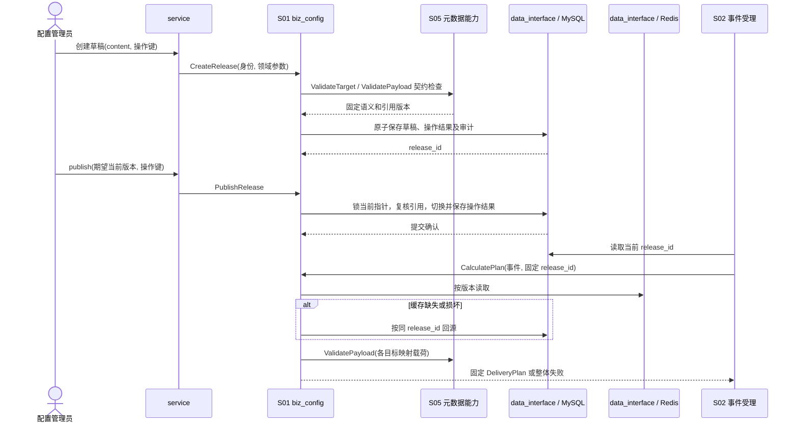

# S01 配置发布与计划计算

| 项目 | 内容 |
| --- | --- |
| 版本 / 状态 | v0.2 / 待实施 |
| 依据 | [技术方案](../TECH_DESIGN.md)第 5、6、10 节 |
| 前置契约 | [S00](00-shared-contracts.md)、[S05](05-provider-runtime.spec.md) 的适配器元数据与凭证引用校验 |
| 输出使用方 | S02 事件受理；S03、S05 按原版本读取固定语义 |
| 建议代码 | `internal/biz/biz_config` 编排，`internal/domain` 实现路由与映射纯规则；经 `internal/data_interface` 调用 `internal/data/mysql` 事务 |

## 1. 目标与范围

将调用方、事件类型、数据版本与事件快照计算为确定的目标列表和每项目标的业务载荷；将路由、映射和语义相关目标配置作为不可变发布管理。

本模块不发起供应商业务 HTTP、不刷新凭证、不修改已受理任务、不执行任意脚本，也不根据事件发生时间自动选择历史配置。

## 2. 输入与输出

### 2.1 发布快照

首版配置采用 JSON，至少包含以下逻辑字段。实际存储可整体放入 `routing_releases.content`，但必须有格式版本并完整保留内容。

| 字段 | 约束 |
| --- | --- |
| `format_version` | 配置结构版本，首版为 `1` |
| `event_schemas` | 已支持的事件类型、数据版本及校验规则；规则必须有界、确定，不支持远程引用或代码执行 |
| `routes` | 规则列表；按调用方、来源业务、事件类型和数据版本限定适用范围 |
| `routes[].conditions` | 受限条件列表，首版为全部成立；空列表表示无附加条件 |
| `routes[].targets` | 一个或多个目标引用；每个目标有唯一 `route_target_id` |
| `targets` | 通道、供应商及账号、操作、适配器类型/版本、凭证引用、固定目标语义及映射引用 |
| `mappings` | 每个映射的标识、版本和字段规则 |
| `policy` | 任务初始预算与退避策略，受服务允许范围限制 |

发布快照固定供应商账号归属、操作、请求业务语义、幂等协议能力及映射；通道启停、当前访问许可和有效凭证由 S05 在执行时另行检查。

### 2.2 计划计算

输入为已认证身份、授权来源、已规范化的事件 envelope 与数据，以及一个明确 `release_id`。输出 `Plan` 至少包含：

- 选定发布 ID 和版本。
- 按 `route_target_id` 排序的非空目标列表。
- 每项目标的通道、供应商及账号、操作、适配器类型/版本、凭证引用和固定语义引用。
- 映射 ID、映射版本、已映射载荷及任务策略。

计算过程不写业务事件表，不查询最新业务数据；对同一输入与发布返回相同业务计划。任务 ID、受理时间等由 S02 在持久化阶段赋值。

## 3. 路由规则

### CFG-R01：确定性匹配

- 先匹配调用方、来源业务、事件类型和版本，再按条件判断。
- 首版只支持 `eq`、`in`、`exists`。字段路径采用 JSON Pointer，从事件 `data` 根开始；首版只允许对象字段，不支持数组索引、通配符、函数、隐式类型转换或脚本。
- `eq` 的操作值和 `in` 的成员仅允许字符串、布尔、有限 JSON 数字或 null。数值按 S02 的规范化数值比较，字符串精确比较。
- 缺失路径：`exists` 为 false，`eq / in` 为 false；显式 null：`exists` 为 true，可与 null 匹配。
- 类型不同直接不匹配；向非对象值继续取子字段视为缺失。
- 同一事件可匹配多条规则，取目标并集。同一 `route_target_id` 重复命中仅生成一项目标；同 ID 出现不同目标定义时配置发布失败。
- 不按供应商名称去重，同一供应商不同操作必须保留为独立目标。

### CFG-R02：有界计算

限制配置大小、规则数、条件数、路径长度/深度、映射字段数、事件大小及最终扇出。超限返回可定位错误，不截断目标列表后继续受理。

无匹配路由返回 `no_matching_route`；未知事件类型/版本返回 `unsupported_schema`。这两类失败不产生已受理事件。

## 4. 映射规则

### CFG-M01：字段规则

每个输出字段规则采用明确的类型与约束：

| 项目 | 规则 |
| --- | --- |
| `to` | 输出 JSON Pointer；首版只生成对象结构；重复或父子路径冲突在发布时拒绝 |
| `from` / `constant` | 二选一；字段取值或固定 JSON 值 |
| `default` | 仅在来源缺失时使用；必须是配置常量，不读取时间、环境或外部系统 |
| `required` | 缺失且无默认值时失败；可选字段缺失时省略 |
| `nullable` | 控制显式 null 是否可用；默认值不自动替换显式 null |
| `type` | 明确的 JSON 类型；不隐式将数字转换为字符串或反向转换 |
| `enum_map` | 对允许的标量来源做明确对应；不存在对应值时失败，不自动保留原值 |

执行顺序：取值或常量 → 缺失默认值 → 必填/null 检查 → 来源类型检查 → 枚举对应 → 输出类型检查。枚举源和目标类型必须在规则中声明。

### CFG-M02：全计划校验

每个匹配目标都必须通过映射和适配器的本地载荷校验。适配器校验不能访问网络、消耗业务尝试或生成与当前时间相关的业务字段。

任一目标失败返回 `mapping_invalid`，指出发布、目标和字段路径，不返回敏感原始值。S02 不允许部分受理。

## 5. 发布、读取与缓存

### CFG-P01：校验与原子发布

首版配置接口为：

| 接口 | 行为 |
| --- | --- |
| `POST /v1/config/releases/validate` | 本地静态校验，返回错误列表；不改变当前版本 |
| `POST /v1/config/releases` | 创建完整草稿，返回发布实体 ID |
| `POST /v1/config/releases/{id}/publish` | 携带操作幂等键、原因和 `expected_current_release_id`，原子切换当前指针 |
| `GET /v1/config/releases/{id}` | 读取完整版本，按运维权限返回脱敏内容 |
| `GET /v1/config/releases/current` | 从 MySQL 确认当前发布并返回内容 |

首版采用创建新草稿替代编辑已有草稿。发布前检查结构、受支持事件版本、条件/映射语法、目标引用、通道账号归属、已注册适配器版本、凭证引用存在性和策略范围。不通过获取真实 Token 或发送业务请求做发布校验。

发布事务保存快照状态、当前指针和管理审计。并发发布使用期望当前指针检查；不允许无条件覆盖。首次发布的期望指针为 null。

发布操作遵循 S00/S07 相同的操作幂等原则：相同键和参数返回原结果，不能因再次请求而重新切换指针；同键不同参数返回 409。重发原发布操作不会把已经前进的当前指针退回旧版本。

### CFG-P02：不可变与引用保留

已发布内容不修改，替换通过新发布完成。已失去当前指针的版本仍可供旧任务读取；首版不提供直接删除被引用版本的接口。清理遵循 S08。

S02 从 MySQL 读取当前发布 ID 后，整个计划计算使用该固定版本，即使期间发生新发布也不重新选取。旧任务读取必须传原 `release_id`，不能回退为当前版本。

### CFG-P03：按版本缓存

Redis key 含格式版本及发布 ID。缓存 miss 或 Redis 故障时按同 ID 回源 MySQL；不得使用其他版本替代。缓存值包含实体 ID、格式版本和内容完整性检查依据，校验失败时丢弃并回源。

缓存缺失与持久化版本缺失分开处理。前者可重建；后者对新受理返回明确不可用，对旧任务报告阻塞和告警，不静默生成新计划。

## 6. 配置字段和发布接口参数

`content` 是以下结构的完整 JSON 对象。未列出的字段拒绝，不支持通配调用方或隐式优先级；所有匹配规则均参与目标并集。数组中的 ID 必须唯一；目标和映射使用对象字典，字典键就是引用 ID。

| 结构 / 字段 | 类型 / 必填 | 规则 |
| --- | --- | --- |
| `event_schemas[]` | 非空数组 | 每项为 `{event_type, schema_version, shape}`；类型与版本的二元组唯一 |
| `shape` | 对象 | `type` 为 `object/array/string/number/integer/boolean/null`；递归最多 16 层 |
| `shape.properties / required / additional_properties` | 对象 / 字符串数组 / 布尔 | 仅 object 使用；required 必须属于 properties，additional_properties 默认 false |
| `shape.items / max_items` | shape / 整数 | 仅 array 使用；items 必填，max_items 默认 100、上限 1000 |
| `shape.enum / max_length` | 标量数组 / 整数 | enum 最多 100 项且类型一致；字符串长度按 Unicode 码点，默认最多 4096、上限 65536 |
| `shape.nullable` | 布尔，可选 | 默认 false；true 允许显式 null，但不把字段变成非必填 |
| `routes[].route_id` | ASCII 标识，必填 | 1～128 字节，仅供规则追踪 |
| `routes[].caller_id / source_business` | 标识，必填 | 精确匹配，发布权限须覆盖对应调用方 |
| `routes[].event_type / schema_version` | 标识，必填 | 必须存在于本发布的 event_schemas |
| `routes[].conditions[]` | 对象 | `{path, op, value}`；`exists` 禁止 value，`in` 的 value 为非空标量数组 |
| `routes[].targets` | 1～50 项目标 ID 数组 | 引用 targets；同一路由内不重复 |
| `targets.<id>` | 对象 | `channel_id, provider_id, provider_account_id, operation, adapter_type, adapter_version, credential_ref, mapping_id, mapping_version, semantic_config` 均必填 |
| `semantic_config` | 适配器版本定义的对象 | S05 校验并冻结；包含业务地址/参数及幂等声明，不含明文秘密 |
| `mappings.<id>` | 对象 | `{version, fields}`；输出字段数受 CONFIG_MAX_MAPPING_FIELDS 限制 |
| `fields[].type / source_type` | JSON 类型名称 | type 必填；使用 enum_map 时 source_type 必填，禁止隐式转换 |
| `fields[].enum_map` | `[{from, to}]` | from 为唯一标量，to 类型符合 type；避免用 JSON 对象键把数字/布尔转成字符串 |
| `policy.max_attempts` | 整数，必填 | 默认发布模板为 8；范围 1～32 |
| `policy.round_timeout_seconds` | 整数，必填 | 默认模板 86400；范围 60～604800 |
| `policy.backoff_initial_ms / backoff_cap_ms` | 整数，必填 | 默认模板 5000 / 300000；初始 100～60000，上限介于初始值与 3600000 |
| `policy.server_wait_cap_seconds` | 整数，必填 | 默认模板 3600；范围 1～3600，不能超过部署允许上限 |

shape 首版只允许以上关键字；禁止 `$ref`、正则表达式、自定义函数、组合条件和网络取 schema。integer 按精确十进制值是否为整数判断，`1.0` 合法；缺失与 null 仍分别校验。对象深度、整体大小和字段数先于 schema 解释检查。映射的 `required / nullable` 默认均为 false；`from` 与 `constant` 必须恰有一个，constant 模式禁止 default/enum_map/source_type。路径使用标准 JSON Pointer 转义 `~0 / ~1`；禁止空根路径、数字数组索引和非法转义。

最小完整发布内容示例（实际创建接口外层再包 `content`）：

```json
{
  "format_version": 1,
  "event_schemas": [{"event_type":"UserRegistered","schema_version":"1","shape":{"type":"object","properties":{"user_id":{"type":"string"},"campaign":{"type":"string"}},"required":["user_id"],"additional_properties":false}}],
  "routes": [{"route_id":"user-crm","caller_id":"caller-demo","source_business":"user-service","event_type":"UserRegistered","schema_version":"1","conditions":[],"targets":["crm-create-user"]}],
  "targets": {
    "crm-create-user":{"channel_id":"1","provider_id":"mock","provider_account_id":"demo","operation":"create-user","adapter_type":"mock-json","adapter_version":"1","credential_ref":"provider/demo","mapping_id":"crm-user","mapping_version":"1","semantic_config":{"base_url":"http://mockvendor:9090","path":"/notify/create-user","auth_type":"bearer","idempotency":{"mode":"key","window_seconds":86400,"starts_at":"first_possible_send"}}}
  },
  "mappings": {"crm-user":{"version":"1","fields":[{"to":"/external_user_id","from":"/user_id","type":"string","required":true,"nullable":false}]}},
  "policy":{"max_attempts":8,"round_timeout_seconds":86400,"backoff_initial_ms":5000,"backoff_cap_ms":300000,"server_wait_cap_seconds":3600}
}
```

该地址仅为测试环境显式许可示例；生产发布必须满足当前目标许可。模板中的默认策略由配置工具显式填入，不能在读取旧版本时再用当前启动默认值补齐缺项。

| 接口 | 请求参数 | 成功响应 |
| --- | --- | --- |
| validate | `{content}` | 200 `{valid, errors:[{code, field_path, route_target_id, message}], truncated}`；内容无效仍为 200/valid=false，JSON 格式错误为 400 |
| 创建草稿 | `{operation_idempotency_key, reason, content}` | 201 `{operation_id, release_id, version_no, status:"draft", content_sha256}` |
| publish | `{operation_idempotency_key, reason, expected_current_release_id}` | 200 `{operation_id, release_id, version_no, previous_release_id, published_at}`；首次 expected 为 null |
| GET 版本 / current | 路径 release_id；current 无参数 | 200 `{release_id, version_no, status, format_version, content_sha256, content, created_at, published_at}` |

所有写接口原因 1～1024 字节、操作键遵循 S00。全局配置操作使用 `caller_scope="__global__"`，类型分别 `config_create / config_publish`；需要 `config:publish`，并校验配置中涉及的调用方范围。`version_no` 由服务器按创建顺序分配，不接受客户端指定。一个草稿最多发布一次；superseded 不能直接重新激活，回退需要复制内容创建新版本。

## 7. 处理步骤、持久化和模块调用

发布读取和静态校验在事务前完成，事务内复核通道版本、账号归属、凭证引用版本及草稿内容 hash。任何引用变化返回 409 `configuration_changed`，调用方重新校验；不在锁内调用 Vault 或供应商。草稿内容从创建后就不可编辑，发布只改变状态及当前指针。`routing_current` 采用预建 singleton=1、允许 release_id=null 的单行；首次发布与后续发布锁同一行，避免空表无法串行化。旧当前版本置 superseded、新版置 published，与指针和操作结果同事务提交。

| 能力 / 端口 | 输入 | 输出及失败 |
| --- | --- | --- |
| `ValidateRelease`（S01 用例） | AuthContext、content | 完整校验结果；最多 100 项，超出标 truncated |
| `LoadCurrentRelease`（仓储） | 无业务事件参数 | 主库当前引用；未发布返回 `configuration_unavailable` |
| `LoadRelease`（仓储/缓存） | release_id、预期格式版本 | 校验 hash 的不可变内容；缺失与缓存 miss 分开 |
| `ValidateTarget`（S05） | 固定目标、操作、凭证引用 | 本地元数据验证结果、引用版本，不执行凭证获取 |
| `CalculatePlan`（S01 能力） | EventEnvelope、明确 release_id、已认证来源 | DeliveryPlan；无目标、schema 或映射错误不写事件 |
| `CreateRelease / PublishRelease`（仓储） | 规范化内容/hash、引用版本、操作参数和期望指针 | 已提交操作结果；唯一冲突重读，CAS 失败不改变指针 |

首次受理读当前指针一次，随后按固定 release_id 完成计算；计算输出必须包括完整 `fixed_target` 和 `round_policy`，不得留下执行时才读取最新配置补齐的字段。路由逐条计算，目标去重后按 ID 排序，再做所有目标的映射和适配器校验。错误排序按路由/目标/字段路径固定，便于重复验证。

## 8. 运行参数

| 参数 | 默认 | 范围 / 行为 |
| --- | --- | --- |
| `CONFIG_MAX_BYTES` | 1 MiB | 64 KiB～4 MiB；包含 content 完整编码 |
| `CONFIG_MAX_ROUTES / CONFIG_MAX_TARGETS` | 500 / 500 | 各 1～2000；单次计划扇出另受 S02 限制 |
| `CONFIG_MAX_CONDITIONS` | 每条 20 | 0～100；`in` 最多 100 项 |
| `CONFIG_MAX_MAPPING_FIELDS` | 每映射 200 | 1～1000；映射后每目标载荷最多 256 KiB |
| `CONFIG_MAX_PATH_BYTES` | 256 | 16～1024；路径最多 16 段 |
| `CONFIG_CALCULATION_TIMEOUT` | 500 毫秒 | 50 毫秒～2 秒，超时 503 `plan_timeout`，无部分计划 |
| `CONFIG_CACHE_TTL` | 1 小时 | 1 分钟～24 小时；只是缓存有效期，不是版本保留期 |

缓存 key 为 `notifier:config:v1:<release_id>`，值包括规范化字节和 hash；current 指针不从 Redis 推断。回源后缓存写失败不影响受理。解析与校验结果可在进程内按 release_id 有界缓存，最多 100 个版本，淘汰不得删除持久化实体。

## 9. 模块依赖序列图



## 10. 持久化与实现任务

- [ ] 实现配置结构、格式版本、静态校验和受限条件解释。
- [ ] 实现受限映射及适配器本地载荷校验调用。
- [ ] 实现不可变实体、当前指针、发布 CAS 和操作幂等事务。
- [ ] 实现 `Plan` 计算与按版本读取；错误包含目标和字段路径。
- [ ] 保存完整历史语义；补齐当前迁移未明确的适配器类型、操作和目标配置读取依据。
- [ ] 接入按版本 Redis 缓存；缓存不成为当前指针的事实来源。

## 11. 验收场景

| 编号 | Given / When | Then |
| --- | --- | --- |
| CFG-01 | 同一事件命中广告和 CRM 两项目标 | 返回两项目标；同供应商不同操作也不合并 |
| CFG-02 | 两条规则引用同一目标 | 只生成一项目标；同 ID 冲突定义不能发布 |
| CFG-03 | 字段缺失、显式 null、类型不匹配分别参与条件与映射 | 严格遵守本 spec 规则；不隐式转换或替换 null |
| CFG-04 | 一个目标映射成功，另一个必填字段缺失 | 整体计划失败，错误定位到失败目标与字段 |
| CFG-05 | 选定 V1 后发布 V2 | 本次计划仍完整使用 V1；新请求可以使用 V2 |
| CFG-06 | 删除 V1 缓存并重启 Redis | 按 V1 回源；不使用 V2 替代 |
| CFG-07 | 相同发布操作重试，期间已有更新发布 | 返回原操作结果，不回滚当前指针 |
| CFG-08 | 未注册适配器版本、缺失凭证引用或任意脚本配置 | 发布失败，不影响当前版本 |
| CFG-09 | 两人基于同一当前指针并发发布不同版本 | 一次切换成功，另一次收到版本冲突 |
| CFG-10 | 示例完整配置创建、校验、发布并用于计算计划 | 字段结构一致，计划含所有固定语义和策略；同内容操作重试不分配新版本 |
| CFG-11 | 发布前校验通过，提交前通道账号或引用版本已改变 | 409 configuration_changed，当前发布和操作结果均不改变 |
| CFG-12 | 配置超限、非法 Pointer、重复映射源枚举或不支持 schema 关键字 | 错误定位到配置路径，最多返回 100 项且标记截断 |

## 12. 完成标准

上述场景有可重复验证；对相同输入与版本的计划结果确定；无网络业务调用；版本回源和引用保留可以在真实 MySQL、Redis 中验证。
