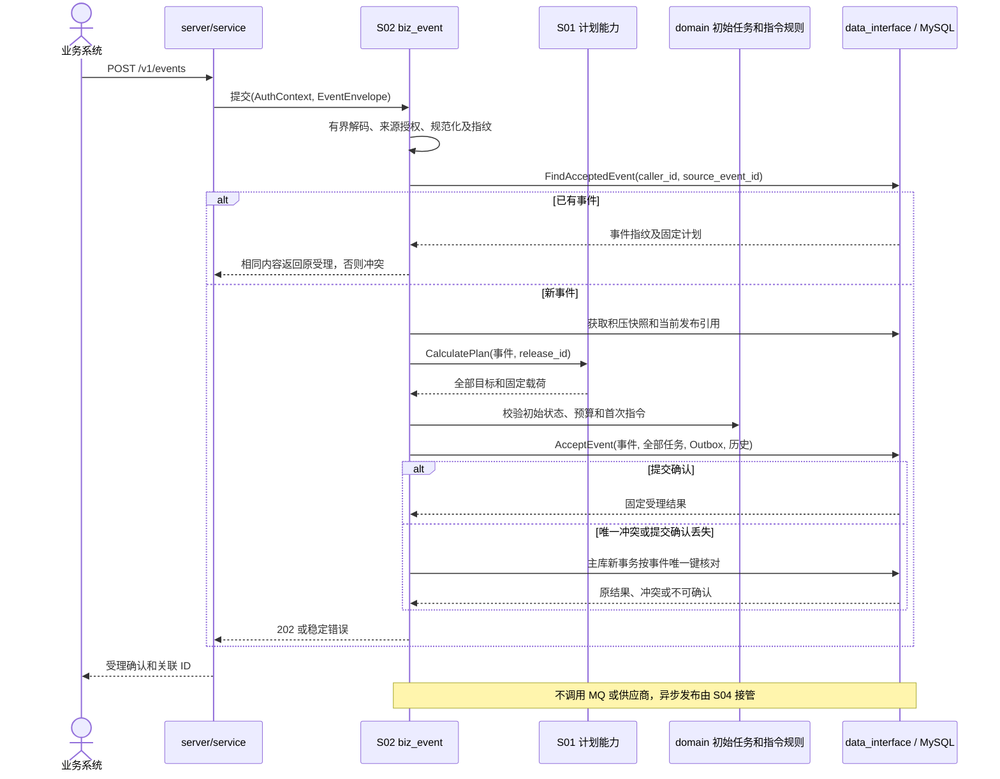

# S02 事件受理

| 项目 | 内容 |
| --- | --- |
| 版本 / 状态 | v0.2 / 待实施 |
| 依据 | [技术方案](../TECH_DESIGN.md)第 4～6、11、12 节 |
| 依赖 | [S00](00-shared-contracts.md)、[S01](01-configuration-release.spec.md)；S03 初始任务规则、S04 指令结构 |
| 建议代码 | `internal/service` 协议转换、`internal/biz/biz_event` 用例；经 `internal/data_interface` 调用 `internal/data/mysql` 原子保存计划 |

## 1. 目标与范围

统一接收已经发生的业务事实，在有界同步流程内形成固定计划，将事件、全部任务和首次指令原子保存后确认接管。

不接受业务方指定供应商 URL、Header、Body、通道或路由版本；不等待 MQ 发布和供应商响应；不保证业务系统自身事务与提交事件之间的原子性。

## 2. 接口契约

### 2.1 提交事件

`POST /v1/events`，认证身份通过请求凭证确定。请求示例：

```json
{
  "source_business": "user-service",
  "source_event_id": "registration-20261109-001",
  "event_type": "UserRegistered",
  "schema_version": "1",
  "occurred_at": "2026-11-09T09:30:00+08:00",
  "business_object_type": "user",
  "business_object_id": "user-001",
  "data": {
    "user_id": "user-001",
    "campaign": "autumn"
  }
}
```

除单一授权来源允许省略 `source_business` 外，以上 envelope 字段均必填；`data` 必须是 JSON 对象，其字段由事件数据版本约束。省略来源时先解析为授权的唯一来源，再生成指纹。来源不唯一则要求显式填写。

### 2.2 成功响应

首次受理和同内容重复提交均返回 `202 Accepted`，返回持久化事件标识、原发布引用和固定分发计划，例如：

```json
{
  "event_id": "1001",
  "source_business": "user-service",
  "source_event_id": "registration-20261109-001",
  "accepted_at": "2026-11-09T01:30:01Z",
  "routing_release_id": "12",
  "delivery_count": 2,
  "deliveries": [
    {"delivery_id": "2001", "route_target_id": "ad-registration", "provider_id": "ad", "provider_account_id": "demo", "operation": "registration"},
    {"delivery_id": "2002", "route_target_id": "crm-create-user", "provider_id": "crm", "provider_account_id": "demo", "operation": "create-user"}
  ]
}
```

受理响应不伪装为送达结果。投递状态通过 S08 查询；重复提交不会更新 `accepted_at`、路由发布或任务列表。无权限查看的配置内容和凭证不出现在响应中。

## 3. 提交幂等与指纹

### EVT-I01：唯一范围

幂等唯一键为 `(caller_id, source_event_id)`。不能改为仅按事件类型、来源业务或业务对象去重。相同键、相同规范化内容返回原结果；相同键、不同内容返回 409 `idempotency_conflict`。

### EVT-I02：首版规范化算法

为避免 JSON 编码细节影响重复提交，定义 `fingerprint_version = 1` 并持久化。指纹为规范化内容的 SHA-256，至少覆盖：`caller_id`、解析后的来源业务、来源事件 ID、事件类型、数据版本、发生时间、业务对象类型/ID 和完整 `data`。

规范化规则：

1. 对象键按 Unicode 码点顺序递归排序，移除结构空白；数组保留顺序。
2. 字符串按解码后的 Unicode 内容编码为 UTF-8，不做大小写或 Unicode 归一化。双引号编码为一个反斜线后接双引号，反斜线编码为两个反斜线，U+0000～U+001F 统一用一个反斜线后接小写 u00xx，其他字符不额外转义；不做 HTML 转义。原 JSON 转义写法差异不影响指纹。
3. 数字以精确十进制表示处理，禁止先转 `float64`。非零数规范成无前导零、无尾零的有符号整数系数，紧接小写 `e` 和无前导零/加号的整数指数；零及负零统一编码为 `0`。例如 `1`、`1.0`、`1e0` 均为 `1e0`，`123.00` 为 `123e0`，`0.01230` 为 `123e-4`。直接调整系数和指数，不按指数展开超大字符串；数字字面量长度受输入上限限制。
4. `occurred_at` 转为 UTC，固定格式 `YYYY-MM-DDTHH:mm:ss.ffffffZ`；缺失与 null 不等价。
5. 拒绝重复键、非法 UTF-8、非法数字或超限数据，不接受编码器的静默修复。

上述字段组成同名键的完整对象，按以上规则编码后对字节序列计算 SHA-256。指纹不包含当前路由版本、适配器部署版本、受理时间、Token 或发送时间。算法升级必须支持已有事件的原算法比较，不直接以新版算法产生冲突。

### EVT-I03：检查顺序

处理顺序为认证及当前接入权限 → 有界格式校验与规范化 → 按唯一键读取已有事件 → 幂等命中处理 → 对新事件选择配置并校验数据/计划。

已有事件命中不依赖当前路由、当前受支持 schema 列表或当前积压是否允许新受理。因此旧事件不会因配置更新而重新展开；但仍需要有效身份和当前数据访问权限。

## 4. 原子受理流程

### EVT-A01：计划计算与保存

1. 检查新受理的大小、扇出与积压保护门槛。
2. 从 MySQL 选定当前发布 ID；使用 S01 完成事件 schema 校验、路由、全部映射与本地载荷校验。
3. 确认所有目标都有固定语义、账号归属和有效引用；生成任务级稳定业务幂等标识。
4. 在一个 `AcceptEvent` 事务中插入事件、全部任务、首次 Outbox 和对应历史。
5. 提交确认后返回受理响应；不在事务中发布 MQ 或执行外部 HTTP。

每个任务的初始值遵循 S00/S03：`PENDING`、第 1 轮、尝试数均为 0、两个版本号为 1；冻结本轮策略，设置本轮截止和首次计划时间。

### EVT-A02：并发唯一冲突

数据库唯一约束是并发最终保障。两个请求独立算出不同版本计划时，只有成功插入者的事件和完整计划有效。另一个事务整体回滚，再读取已提交原事件，比较指纹并返回原结果或冲突；不能合并两份目标列表。

### EVT-A03：提交结果不确定

事务提交连接中断时，按 `(caller_id, source_event_id)` 查询实际结果。能够确认则返回原受理；仍无法确认则返回可重试的 503，不声明未受理，也不执行新一轮盲目插入或供应商请求。调用方沿用原来源事件 ID 重试。

未成功受理的无路由、schema 错误或映射错误不保留成功事件记录，不占用幂等键。修复后可使用原来源事件 ID 再提交。

## 5. 错误与故障边界

| 条件 | 返回 / 行为 |
| --- | --- |
| 缺必填字段、来源不明确、非法时间 | 400 `invalid_request` |
| 未授权来源 | 403 `forbidden` |
| 超过请求体上限 | 413 `payload_too_large`，有界读取 |
| 未支持事件版本、schema 校验不通过 | 422 `unsupported_schema` 或 `event_data_invalid` |
| 无路由 / 映射失败 / 超过扇出 | 422 `no_matching_route` / `mapping_invalid` / `fanout_exceeded` |
| 相同来源事件 ID 内容不同 | 409 `idempotency_conflict` |
| MySQL 不可用或当前发布不可读取 | 503 `dependency_unavailable` |
| MQ 暂停，积压尚在保护范围内 | 可受理，首次 Outbox 持久化等待发布 |
| 积压超过受理阈值 | 新事件返回 503 `admission_paused`；已有事件仍可幂等查询 |
| Redis 不可用 | S01 按原版本回源；不依赖 Redis 完成事件去重 |

积压保护必须有可配置阈值、统计时间与失效策略。统计无法获得时不无限接收新事件，返回可定位的不可用；幂等命中不增加积压。

## 6. 请求参数、响应与受理参数

| 参数 | 类型 / 必填 | 校验及使用 |
| --- | --- | --- |
| `source_business` | 字符串，条件必填 | 按 S00 解析当前授权；省略时必须只有一个授权来源 |
| `source_event_id` | 字符串，必填 | S00 长度/精确比较；不从请求 ID 或对象 ID 自动生成 |
| `event_type / schema_version` | 字符串，必填 | envelope 格式校验先做，是否受支持仅对新事件用选定发布校验 |
| `occurred_at` | 时间字符串，必填 | S00 时间范围和精度；UTC 规范化，不能使用 received_at 补齐 |
| `business_object_type / business_object_id` | 字符串，必填 | 标识对象类型和对象 ID；不要求与 data 中某字段同名，具体一致性由 schema/适配器校验 |
| `data` | JSON object，必填 | 包含嵌套对象/数组均可；深度及数字限制遵循 S00，再做 S01 schema 校验 |
| `caller_id / release_id / channel_id / url / headers / body` | 不允许 | 出现在 envelope 即 400，不容许业务方控制目标 |

成功响应必含 `event_id / source_business / source_event_id / accepted_at / routing_release_id / delivery_count / deliveries`。`deliveries` 按 `route_target_id` 升序，每项返回 `delivery_id / route_target_id / provider_id / provider_account_id / operation`；它是固定计划摘要，不混入随时间变化的投递状态。重复提交的响应内容保持原受理语义，当前状态另由 S08 获取。结果不确定返回 503 `acceptance_unconfirmed`，message 明确要求沿用原事件 ID 重试，不能声称“没有受理”。

| 部署参数 | 默认 | 范围 / 说明 |
| --- | --- | --- |
| `EVENT_MAX_BODY_BYTES` | 256 KiB | 1 KiB～1 MiB；包含完整 envelope，读取最多上限加 1 字节 |
| `EVENT_MAX_FANOUT` | 50 | 1～200；所有目标完整计算，不截断受理 |
| `EVENT_MAX_PLAN_BYTES` | 2 MiB | 256 KiB～8 MiB；固定载荷与语义总编码大小 |
| `EVENT_MAX_PENDING_OUTBOX` | 100000 | 100～1000000；尚未完成发布的有效 Outbox 数量 |
| `EVENT_MAX_OLDEST_OUTBOX_AGE` | 1 小时 | 1 分钟～24 小时；与数量任一超限即暂停新受理 |
| `EVENT_BACKLOG_SAMPLE_INTERVAL` | 1 秒 | 100 毫秒～5 秒；主库统计或受保护统计快照 |
| `EVENT_BACKLOG_SAMPLE_MAX_AGE` | 5 秒 | 不小于采样间隔，最多 30 秒；过期且回源失败则 503 |
| `DELIVERY_IDEMPOTENCY_NAMESPACE` | 本地 `local` | 部署必填 1～24 位 ASCII 字母数字；首次受理后禁止改变已有任务的值 |

积压保护是有界采样的准入控制，不宣称集群并发时严格限于某一条数。采样统计不含已经失效的旧调度指令；MQ 未停机但积压超限同样拒绝新事件。已有事件先走幂等路径，不受积压保护、当前 schema 或当前发布可用性影响。准入检查失败时，在返回新受理错误前最后按唯一键复核一次，避免并发请求已成功受理而本请求仍报告无路由等过时错误。

## 7. 指纹实现和数据保存

规范化必须在 token 级精确解码，拒绝不成对的 UTF-16 代理项转义；不能使用会替换非法 Unicode 或先转 float64 的普通反序列化路径。字符串转义规则中的双引号编码为一个反斜线后接双引号，反斜线编码为两个反斜线；控制字符固定六字节 `\u00xx`。发生时间先解析为一个 UTC 时刻，再以固定六位小数编码。S00 的规范化数字范围在计算系数/指数后检查，不按巨大指数展开字符串。

下列规范化字节样例用于验收编码器；计算 SHA-256 的输入是 UTF-8 字节，不带换行：

| 原始 JSON | 规范化 JSON |
| --- | --- |
| `{"b":1.0,"a":"中"}` | `{"a":"中","b":1e0}` |
| `{"v":-0.0,"n":0.01230}` | `{"n":123e-4,"v":0}` |
| `{"v":"\u0061","list":[true,null]}` | `{"list":[true,null],"v":"a"}` |

创建事件时同时保存 canonical 字节、指纹和算法版本；映射器使用同一精确 JSON 值模型。同一个事件的原始空白、键顺序和数字表示不作为业务事实的差异，但数值和字符串的类型差异必须保留。

`AcceptEvent` 的输入为 `{auth_scope, envelope, fingerprint_version, fingerprint, canonical_data, release_id, expected_release_hash, plan, idempotency_namespace}`；仓储只接收已完成校验的领域参数，但仍检查引用、唯一键和大小不变量。事务步骤固定为：

1. 取得本次数据库 UTC 时间作为 `accepted_at`，验证所选不可变发布仍存在且 hash 一致；不因当前指针改变而换版。
2. 插入事件并获取 `event_id`；目标按 `route_target_id` 稳定顺序创建，数据库分配任务 ID。
3. 生成任务稳定业务键 `n1_<namespace>_<delivery_id>`，按 S05 协议映射为供应商键；整个键落库，重试不重新生成。每任务保存精确载荷、fixed_target、轮次策略、发布和映射引用。
4. 初始 `scheduled_at = accepted_at`，`round_deadline_at = accepted_at + round_timeout_seconds`；本轮/累计次数 0，轮次/行版本/调度版本 1，任务级确定性 `NOT_RECEIVED`。初始 lease、最近尝试、错误、检查/重试/结案时间为空。
5. 为每个任务插入 S04 首次即时 Outbox；同事务追加 `TASK_CREATED` 和 `SCHEDULE_CREATED` 两条历史，分别分配 history_seq 1、2。
6. 提交后返回数据库实际分配的固定计划。任何子写入失败均整体回滚；自增 ID 出现间隙不视为错误。

唯一冲突后必须结束原事务，在主库新事务中按 `(caller_id, source_event_id)` 重读；不在旧隔离快照中循环读取。错误必须区分事件唯一键和其他唯一约束：任务/Outbox 唯一冲突若不能对应完整原受理，按一致性异常处理，不能直接当作事件幂等成功。

## 8. 模块依赖序列图



## 9. 持久化与实现任务

- [ ] 实现认证上下文与来源授权接入，不信任请求内的调用方身份。
- [ ] 实现 envelope、指纹版本和精确 JSON 规范化，保存原事件事实。
- [ ] 实现已有事件优先的幂等路径与稳定受理响应。
- [ ] 实现计划计算调用、完整受理事务及唯一冲突后的原结果读取。
- [ ] 校验 `(caller_id, source_event_id)`、`(event_id, route_target_id)` 及首次调度唯一约束。
- [ ] 接入上限、积压保护和有界上下文；所有错误脱敏。

## 10. 验收场景

| 编号 | Given / When | Then |
| --- | --- | --- |
| EVT-01 | 一个注册事件匹配两个目标 | 一条事件、两个任务、两个首次 Outbox 和初始历史同事务保存 |
| EVT-02 | 多个并发请求提交相同 ID 与内容 | 全部成功响应指向同一事件和计划，不多建任务 |
| EVT-03 | 相同 ID 仅对象键顺序、数字表示或时间时区写法变化 | 按规范化规则命中原事件 |
| EVT-04 | 相同 ID 的发生时间、来源业务或数据发生实质变化 | 返回 409，不覆盖原事件 |
| EVT-05 | 已受理 V1 事件，V2 改变路由或移除原 schema | 原请求重复提交仍返回 V1 原计划 |
| EVT-06 | 一个目标映射失败，随后修复配置并沿用原 ID | 首次不留半套计划；修复后成功受理 |
| EVT-07 | 并发受理期间切换发布版本 | 只保留唯一成功事务的计划，不混合两个版本 |
| EVT-08 | 提交事务已成功，响应返回前中断连接 | 重试返回原受理，事件、任务和历史数量不增加 |
| EVT-09 | Broker 停机且积压未超限 / 超限 | 分别持久化接管 / 明确拒绝新事件，不假报供应商送达 |
| EVT-10 | 请求伪造 `caller_id`、目标 URL 或未授权来源 | 拒绝请求，不能指定投递目标或越权建任务 |
| EVT-11 | 请求体/总计划/扇出恰好达到边界及超过 1 单位 | 边界可受理，超限不截断计划；事务无残留 |
| EVT-12 | 当前发布不可用或积压统计过期，但事件早已受理 | 先返回原受理；相同键不同内容仍冲突，不进入当前计划计算 |
| EVT-13 | 对含大整数、转义字符串及不同时区的等价事件并发提交 | 按精确规范化命中原事件，数据库读取后指纹及载荷仍一致 |
| EVT-14 | 新事件在准入/配置校验时失败，另一个并发请求已经成功提交 | 返回错误前复核唯一键并返回原结果或内容冲突，不误报原事件未受理 |

## 11. 完成标准

基于真实 MySQL 验证原子性、并发唯一键和提交恢复；固定发布内容与原始事实可追溯；受理过程不依赖供应商响应，且所有错误路径不会遗留半套计划。
