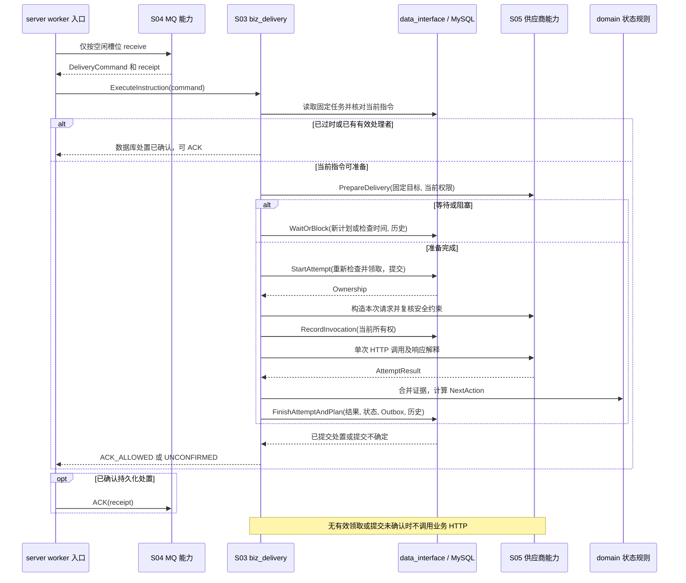

# S03 投递状态与执行

| 项目 | 内容 |
| --- | --- |
| 版本 / 状态 | v0.2 / 待实施 |
| 依据 | [技术方案](../TECH_DESIGN.md)第 7～9、11 节 |
| 依赖 | [S00](00-shared-contracts.md)、[S04](04-reliable-dispatch.spec.md)、[S05](05-provider-runtime.spec.md) |
| 规则使用方 | worker、S06 自动恢复、S07 人工处置 |
| 建议代码 | `internal/domain` 定义状态规则，`internal/biz/biz_delivery` 编排，`internal/server` 提供 worker 入口；经 `internal/data_interface` 调用 `internal/data/mysql` 事务 |

## 1. 目标与职责边界

将持久化任务推进为可查询的接收成功、明确失败或结果不确定，并在允许时安排独立重试。模块拥有任务状态转换、任务级确定性、轮次预算、尝试和计划时间的统一规则。

worker 负责消息、前置检查、外部调用和 ACK 编排；适配器只解释供应商协议；恢复与人工操作复用领域规则。上述入口不能分别拼装任务 SQL 或各自决定“超时等于失败”。

## 2. 状态与时间不变量

| 状态 | 含义 | 有效时间字段与后续 |
| --- | --- | --- |
| `PENDING` | 首次或新轮次待执行 | `scheduled_at` 非空；到期可领取 |
| `PROCESSING` | 已创建尝试且有当前领取信息 | `current_attempt_id / lease_token / lease_expires_at` 非空；发送计划字段为空 |
| `RETRY_WAIT` | 已持久化自动重试或执行前等待 | `scheduled_at = next_retry_at` 非空；到期可领取 |
| `BLOCKED` | 当前权限、通道或旧版本条件不允许执行 | `next_check_at` 非空；发送计划及领取字段为空；必须有阻塞原因 |
| `SUCCEEDED` | 按协议确认接收 | 发送/检查/领取字段为空；`round_finished_at` 非空；不可重投 |
| `FAILED` | 明确失败且没有未决结果 | 同上；可按 S07 新开轮次 |
| `UNKNOWN` | 接收结果不确定且停止自动发送 | 同上；可核对结案或按 S07 处理 |

除 `RETRY_WAIT` 外，`next_retry_at` 必须为空；除 `BLOCKED` 外，`next_check_at` 必须为空。`PENDING / RETRY_WAIT / PROCESSING / BLOCKED` 的当前轮次结案时间为空。

进入 `PROCESSING` 清空当前发送计划；尝试结束后清空当前领取信息并保存 `last_attempt_id`。进入终止自动执行的状态不能遗留“下次重试时间”。

### DLV-S01：允许的状态推进

| 来源 | 条件 / 动作 | 去向 |
| --- | --- | --- |
| `PENDING / RETRY_WAIT` | 到期、前置检查通过、预算有效，创建尝试并领取 | `PROCESSING` |
| `PENDING / RETRY_WAIT` | 限流或暂时凭证等待，保存新计划 | `RETRY_WAIT`，不增加尝试 |
| `PENDING / RETRY_WAIT` | 通道停用、权限撤销、原适配器缺失等 | `BLOCKED` |
| `PROCESSING` | 接收确认且证据充分 | `SUCCEEDED` |
| `PROCESSING` | 允许再次发送且预算有效 | `RETRY_WAIT` |
| `PROCESSING` | 当前约束变更且确认未调用 HTTP，结束尝试后满足 DLV-S02 的阻塞条件 | `BLOCKED` |
| `PROCESSING` | S06 结束过期尝试后，满足 DLV-S02 的阻塞条件 | `BLOCKED` |
| `PROCESSING` | 明确不可继续，且无未决结果 | `FAILED` |
| `PROCESSING` | 存在未决结果且无法继续安全自动发送 | `UNKNOWN` |
| `BLOCKED` | 原条件解除、预算有效且当前重发安全检查通过 | 恢复保存的待执行类别并建立新版本指令 |
| 无有效领取的非终结状态 | 本轮期限/尝试预算耗尽 | 无未决则 `FAILED`，否则 `UNKNOWN` |
| `FAILED / UNKNOWN` | S07 授权人工重投 | 新轮次 `PENDING` |
| `UNKNOWN` | S07 有据核对结案 | `SUCCEEDED / FAILED` |

### DLV-S02：阻塞进入与恢复

`PROCESSING` 只有在结束当前尝试后，仍有剩余次数、本轮未截止、协议允许继续、下一次允许发送时间早于本轮截止，且没有未决结果或供应商幂等能力足以覆盖未决结果时，才可因通道停用、权限撤销等可恢复运行约束进入 `BLOCKED`。预算或期限耗尽、或下一次允许时间已达到本轮截止时，无未决结果则 `FAILED`，否则 `UNKNOWN`；存在无法安全覆盖的未决结果时直接进入 `UNKNOWN`，不能以阻塞延后人工介入。已用于创建尝试的风险重投授权不能再次用于阻塞恢复。

阻塞时持久化恢复类别和最早允许发送时间，可放入专用字段或结构化元数据：

| 阻塞来源 | 恢复类别 | 最早允许发送时间 |
| --- | --- | --- |
| 创建尝试前的 `PENDING / RETRY_WAIT` | 保留原类别 | 保留原计划时间 |
| 已结束当前尝试的 `PROCESSING` | `RETRY_WAIT` | 按 DLV-R03 计算的下一次允许时间；阻塞检查不重复推迟该时间 |

从 `PROCESSING` 进入阻塞由有效领取者通过 `FinishAttemptAndPlan` 完成，或由 S06 在领取过期后通过 `RecoverTask` 完成。同一事务必须：

1. 结束当前尝试并保存最终结果；确认未调用 HTTP 时为 `LOCAL_FAILURE / NOT_RECEIVED`、`NOT_SENT`，HTTP 耗时为空；领取过期时按 S06 保存 `UNCERTAIN / LEASE_EXPIRED`。任务级确定性仍汇总全部未决证据。
2. 保留已消耗的本轮/累计次数，设置 `last_attempt_id`，清空 `current_attempt_id / lease_token / lease_expires_at`。
3. 保存 `BLOCKED`、原因、恢复依据和 `next_check_at`，清空 `scheduled_at / next_retry_at`；当前轮次结案时间保持为空。
4. 增加 `row_version / schedule_version`，作废原指令并追加尝试结束及阻塞历史；阻塞期间不创建供应商执行 Outbox。只有确认事务已提交后才能 ACK 旧指令。

条件解除时重新检查预算、期限、当前权限和未决结果的重发安全性；尚未创建本轮首次尝试时，可按 DLV-E02 校验尚未使用的人工发送授权，等待和阻塞检查不消耗授权。通过后按保存类别恢复，计划时间取已保存最早允许时间与当前时间的较晚值，在同一事务中清空阻塞原因、检查时间及恢复元数据，增加行/调度版本，创建新 Outbox 和恢复历史；恢复本身不增加尝试或轮次。若该计划已达到本轮截止，或此时无法通过安全/授权检查，则按上述结案规则处理。不得恢复到 `PROCESSING`、复用旧领取或重新使用已消耗的人工发送授权。

## 3. 消费与执行流程

### DLV-E01：有空闲容量才接收

固定 worker 并行上限；没有空闲容量时不继续拉取。消费预取、批大小及待处理队列均有界。收到消息后先验证 S04 协议，再从 MySQL 读取任务和原版本信息，不信任消息携带的业务载荷或任意目标。

### DLV-E02：执行前检查

1. 核对消息与任务的事件 ID、轮次、调度版本、Outbox 归属及当前状态。
2. 对已完成、旧轮次/旧版本指令读取持久化处置后 ACK，不执行 HTTP。
3. 同版本有有效处理者时不再次执行；本次重复指令可在确认有效领取已持久化后 ACK，过期领取交 S06 处理。
4. 尚未到 `scheduled_at` 时不得发送。通过 S04 保存原指令的到期再发布安排后 ACK，不空转等待，也不增加尝试。
5. 无有效领取时检查本轮期限、剩余尝试、当前权限、通道、原配置及适配器；仍有未决结果时重新检查当前幂等窗口或本轮首次尝试的明确人工发送授权，不能只凭 `PENDING` 状态跳过安全判断。
6. 按 S05 通过限流并准备有效凭证。暂时等待保存有界计划；条件阻止执行则记录 `BLOCKED`。不在数据库锁内等待网络或 Token。

### DLV-E03：创建尝试与领取

前置准备完成后，`StartAttempt` 在一个事务内重新检查任务状态、计划到期、版本、无有效领取和剩余预算；以数据库时间为准。

- 新建 `attempt_id`，`attempt_no = round_attempt_count + 1`。
- 本轮和累计次数各加 1，记录 `outbox_id`、worker、部署版本与 trace。
- 写入当前尝试、全新领取 token 和期限，转为 `PROCESSING`。
- 保存 `started_at` 与开始历史；`row_version` 增加，当前 `schedule_version` 不变。
- 若依靠 S07 风险重投授权发送，匹配本轮对应操作记录，并在同一事务中将这次授权关联到新尝试；授权只供该轮首次业务尝试使用，不能跨轮次或重复尝试复用。

仅事务提交已确认后才能构造并执行业务请求。领取提交结果不确定时读取确认；无法确认则不发送、不 ACK，交重投/恢复处置。

### DLV-E04：一次尝试一次调用

- 生成本次发送上下文，使用固定载荷、稳定业务幂等键和当前有效凭证构造请求。
- HTTP 前再次核验当前领取及当前安全约束，并设置早于领取到期的请求截止时间。
- 通过 S05 的单次传输接口调用，禁止适配器或传输层隐式业务重试和自动重定向。
- 构造阶段明确失败仍保留已创建尝试和已消耗预算，标记 `NOT_SENT`；可重试性按明确错误分类决定。
- 领取后进程崩溃，即使可能尚未发送，也不能仅凭缺少发送日志推定未发送。
- 当前约束在领取后变更且能够确认尚未调用 HTTP 时，结束本次 `NOT_SENT` 尝试，按 DLV-S02 决定阻塞或结案；该次已消耗预算不回退。

### DLV-E05：原子保存结果

`FinishAttemptAndPlan` 校验状态、当前尝试、轮次、调度版本、领取 token 及有效性，在同事务内：结束尝试、保存脱敏结果与耗时、更新任务级确定性和状态、建立必要的新计划与 Outbox、追加历史。

尝试最终结果只写一次。重复保存先读取稳定结果；旧 worker 或过期领取的结果不覆盖已结束尝试或当前任务，按 S06 追加迟到证据。

提交确认丢失时读取尝试及当前任务判断是否已处置；无法确认则不 ACK。不能因结果提交失败立即再调用供应商。

## 4. 结果确定性与重试决策

### DLV-R01：任务级汇总

任务确定性根据全部相关尝试和核对证据计算，包括前轮次遗留的不确定性。最近一次结果另存 `last_result_certainty`，两者不能混用。

存在未决尝试时，后续 `NOT_RECEIVED` 不清除未决。针对同一稳定业务幂等标识的接收确认或明确核对证据才可消除其覆盖范围内的未决；供应商没有足够证据时保持 `UNCERTAIN`。

### DLV-R02：允许重发

自动重发同时满足：错误/协议允许继续、当前访问约束允许、轮次未过期、尝试数未达上限，并且没有未决结果或供应商当前幂等能力足以覆盖这些未决结果。仅 `retryable=true` 不足以授权发送。

对结果不确定且没有安全重发依据的任务立即停止自动发送，进入 `UNKNOWN`。等待凭证或限流也不能延长供应商幂等窗口；真正发送前重新判断窗口。

S07 的风险重投允许新轮次首次尝试使用已持久化的明确人工授权，它是单次人工授权发送，不视为供应商具备安全幂等能力。该次尝试后的自动重试仍执行以上安全判断；如仍存在不能安全覆盖的未决结果，则再次进入 `UNKNOWN`，不能沿用风险确认无限重发。

### DLV-R03：退避与期限

第 n 次已计入尝试后的本地退避基数为 `min(initial × 2^(n-1), cap)`，采用有界抖动，首版为基数的 50%～100%。计算须防整数/时长溢出。

供应商等待建议经 S05 校验后纳入计划；首版最多接受 1 小时建议，超过限制或非法值记录原因，按该通道已声明的安全策略等待或阻塞，不能无说明提前违反供应商强制等待。

`next_time` 取本地退避和有效供应商最早允许时间的较晚值。新计划达到或超过本轮截止时不创建注定无效的发送计划，按任务级确定性结案。限流与凭证等待有独立的短等待策略，也受同一截止时间约束。

### DLV-R04：预算计数

创建尝试即消耗次数，实际未发送也不减回。Outbox 发布次数、MQ 消费次数和业务尝试次数分别统计。人工重投只重置本轮次数，不重置累计次数或未决证据。

## 5. 调度版本与 ACK

产生新自动计划、进入阻塞或结案时作废原指令并增加 `schedule_version`；新指令以新版本唯一生成。同版本补发和消息过早到达只安排原指令再次发布，不新增版本。

| 处置 | ACK 前提 |
| --- | --- |
| 成功或最终失败/未知 | 尝试、任务和历史事务已提交 |
| 自动重试或执行前等待 | 当前处置、新版本计划和 Outbox 已提交 |
| 阻塞 | 阻塞原因、检查时间、指令失效和历史已提交 |
| 已过时或重复指令 | 已读取能够说明该指令无需执行的持久化状态 |
| 当前指令过早到达 | 原 Outbox 的到期再发布安排已提交 |
| 数据库或提交状态不可确认 | 不 ACK |

ACK 调用失败只记录并等待重投，不撤销已提交结果、不重复业务 HTTP。ACK 日志不作为 Broker 已确认的证明。

## 6. 尝试记录与退出

尝试记录覆盖技术方案第 11.2 节字段。HTTP 耗时用单调时钟，从调用客户端到响应读完或错误返回；总尝试耗时从开始当前尝试、进入领取事务前计时，到结果计算完成并准备写入结果事务时结束，包含领取、构造、调用和结果解释，不宣称包含最终提交确认。

无响应则状态码/响应摘要为空；读取响应体失败仍保留已经收到的状态码。明确未发送则 HTTP 耗时为空。恢复无法还原耗时，标记 `timing_incomplete`，不使用领取期限伪造。

退出时停止拉取，给在途调用和结果保存有界排空时间；超限则取消上下文，不虚构发送失败或提前 ACK。未完成尝试由持久化领取与 S06 接管。

## 7. 执行参数与领域端口

| 参数 | 默认 | 范围 / 约束 |
| --- | --- | --- |
| `DELIVERY_PARALLELISM` | 10 | 1～100；一个槽位覆盖前置准备、一次尝试和结果保存 |
| `DELIVERY_HTTP_TIMEOUT` | 10 秒 | 100 毫秒～60 秒；供应商业务调用总预算 |
| `DELIVERY_BUILD_TIMEOUT` | 1 秒 | 10 毫秒～5 秒；请求构造及签名，本地操作也遵守取消 |
| `DELIVERY_LEASE_TIMEOUT` | 30 秒 | 5～300 秒；首版不续任务领取 |
| `DELIVERY_RESULT_RESERVE` | 5 秒 | 至少大于 MYSQL_OPERATION_TIMEOUT；用于结果保存余量 |
| `DELIVERY_MQ_INVISIBLE` | 60 秒 | 10～600 秒；覆盖凭证准备、领取、结果和 ACK |
| `DELIVERY_ACK_TIMEOUT` | 3 秒 | 100 毫秒～10 秒 |
| `DELIVERY_CREDENTIAL_WAIT` | 5 秒 | 1～60 秒；临时凭证获取失败后的最短等待 |
| `DELIVERY_RECEIVE_BATCH` | 10 | 1～32 且不超过空闲槽位；无额外无界队列 |
| `DELIVERY_RECEIVE_TIMEOUT` | 5 秒 | 100 毫秒～20 秒；空拉取不写业务错误 |
| `DELIVERY_MQ_MAX_EXTENSION` | 120 秒 | 不小于初始不可见期限；单条指令本地不可见总时长上限 |
| `DELIVERY_MAX_ALLOWED_ATTEMPTS` | 32 | 1～32；发布和人工新轮次允许的次数上限，不是默认轮次次数 |
| `DELIVERY_MAX_ALLOWED_ROUND_TIMEOUT` | 168 小时 | 1～168 小时；限制新轮次时长，不修改已开始轮次 |

启动必须满足 `BUILD_TIMEOUT + HTTP_TIMEOUT + RESULT_RESERVE < LEASE_TIMEOUT`，以及 `MQ_INVISIBLE >= S05 凭证准备预算 + LEASE_TIMEOUT + ACK_TIMEOUT + 5秒`。执行时还要根据数据库计算的剩余领取时间缩短本次 HTTP 截止；余量不足则明确不发送并结束本地失败尝试，不能通过延长请求越过领取。任务本轮截止仅限制开始新尝试，不缩短已有效领取的在途操作。

已有环境变量 `DELIVERY_MAX_ATTEMPTS / DELIVERY_BACKOFF_INITIAL / DELIVERY_BACKOFF_CAP / DELIVERY_SERVER_WAIT_CAP / DELIVERY_ROUND_DEADLINE` 是生成发布模板的启动默认值；模板值必须满足 S01 范围及部署允许上限。执行读取任务冻结的 `round_policy`，不能用当前默认值覆盖旧轮次。精确业务策略结构见 S01。

| 领域操作 | 输入 | 输出及并发语义 |
| --- | --- | --- |
| `InspectInstruction` | S04 DeliveryCommand、TaskSnapshot | `STALE / ACTIVE_OWNER / EARLY / PREPARE` 或关联错误；无 HTTP |
| `PrepareDelivery`（S05） | 固定目标、当前范围、预算剩余信息 | `READY / WAIT / BLOCK / UNSAFE`；READY 含凭证句柄、通道版本和安全依据有效期 |
| `StartAttempt`（仓储） | 当前消息、预期行版本/计划、worker/deployment/trace、前置检查版本 | Ownership、尝试序号和数据库开始时间；CAS 未命中重读，不发送 |
| `RecordInvocation`（仓储） | Ownership、请求开始时间、脱敏请求信息 | 验证当前有效所有权，写 HTTP_INVOKED 及请求元数据；失败不得调用 HTTP |
| `FinishAttemptAndPlan`（仓储） | Ownership、AttemptResult、动作所需证据 | 原子结果及最新任务；过期结果返回 `ownership_lost` 并交迟到证据路径 |
| `WaitOrBlock`（仓储） | 消息当前版本、预期行版本、WAIT/BLOCK 原因与时间 | 不新增尝试，保存新状态/版本/历史和所需 Outbox |

StartAttempt 在同一事务中复核 MySQL 中的通道当前版本和原发布引用；引用已变化则返回 `precondition_changed`，释放本次前置资源后重新判断，不能沿用已过期 READY。受保护身份配置中的调用方授权在前置准备和实际调用前分别检查，不在数据库锁内查询外部身份服务。供应商安全依据至少包含未决覆盖范围、窗口起点和安全截止；创建尝试及实际调用前都重新比较数据库时间。调用前的当前访问校验不能替代 S05 对实际网络连接目标的检查。

初始尝试为 `status=PROCESSING`、`send_state=UNCERTAIN`、最终 outcome/完成时间为空。RecordInvocation 的提交只能证明准备进入调用，不能证明收到；若提交确认不确定则不发 HTTP，后续保守恢复。请求构造明确失败时在最终结果中写 `NOT_SENT`；崩溃恢复不能仅凭该中间记录缺失写未发送。每次 HTTP 调用后关闭响应体和释放连接资源，再提交结果。

## 8. 下一步动作判定与错误分类

判定顺序固定为：验证当前所有权 → 保存本次发送事实 → 合并未决证据 → 接收成功判定 → 协议继续条件 → 次数/时间预算 → 重发安全性 → 当前运行约束 → 计算下一计划。运行阻塞不能掩盖已经耗尽预算或无法安全重发的结果。

| 本次事实 / 结果 | 任务级证据 | 动作 |
| --- | --- | --- |
| RECEIVED，证据覆盖同一业务操作 | 未决均已覆盖，接收结论无冲突 | SUCCEED；保存供应商编号，不继续发送 |
| PERMANENT_REJECT 或不可重试 LOCAL_FAILURE | 无未决 / 仍有未决 | FAIL / UNKNOWN |
| RETRYABLE_REJECT、可重试 LOCAL_FAILURE | 无未决，预算和期限有效 | RETRY；如有运行阻塞则按 DLV-S02 BLOCK |
| UNCERTAIN，或其他本次结果但仍有旧未决 | 当前幂等能力不能覆盖 | UNKNOWN；人工授权仅按其一次性范围使用 |
| UNCERTAIN，或仍有旧未决 | 幂等足以覆盖、协议允许且预算有效 | RETRY 或按 DLV-S02 BLOCK |
| 任一可继续结果 | 次数已达上限、截止已到或下一允许时间不早于截止 | 无未决 FAIL，否则 UNKNOWN |
| 创建尝试前临时凭证等待 / 限流 | 仍符合当前安全/授权检查且预算有效 | WAIT；持久化 RETRY_WAIT 和新指令，不增加次数 |

RECEIVED 证据不足以覆盖旧未决或存在重复执行冲突时，不伪装完全消除不确定性，转 UNKNOWN 并告警。供应商明确返回“未接收”只覆盖其声明的尝试/业务操作范围。核对证据追加在历史和证据集合中，不改原尝试结果。

本地退避抽取一次 `jitter ∈ [0.5,1.0]`，最终计划持久化后重复提交必须复用该值，不重新随机。限流等待时间取 S05 返回的最早许可时间；凭证暂不可用取当前时间加 DELIVERY_CREDENTIAL_WAIT，可带 0～1 秒正抖动；二者都不得早于供应商强制等待。等待不使用 HTTP 尝试序号扩大指数退避，但有相同轮次截止。轮次策略禁止浮点配置，时间计算用有界整数时长。

错误码至少区分 `HTTP_TIMEOUT / CONNECTION_ERROR / RESPONSE_READ_ERROR / RESPONSE_TOO_LARGE / PROVIDER_RETRYABLE_REJECT / PROVIDER_PERMANENT_REJECT / AUTH_WAIT / RATE_LIMIT_WAIT / CHANNEL_DISABLED / CALLER_FORBIDDEN / ADAPTER_UNAVAILABLE / CONFIGURATION_UNAVAILABLE / TARGET_FORBIDDEN / BUILD_FAILED / LEASE_EXPIRED / ATTEMPT_LIMIT_REACHED / ROUND_DEADLINE_REACHED`。错误码与状态分别保存，最近错误不替代任务级确定性；重试成功后任务最近错误清空，但历史尝试保留。错误摘要按 S00 截断，不记录请求凭证。

## 9. 模块依赖序列图

序列图省略早到指令再发布和迟到结果分支，分别按 S04/S06 执行；所有 HTTP 前写入都以当前领取有效为条件。`receipt` 只留在 MQ 包装层和入口，不存入任务或传给供应商。

## 10. 实现任务

- [ ] 建立纯任务状态规则、结果确定性聚合与统一重试决策。
- [ ] 实现 `StartAttempt / RecordInvocation / FinishAttemptAndPlan / WaitOrBlock` 完整事务。
- [ ] 实现 worker 容量控制、消息验证、前置准备、单次调用和 ACK。
- [ ] 实现各状态时间字段校验及版本推进，覆盖 `PROCESSING → BLOCKED` 的原子处置及恢复类别/最早时间保存。
- [ ] 实现尝试摘要、错误、耗时、结果提交不确定读取和迟到证据交接。
- [ ] 接入可停止生命周期和有界排空。

## 11. 验收场景

| 编号 | Given / When | Then |
| --- | --- | --- |
| DLV-01 | 一个事件两个目标分别成功与暂时拒绝 | 仅拒绝目标安排重试，成功目标不再发送 |
| DLV-02 | 同版本消息重复并发消费 | 只创建一个有效尝试；每次尝试最多一次业务调用 |
| DLV-03 | 限流或凭证不可用，等待多次后解除 | 等待不增加次数；到期执行才创建尝试 |
| DLV-04 | 第一次不确定，第二次明确拒绝，预算耗尽 | 保留两次结果，任务为 `UNKNOWN` |
| DLV-05 | 领取后构造请求明确失败 | 尝试及预算保留，`NOT_SENT`，HTTP 耗时为空 |
| DLV-06 | 结果已提交，ACK 失败后消息重投 | 读取已有处置后 ACK，不再次执行 HTTP |
| DLV-07 | 结果事务提交确认丢失 | 先读取尝试结果；不可确认时不 ACK、不重发 |
| DLV-08 | 旧领取过期或已被恢复，新 worker 推进后旧请求返回 | 当前任务不被旧结果覆盖，迟到证据可查询 |
| DLV-09 | 消息提前到达 / 阻塞 / 结案 | 分别安排原指令再发布 / 展示检查时间 / 清空所有发送计划 |
| DLV-10 | 本轮截止时仍有有效在途请求 | 不强制结案；先保存其结果或在领取过期后恢复 |
| DLV-11 | 关闭进程时仍有在途尝试 | 有界退出，无虚假成功/失败；重启后可恢复 |
| DLV-12 | UNKNOWN 经明确风险授权新开轮次，首次发送后仍不能消除未决 | 首次授权只使用一次；不安全的后续自动发送被阻止，维持 UNKNOWN |
| DLV-13 | 领取后通道禁用或权限撤销，确认未调用 HTTP，仍有预算、下一允许时间早于截止且无未决结果 | 同事务结束 `LOCAL_FAILURE / NOT_RECEIVED / NOT_SENT` 尝试并进入 `BLOCKED`；次数不回退，领取和发送计划清空，保存检查时间及 `RETRY_WAIT` 恢复依据，原指令失效；提交后才 ACK |
| DLV-14 | 上述阻塞解除且预算/安全检查通过，两条旧指令重投并与扫描器竞争 | 只恢复一个新版本计划，恢复到 `RETRY_WAIT`，执行时间不早于保存的最早时间；恢复不增加次数/轮次，旧领取及旧指令不能执行 |
| DLV-15 | 领取后确认未发送但已耗尽次数/期限、下一允许时间达到截止，或前轮次未决结果无法安全覆盖 | 分别按任务级确定性进入 `FAILED / UNKNOWN`，不进入 `BLOCKED`；已用于创建尝试的风险授权不能支持再次发送 |
| DLV-16 | 尝试结束并阻塞的事务写历史失败，或提交确认丢失 | 失败时全部回滚；确认丢失时先读取已有处置，不 ACK 未确认的结果，不重复结束尝试、追加历史或发送 HTTP |
| DLV-17 | 通道禁用时已进入 HTTP 调用，或无法证明尚未调用 | 不因通道禁用或缺少发送日志而标记 `NOT_SENT`；按实际响应及传输事实保存结果，证据不足时保留不确定性 |
| DLV-18 | 风险重投新轮次在创建首次尝试前阻塞，之后条件解除 | 未使用的首次人工发送授权保持有效，恢复不增加次数或消耗授权；创建首次尝试时才原子关联使用 |
| DLV-19 | 凭证准备后通道版本改变，或调用前剩余领取时间不足 | 不使用过期 READY 发送；未领取则重检，已领取则保存明确未发送结果并按预算处置 |
| DLV-20 | RecordInvocation 提交确认丢失 | 本 worker 不调用 HTTP；恢复按不确定处理，不能因数据库有 HTTP_INVOKED 就证明供应商已收到 |
| DLV-21 | 结果事务重试时退避抖动重新计算，或服务启动默认策略已修改 | 复用原计算的持久化计划和本轮冻结策略，不能改变原业务重试时间或次数上限 |

## 12. 完成标准

状态转换、时间、预算与确定性场景全部通过；真实 MySQL 条件更新能隔离竞争；真实 MQ 重投不造成重复推进；S06、S07 复用相同状态规则。
