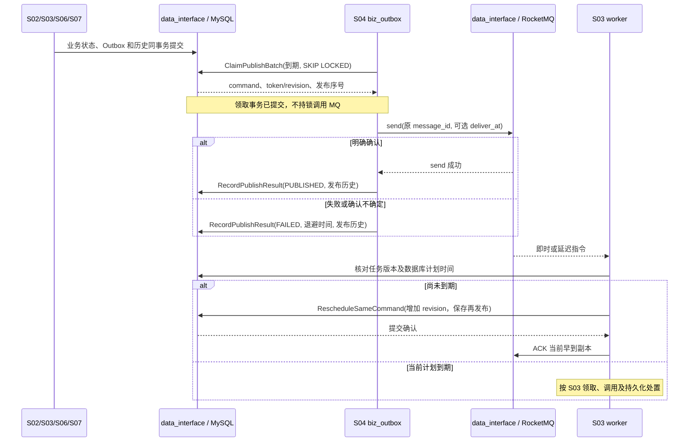

# S04 可靠指令传递

| 项目 | 内容 |
| --- | --- |
| 版本 / 状态 | v0.2 / 待实施 |
| 依据 | [技术方案](../TECH_DESIGN.md)第 8、9、11 节 |
| 依赖 | [S00](00-shared-contracts.md)；S02、S03、S06、S07 在业务事务中建立指令 |
| 建议代码 | `internal/biz/biz_outbox` 经 `internal/data_interface` 编排；`internal/data/rocketmq` 和 `internal/data/mysql` 实现消息收发与发布领取 |

## 1. 目标与范围

将 MySQL 中已持久化的任务计划可靠交给 RocketMQ，允许重复发布和消费，通过稳定消息标识与任务状态去重。Outbox 发布失败不能丢失任务，也不能消耗业务尝试预算。

本模块不解释供应商结果、不负责业务重试决策、不承诺外部 HTTP 恰好一次；首版不并行维护另一套事务消息协议。

## 2. 指令契约

首版消息体：

```json
{
  "protocol_version": 1,
  "outbox_id": "3001",
  "message_id": "delivery-2001-round-1-schedule-1",
  "event_id": "1001",
  "delivery_id": "2001",
  "round_no": 1,
  "schedule_version": 1
}
```

- `message_id` 是应用稳定键，不依赖 Broker 分配的物理消息 ID。示例命名可替换，但存储后必须稳定且唯一。
- 消息不含业务载荷、目标 URL、认证 Header、Token 或签名。消费者按任务读取固定载荷。
- `outbox_id` 与 `message_id` 都必须匹配数据库实体；所有关联 ID、轮次及调度版本一致才可执行。
- MySQL 中唯一约束为 `(delivery_id, round_no, schedule_version)`，同时保证 `message_id` 唯一。
- 消息协议升级显式增加版本；未知版本不能当作首版解释。

## 3. Outbox 创建与发布

### MQ-O01：指令原子创建

首次指令由 S02 的受理事务创建；后续计划由 S03/S06/S07 的业务事务创建。不能先提交任务计划再异步补写正常路径的 Outbox。

Outbox 保存计划时间、即时/延迟类型、发布状态、发布次数、下次发布时间、领取 token/期限及最近错误。`FAILED` 表示本次发布失败且仍可重试，不等于业务任务失败。

### MQ-O02：短事务领取

发布器分批领取发布到期且无有效领取者的记录，通过 MySQL 条件更新和 `FOR UPDATE SKIP LOCKED` 协调。领取保存新 token 和期限，提交后调用 MQ。

查询同时考虑 `next_publish_at` 和领取过期时间，并配置相应索引。延迟消息可在执行时间之前发布，不能简单按 `scheduled_at <= now` 过滤而丢失 Broker 延迟能力。

领取事务不锁任务，不在持锁期间调用 MQ。并行发布受限，过期领取可重新领取。

### MQ-O03：记录发布结果

- 每次准备调用 MQ send 时先在领取事务中持久化增加发布计数，计数表示已经分配的发布尝试，与业务尝试计数分开；发送前崩溃也保守计入，不能用计数证明 Broker 已收到。
- 发送确认成功后，校验 Outbox 领取 token/期限，在一个短事务中更新发布结果并追加任务发布历史；按 S00 锁顺序先锁任务再锁 Outbox。
- send 失败或确认不确定时按原 `message_id` 退避重发，保存错误与 `next_publish_at`。
- 记录发布结果失败时保留可恢复状态，不假设没有发送过。
- 旧发布者的迟到成功/失败不能覆盖新领取者；可追加独立的迟到发布证据，不改变新处置。
- 发布器发现计划已过时可以记录取消该发布处置；即使竞争导致旧消息已发出，仍由 S03 检查阻止执行。

退避及最大单次调用时间有界。MQ 长期不可用时保留未发布记录并告警，不能因发布次数过多删除任务。发布错误摘要按白名单脱敏。

## 4. 即时、延迟与过早指令

### MQ-D01：以数据库时间为准

即时与延迟指令使用对应消息类型的 Topic；部署显式初始化 Topic、消费者组和 DLQ 相关策略，并验证 Broker/Proxy/SDK 的能力组合。

计划时间在 Broker 支持的延迟范围内时，设置延迟投递时间。超出范围时保留原 Outbox，安排在进入支持窗口后再发布，不截断成过早业务执行。范围与最大时钟误差应在批次 0 验证并记录。

### MQ-D02：过早到达

消费者发现当前有效指令仍未到期时，通过短事务重新检查任务和计划，将**同一 Outbox** 安排到 `scheduled_at` 或可用的延迟发布窗口后再次发布，并写等待历史。事务提交后才 ACK 当前提前到达的指令。

不创建新 `message_id`，不增加 `schedule_version` 或业务尝试。与发布器竞争时通过 token/版本条件更新保证不会丢失再次发布安排；无法确认保存则不 ACK。

## 5. 消费边界与异常消息

RocketMQ 包装层提供有界 receive、ACK 及按需调整不可见期限的能力，不隐藏业务重试。S03 决定何时 ACK，本模块暴露真实调用结果。

| 消息情况 | 处置 |
| --- | --- |
| 已完成任务、旧轮次或旧版本 | 读取有效持久化状态后可 ACK，不发业务请求 |
| 任务有有效当前处理者 | 不重复执行，按 S03 处理重复指令 |
| MySQL 不可用 | 不 ACK，等待重投或恢复 |
| 非法格式、未知协议版本、关联关系不符 | 不执行；记录脱敏错误及指标，按 Broker 配置进入 DLQ/隔离流程 |
| 缺失任务或 Outbox | 区分保留期内数据损坏与已协调清理；无法确认来源时不盲目 ACK |
| 超过自动消费限制进入 DLQ | 交 S06 依据当前任务修复，不直接逐条重放 HTTP |

毒消息不能导致进程崩溃或无日志丢弃。若实现隔离后 ACK，必须先有持久化隔离记录及受控处置协议；首版默认使用有限 Broker 重投和 DLQ，不额外引入此分支。

## 6. 恢复与生命周期

S06 可请求恢复发布、在宽限后重发原指令或补建确实缺失的当前指令。现有唯一键限制重复指令实体；每次补发保存修复历史与冷却依据。

停止时先停止领取新 Outbox，给已有发布调用有界排空时间。未确定的发布不删除，领取到期后可恢复。消费者停止拉取后，是否 ACK 仍取决于 S03 已持久化处置。

## 7. 消息参数、发布状态和存储字段

DeliveryCommand 仅允许第 2 节的 7 个字段，均必填；ID、轮次和版本遵循 S00，`protocol_version=1`。消息 UTF-8 编码最多 4096 字节，拒绝重复键/未知字段/尾随 JSON。Broker 物理消息 ID 只作诊断，不参与应用去重；应用 `message_id` 为 `o1_<outbox_id>`，在创建 Outbox 的事务内分配并持久化。第 2 节长命名仅为语义示意，实现统一采用此格式。

| 发布状态 | 含义 | 可执行动作 |
| --- | --- | --- |
| PENDING | 初次或同指令再次待发布 | 到 next_publish_at 且无有效领取时领取 |
| PUBLISHING | 已分配一次发布尝试 | token、revision 和期限匹配者可记录结果；过期可重新领取 |
| PUBLISHED | Broker send 已明确成功 | 保留记录；S06 或早到消费可安排同消息再次发布 |
| FAILED | 本次失败或确认不确定 | 到 next_publish_at 重试；不删除 |
| CANCELLED | 任务已完成或该轮次/调度已失效 | 不再发布，已有 Broker 副本由 S03 判过时 |

补充持久化 `publish_revision`（初始 1）、`last_publish_started_at`、`last_published_at`、`repair_count`（初始 0）、`last_repair_at`、`next_repair_at`。每次领取、恢复发布资格或安排同消息再发布时增加 publish_revision；领取 token 和 revision 共同校验。发布计数在领取事务增加，产生稳定 `publish_attempt = (outbox_id, publish_count)`，与 task 的 schedule_version 无关。

PUBLISHED 不代表任务被消费，CANCELLED 也不撤销已经发出的消息。新业务计划插入新的 Outbox；早到消费和修复则把原 Outbox 置 PENDING，安排 next_publish_at、增加 revision 并清理旧发布领取。旧发布者返回时因 token/revision 不匹配只能追加迟到证据，不得将 PENDING 覆盖成 PUBLISHED。任务历史写入键包含 outbox_id、publish_count 和结果阶段；同一发布结果事务重试不产生重复历史。

发布索引至少为 `(publish_status, next_publish_at, outbox_id)`、`(publish_status, lease_expires_at, outbox_id)`；以不同查询分支分别领取，避免用无索引 OR 扫描。取消判断和结果事务按 S00 先锁任务、后锁 Outbox；单独领取阶段仅锁 Outbox。重发原消息也必须保留首次/最近发布和修复依据。

## 8. 运行参数和发布流程

| 参数 | 默认 | 范围 / 规则 |
| --- | --- | --- |
| `OUTBOX_POLL_INTERVAL` | 1 秒 | 100 毫秒～10 秒；有积压时继续有界批处理 |
| `OUTBOX_BATCH_SIZE` | 100 | 1～500；实际领取数为此值与发布空闲槽位数的较小值 |
| `OUTBOX_PARALLELISM` | 4 | 1～32；不能提前领取大量未开始发送的行 |
| `OUTBOX_SEND_TIMEOUT` | 3 秒 | 100 毫秒～10 秒 |
| `OUTBOX_LEASE_TIMEOUT` | 15 秒 | 5～120 秒；必须大于 SEND_TIMEOUT + MYSQL_OPERATION_TIMEOUT + 5 秒 |
| `OUTBOX_BACKOFF_INITIAL / OUTBOX_BACKOFF_CAP` | 1 秒 / 1 分钟 | 初始 100 毫秒～10 秒，上限初始值～10 分钟，50%～100% 抖动 |
| `ROCKETMQ_MAX_DELIVERY_ATTEMPTS` | 16 | Broker/组配置目标值 2～64，初始化时核验；不是业务 max_attempts |
| `ROCKETMQ_MAX_DELAY` | 本地目标 24 小时 | 正数，必须按实际 Broker/Proxy 验证；不兼容则阻止后台发布就绪 |
| `ROCKETMQ_CLOCK_SAFETY` | 1 秒 | 0～5 秒；设置延迟窗口和监控时钟差，实际执行仍以数据库时间为准 |

部署沿用已有 `ROCKETMQ_ENDPOINT / ROCKETMQ_TOPIC_IMMEDIATE / ROCKETMQ_TOPIC_DELAYED / ROCKETMQ_GROUP`；Topic 类型显式固定为即时与延迟。一个逻辑任务消费者处理两类 Topic，不为每个供应商新建消费者组。应用启动只验证，不自动创建或重置 Topic/DLQ。

| 端口 | 输入 | 返回与副作用 |
| --- | --- | --- |
| `ClaimPublishBatch` | limit、lease duration | 已领取记录及 token/revision/发布序号；短事务内完成 |
| `SendDeliveryCommand` | 不可变消息、Topic、可选 deliver_at | 明确成功或不确定/失败；任何隐藏 SDK 重试仍须使用同一消息键并受调用总预算限制 |
| `RecordPublishResult` | outbox_id、token/revision、publish_count、结果/错误 | 任务发布历史与 Outbox 同事务，失去所有权不覆盖 |
| `RescheduleSameCommand` | 当前任务版本、outbox_id、期望 revision、not_before、原因 | 原 Outbox 再发布及等待/修复历史；不创建新 message_id |
| `Receive / Ack / ChangeInvisible` | 空闲数量、接收预算 / receipt | 有界结果和真实错误；receipt 由入口短期持有 |

首次建 Outbox 或安排再发布时即计算 next_publish_at；发布器在分配发布尝试前复核延迟窗口。若计划已到期，发即时 Topic；否则在 Broker 支持窗口内发延迟 Topic。过远的计划留在 PENDING，设置 `next_publish_at = scheduled_at - max_delay + clock_safety`，此时不创建发布尝试、不增加 publish_count。下一轮进入窗口时才领取和 send。

已领取后检查出计划失效则原子取消；在检查后计划才变化的竞争允许旧消息到达，消费者必须挡住。send 报成功但保存结果失败时，不补写虚假 FAILED，保留 PUBLISHING 直到原领取过期后按原键恢复。发布退避计数只影响发布节奏，不耗尽持久化消息的生命周期。

早到指令执行 RescheduleSameCommand 时必须锁任务和 Outbox：确认仍是当前计划、尚未到期且无有效任务领取，作废旧发布领取，安排到延迟窗口，追加 WAIT_PLANNED 历史。若发现任务已推进，直接按过时消息处置；若任务已到期，不再安排未来发布，交 S03 当前指令执行路径。

## 9. 模块依赖序列图



## 10. 实现任务

- [ ] 固定消息 JSON、协议版本、关联校验和应用消息键。
- [ ] 实现 Outbox 插入辅助逻辑，供完整业务事务使用，不自行独立提交。
- [ ] 实现并发领取、send、结果事务、稳定键重试与迟到保护。
- [ ] 实现即时/延迟 Topic、Broker 时间范围适配及过早指令再发布。
- [ ] 实现 SimpleConsumer 包装、ACK 错误暴露及有界不可见续期。
- [ ] 接入发布积压、最老年龄、消费错误和 DLQ 指标。

## 11. 验收场景

| 编号 | Given / When | Then |
| --- | --- | --- |
| MQ-01 | 事件事务提交后进程立即退出 | 重启后首次 Outbox 继续发布，计划不丢失 |
| MQ-02 | Broker 接收但 send 确认丢失 | 以原消息标识重发，数据库不新增同版本 Outbox |
| MQ-03 | 两个发布器并发、其中一个领取后退出 | 正常时只由当前领取者推进；过期后可恢复发布 |
| MQ-04 | 旧发布者迟到结果返回 | 不覆盖新领取者状态，迟到证据可定位 |
| MQ-05 | Broker 停机多次发布失败 | 发布计数增加，业务尝试数不变，记录与告警保留 |
| MQ-06 | 延迟消息正常、过早到达或超出 Broker 范围 | 都不提前发业务请求，且最终计划仍可恢复 |
| MQ-07 | 尝试结果已提交，ACK 失败造成消费重投 | S03 不再执行 HTTP，完成安全 ACK |
| MQ-08 | 消息含错误关联 ID 或未知协议版本 | 不执行供应商调用，错误进入可见的重投/DLQ 流程 |
| MQ-09 | 同一调度被多次补发 | `message_id` 和 Outbox 不变，发布历史及冷却信息存在 |
| MQ-10 | 消费者安排原 Outbox 再发布时，旧发布者成功返回 | 新 publish_revision 保留，旧结果不覆盖 PENDING 或其 next_publish_at |
| MQ-11 | 计划时间超出 Broker 延迟范围 | 进入支持窗口前不领取发送、不增加 publish_count，进入窗口后按原消息键发送 |
| MQ-12 | Broker send 成功但保存发布结果失败 | 原记录可在领取过期后恢复，保留不确定发布证据，业务尝试数不变 |

## 12. 完成标准

在真实 RocketMQ 和 MySQL 上验证发送确认丢失、重复、延迟、过早到达与过期领取。记录经过验证的版本和 Topic 初始化方式；只用假的队列不能完成本 spec 验收。
