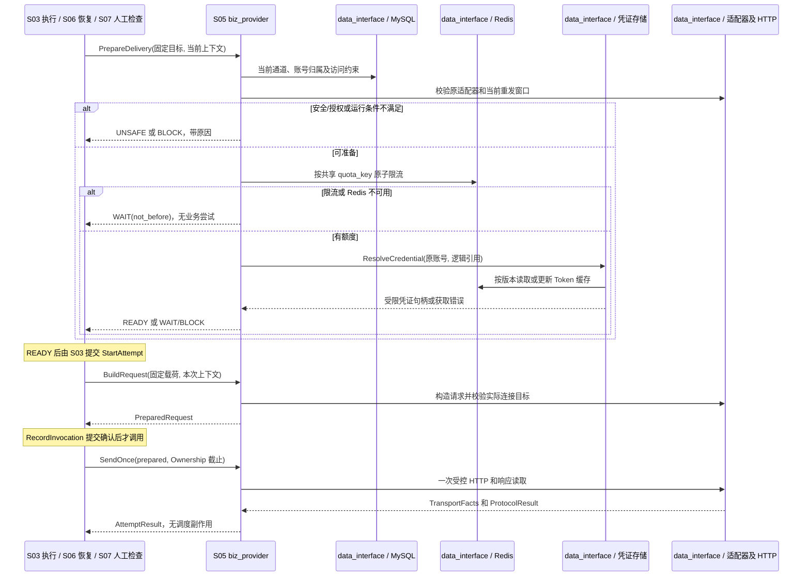

# S05 供应商执行边界

| 项目 | 内容 |
| --- | --- |
| 版本 / 状态 | v0.2 / 待实施 |
| 依据 | [技术方案](../TECH_DESIGN.md)第 6、7、10、11 节 |
| 依赖 | [S00](00-shared-contracts.md)；读取 S01 固定目标语义 |
| 使用方 | S01 发布校验、S03 执行、S06 恢复、S07 重投检查 |
| 建议代码 | `internal/biz/biz_provider` 经 `internal/data_interface` 编排；协议与凭证实现在 `internal/data/provider`，缓存与限流实现在 `internal/data/redis` |

## 1. 目标与范围

把固定任务业务载荷与当前有效发送上下文转换为一次受控供应商调用，并输出标准结果。模块解释供应商协议、凭证和运行约束，不拥有任务重试调度或任务状态写入权。

首版仅接入明确注册的适配器。异步任务编号可作为供应商接收依据保存；跨供应商通用业务完成轮询、回调验签和流程编排不在首版范围。

## 2. 适配器契约

### PRV-A01：注册与本地校验

适配器以 `(adapter_type, adapter_version)` 注册，同一版本必须保持声明的协议语义。启动时拒绝重复注册；原任务引用的版本缺失时报告阻塞，不能选择最新版本代替。

适配器元数据至少声明：支持操作、载荷校验约束、鉴权类型、请求与响应格式、接收判定规则、幂等能力、供应商等待规则及摘要字段白名单。

### PRV-A02：最小操作边界

| 操作 | 输入 | 输出 / 限制 |
| --- | --- | --- |
| `ValidateTarget` | 固定目标配置、操作及凭证引用元数据 | 发布期静态校验；不发网络请求 |
| `ValidatePayload` | 已映射业务载荷及固定语义 | 确定性本地校验；不生成动态业务字段 |
| `BuildRequest` | 固定载荷/语义、稳定业务幂等键、有效凭证、本次上下文 | 结构化 HTTP 请求与允许记录的摘要；不自行发送 |
| `InterpretResponse` | HTTP 状态、受限响应体及传输事实 | S00 标准结果、供应商编号/业务码、等待建议与证据范围 |
| `DescribeReplaySafety` | 固定协议能力及当前时间、历史尝试依据 | 安全重发判断材料；最终状态与计划仍由 S03 决定 |

本次上下文包含 `event_id / delivery_id / attempt_id`、原事件时间、本次发送/签名时间、截止时间和 trace。适配器不获得可以任意推进任务状态的存储接口。

### PRV-A03：统一协议结果

至少返回 `outcome`、`result_certainty`、`retryable`、稳定 `error_code`、脱敏原因、HTTP 状态、业务码、供应商请求/受理编号、等待建议及覆盖哪些未决结果的证据。

- HTTP 200 不自动等于接收；按业务码或协议字段判断。
- 429、5xx 或鉴权错误也不一律等于未接收，按供应商协议判断。
- 网络超时、连接中断或响应读取失败无法证明未接收时返回 `UNCERTAIN`。
- 本地构造失败且能够证明未发出时返回 `LOCAL_FAILURE / NOT_RECEIVED`。
- 协议声明异步任务已受理时可返回 `RECEIVED` 并保存编号；等待其业务完成期间不得重复创建外部任务。

## 3. 固定语义与动态信息

固定语义来自任务或不可变发布：供应商、账号、操作、接口业务版本、映射载荷、业务幂等键及语义相关目标参数。

动态信息来自本次上下文：有效 Token、签名时间、发送时间及协议要求的随机值。不能把上一次完整请求作为重放依据，也不能用本次时间覆盖事件发生时间。

目标地址的语义部分取原配置，当前安全允许范围另行检查。若原地址不再允许，阻塞旧任务，不静默改为新地址或其他供应商账号。

## 4. 凭证生命周期

### PRV-C01：引用与缓存

任务保存逻辑凭证引用与账号归属，事件和 MQ 不保存动态秘密。长期凭证放入受保护存储或秘密配置；普通查询和配置接口只展示引用及脱敏元数据。

Access Token 缓存键至少包含供应商、账号、授权范围和凭证版本，TTL 留出失效余量。轮换或撤销后旧版本缓存不可继续使用。

### PRV-C02：有界获取与刷新

凭证准备在创建业务尝试前执行，使用独立超时和有界获取/刷新预算。获取失败交 S03 保存等待或阻塞，不消耗业务尝试次数。

同账号并发获取尽量合并；涉及 Refresh Token 轮换时必须通过受保护的持久化版本/CAS 或等价持久协调，Redis 锁只做减压。只有刷新结果及新版本持久化确认后才发布到缓存。

刷新提交结果不确定先读取持久化版本；供应商可能已轮换而本地没有新凭证时，不能盲目沿用旧 Refresh Token，进入可见凭证异常处置。未接入 OAuth 的供应商无需预建 OAuth 流程，但接入时必须满足这些条件。

### PRV-C03：业务请求鉴权失败

已经发出的业务请求计为一次尝试。适配器或凭证模块不能在收到 401 后隐式刷新并重发同一尝试；应保存本次结果，再由公共流程安排下一次尝试。

## 5. 当前通道约束与限流

### PRV-L01：当前约束

每次执行核对通道启停、账号归属、调用方权限、目标许可和适配器可用性。当前限制以 MySQL/受保护配置为准，不因运行参数缓存过期而越权发送。

首版通道接口为 `GET /v1/channels`、`GET /v1/channels/{id}`、`POST /v1/channels` 和 `PATCH /v1/channels/{id}`。管理修改携带操作幂等键、原因与期望通道版本，原子保存变更及管理审计；现有迁移需补充版本依据。

禁用与运行限制可更新；既有账号归属和操作语义不能通过修改可变通道重新解释旧任务。新增不同账号/操作时创建适当的新实体并发布新配置。同账号不同操作不能被唯一约束误合并。

### PRV-L02：分布式限流

以通道或供应商实际共享额度范围定义限流 key，使用 Redis 原子令牌桶或等价算法；同账号多个通道共享供应商额度时不能各自获得完整额度。

不满足限流返回最早可再检查时间，由 S03 保存等待计划。限流通过后任务 CAS 失败允许浪费本次额度，不能因此绕过下一次限流或产生额外业务请求。

Redis 限流不可用时暂停相关新投递，保存有界等待，不退化为无限放行。配置缓存故障可回源；凭证缓存故障按协议获取；不同用途分别降级。

## 6. 受控 HTTP 传输

### PRV-H01：请求约束

- 只接收注册适配器生成且通过当前目标许可检查的请求；业务方不能直接传任意 URL。
- URL scheme、主机、端口及解析后的目标地址受部署策略约束，禁止访问未授权的本地、私有或元数据地址；本地模拟供应商仅在测试环境显式许可。
- 检查覆盖实际连接目标，防止只校验字符串而连接到未授权地址；代理也必须显式配置并受同一策略控制。
- 正常供应商接入校验 TLS，不跳过证书验证；关闭自动重定向。
- HTTP 客户端、传输层和适配器均不得隐式重复业务请求；实现时验证底层连接重试行为满足一次尝试一次调用契约。
- 请求构造、连接、TLS、响应头、响应读取和总执行均受有界上下文及大小限制。

### PRV-H02：响应与摘要

响应读取另设字节上限，与 2 KiB 摘要上限分别配置。超限即停止读取、关闭响应并记录实际已读字节数和协议错误；不能为记录追踪无限读取。

请求/响应/错误摘要按供应商白名单提取，默认各最多 2 KiB，UTF-8 安全截断并标记。认证 Header、Token、签名、Refresh Token 和无关个人信息不能进入持久化摘要或日志。

未收到响应时状态码和响应摘要为空；收到响应头后读取失败仍保留状态码。响应不完整且不能证明接收或拒绝时维持不确定，不将读取失败简单归类为永久拒绝。

## 7. 幂等能力与重发窗口

每个协议声明：是否支持幂等、键所在字段、参数一致性要求、去重窗口、窗口起算依据、重复调用返回语义，以及不确定结果的允许处置。

S03/S06/S07 必须能用这些声明和历史时间判断当前是否安全；窗口起算无法确定时保守判断，不以最近一次尝试重新延长窗口。本地记录保留 30 天不代表供应商去重 30 天。

业务幂等键沿用 `delivery_id` 对应的稳定值，自动重试和新轮次不更换。参数必须保持一致；若协议把动态签名字段排除在业务参数一致性之外，适配器显式表达该约定。

## 8. 通道与协议参数

| 字段 | 类型 / 必填 | 首版规则 |
| --- | --- | --- |
| `channel_id / row_version` | ID / 整数，服务端返回 | 创建后 ID 不变，row_version 初始 1，每次实际变更加 1 |
| `provider_id / provider_account_id / operation` | S00 标识，必填 | 账号和业务操作归属不可编辑；新归属新建通道 |
| `adapter_type / adapter_version` | S00 标识，必填 | 创建时必须注册；变更协议需新通道及新发布，不重解释旧任务 |
| `credential_ref` | 1～191 字节 UTF-8，必填 | 逻辑引用，不含秘密；绑定相同 provider/account，不允许 PATCH 换至其他逻辑引用 |
| `enabled` | 布尔 | 创建默认 false，完成目标许可/凭证/额度配置后显式启用 |
| `access_constraints.allowed_callers` | 调用方 ID 数组，必填 | 非空，最多 100 项；不支持全局通配符 |
| `access_constraints.allowed_origins` | `{scheme, host, port}` 数组 | 非空；主机规范成 ASCII 域名，精确匹配，不允许用户信息及 URL fragment |
| `access_constraints.allowed_cidrs` | CIDR 数组 | 与 origin 同时满足；生产默认拒绝本地/私有/链路本地及元数据地址，测试例外须显式列出 |
| `runtime_policy.quota_key` | 1～128 位 ASCII 标识，必填 | 供应商账号实际共享额度的逻辑键；同额度必须同 key |
| `runtime_policy.rate_per_second / burst` | 正整数，必填 | 1～10000 / 1～10000；无额度配置的通道不能启用 |
| `runtime_policy.rate_policy_version` | 正整数，服务端分配 | 同 quota_key 的通道必须使用相同额度参数和策略版本 |
| `semantic_config.base_url / path` | URL / 路径，必填 | 原地址冻结在发布；path 以 `/` 开头且不含认证查询参数 |
| `semantic_config.auth_type` | `bearer / hmac_sha256 / none` | 由适配器版本声明支持；none 仅测试通道许可 |
| `semantic_config.idempotency` | 对象，必填 | `{mode:"key"或"none", window_seconds, starts_at:"first_possible_send"}`；key 模式有效期 1～604800 秒 |

幂等声明是所接协议经验证的能力，不能由业务调用方自由填写。S01 必须调用该版本适配器元数据校验声明；声明超出实现支持范围则发布失败。窗口起点取全部未决尝试可能首次发送的最早时间；崩溃无法还原时保守取对应 `started_at`。安全条件为当前时间加本次请求最大预算严格小于窗口终点，禁止在刚好过期边界发出新请求。

## 9. 通道管理接口和凭证契约

| 接口 | 参数 | 成功 / 错误 |
| --- | --- | --- |
| `POST /v1/channels` | 操作键、原因、第 8 节创建字段 | 201 `{operation_id, channel}`；同 provider/account/operation/adapter_type 重复为 409 `channel_conflict` |
| `PATCH /v1/channels/{id}` | 操作键、原因、expected_row_version；enabled/access_constraints/runtime_policy 至少一项 | 200 `{operation_id, channel}`；禁止 JSON Merge Patch 的隐式 null 删除，未知/不可变字段 400 |
| `GET /v1/channels/{id}` | 路径 ID | 200 脱敏通道、row_version、凭证状态及更新时间，无 Token |
| `GET /v1/channels` | provider_id、provider_account_id、enabled、page_size、cursor | S08 同类稳定游标，按 channel_id 倒序；管理权限限定范围 |

通道管理操作使用全局 caller_scope `__global__`，类型 `channel_create / channel_update`，要求 `channels:manage` 及受影响调用方范围；幂等先于新操作 CAS。禁用时不逐个改写所有任务，由 S03 当前检查和 S06 阻塞恢复处理。共享 quota_key 的额度变更必须在一个管理事务中更新全部关联通道并递增各自版本；受影响通道超过 100 个则拒绝变更并要求拆分额度组，不能让同一 key 并存两个策略。

凭证端口 `ResolveCredential(ref, provider_account_id, scopes)` 返回短期 `CredentialHandle{version, expires_at, account, opaque_handle}`，只由 `data/provider` 解引用为秘密。业务用例只判断账号/有效时间，不接收原始 Token。逻辑 ref 不变的密钥轮换更新凭证版本并保持相同账号归属；撤销后立即拒绝旧版本获取，不等待缓存 TTL。

Access Token key 为 `notifier:token:v1:<provider>:<account>:<scope_sha256>:<credential_version>`，缓存有效期 `expires_at - now - skew`，非正数则不可用。获取返回的 Token 剩余寿命必须覆盖 HTTP_TIMEOUT + 失效余量。获取失败分 `TEMPORARY`（保存 WAIT）、`REVOKED / ACCOUNT_MISMATCH`（BLOCK）和无法安全轮换（BLOCK 并告警）。凭证获取/刷新失败不能制造业务尝试。

需要 Refresh Token 的接入在受保护存储中维护 `{credential_ref, account, version, state, refresh_owner, refresh_deadline}`。先以持久 CAS 进入 REFRESHING，调用供应商后持久化新版本和 Token，再置 ACTIVE 并写缓存。刷新窗口中进程崩溃或响应丢失时，依协议判断能否重取；无法证明旧 Refresh Token 仍有效时置 REAUTH_REQUIRED，禁止第二个实例盲目刷新。短期 Redis 锁只减少等待，不承担上述状态机正确性。

## 10. 限流、执行返回值和运行参数

令牌桶 key 为 `notifier:quota:v1:<quota_key>`，状态含 `tokens / last_refill_ms / policy_version`，用 Redis 服务器时间和单次原子脚本计算。`tokens = min(burst, tokens + elapsed_ms × rate_per_second / 1000)`；至少 1 才扣 1，否则返回凑足一个令牌的最早时间。实现使用有界定点数，不让时钟回退产生额度；策略版本不匹配先从 MySQL确认新策略再原子重建桶，不增加旧版本容量。空闲 TTL 为 `max(60秒, 2 × burst/rate)`。同一 quota_key 不能把重建操作当成每次请求的额外 burst。

| 输出结构 | 必需字段 | 调用规则 |
| --- | --- | --- |
| `PrepareResult` | `READY / WAIT / BLOCK / UNSAFE`、reason_code | WAIT 必含 not_before；BLOCK 必含稳定阻塞原因；UNSAFE 交 S03 UNKNOWN |
| READY 附件 | credential_handle、channel_row_version、credential_version、safety_basis、safe_until、证据覆盖、manual_authorization_operation_id | 均与原任务账号匹配；真正发出前重查有效性 |
| `PreparedRequest` | method、经过校验的地址、body bytes、脱敏摘要、request_size_bytes | 不存整包；原 body 用后释放，不能作为重试依据 |
| `TransportFacts` | 是否进入 HTTP、状态/时间/已读字节、读取完整性、传输错误 | 连接错误不凭错误文本猜测“对方未收到” |
| `ProtocolResult` | S00 outcome/certainty、retryable、错误、provider_code/request_id、wait_until、evidence_scope | 不含下一任务状态，不执行自动重试 |

safety_basis 为 `NOT_NEEDED / PROVIDER_IDEMPOTENCY / MANUAL_FIRST_ATTEMPT`。没有未决结果时为 NOT_NEEDED；供应商幂等依据必须返回 safe_until。人工风险重投由 S03 传入已校验的本轮未使用操作授权，PrepareDelivery 可据此返回 MANUAL_FIRST_ATTEMPT，不把供应商不支持幂等单独判为 UNSAFE；safe_until 此时为空，operation_id 必填，StartAttempt 再原子核验并消耗授权。只有两类依据都不成立且存在未决结果时才返回 UNSAFE。S06 过期恢复不能传入已被原尝试消耗的授权。

| 参数 | 默认 | 范围 / 关系 |
| --- | --- | --- |
| `PROVIDER_CREDENTIAL_TIMEOUT` | 5 秒 | 100 毫秒～10 秒；整个准备阶段最多一次获取及一次协议允许的刷新 |
| `PROVIDER_TOKEN_EXPIRY_SKEW` | 30 秒 | 5～300 秒；短期 Token 不足覆盖请求则 WAIT |
| `PROVIDER_DIAL_TIMEOUT / PROVIDER_TLS_TIMEOUT / PROVIDER_HEADER_TIMEOUT` | 2 / 3 / 5 秒 | 各不少于 100 毫秒且不超过 HTTP 总预算 |
| `PROVIDER_MAX_RESPONSE_BYTES` | 1 MiB | 4 KiB～8 MiB；最多读取上限加 1 字节来判超限 |
| `PROVIDER_MAX_REQUEST_BYTES` | 256 KiB | 1 KiB～1 MiB；构造超限为 NOT_SENT 本地失败 |
| `PROVIDER_MAX_IDLE_CONNECTIONS` | 100 | 1～1000；每主机上限不超过执行并行数 |
| `PROVIDER_IDLE_TIMEOUT` | 90 秒 | 10～300 秒 |

HTTP response body 读取超限使用 `RESPONSE_TOO_LARGE`，读取失败使用 `RESPONSE_READ_ERROR`，非法 JSON 或缺必需接收字段使用 `PROTOCOL_INVALID_RESPONSE`；网络超时在协议解释后仍保留 `HTTP_TIMEOUT`。这些错误按实际证据判断不确定性，不会因 2xx 就成功。共享限流器不可用使用 `RATE_LIMITER_UNAVAILABLE`，与额度不足的 `RATE_LIMIT_WAIT` 区分。分类和标准消息见 [错误码体系](09-error-codes.md)。Retry-After 支持非负十进制秒数或 HTTP 日期，依据响应接收时刻换算，计划时间最终按数据库 UTC 复核，过去值按当前时间；超过策略允许上限时保存原建议并 BLOCK 到有界检查或本轮截止，不能截断后提前违反供应商强制等待。响应超限读取第 N+1 字节时，实际已读计 N+1，摘要另按白名单截断。

## 11. 首版模拟协议和故障注入

必须交付 `mock-json@1` 适配器，支持配置中的 operation，业务请求为 `POST <base_url><path>`、`Content-Type: application/json`、`Idempotency-Key: <任务稳定键>`；body 为固定映射载荷，不额外插入当前时间。bearer 从句柄生成 Authorization；hmac 模式使用凭证密钥对 timestamp、method、path、body_sha256 四项按顺序以单个 LF 字节分隔后的 UTF-8 字节做 HMAC-SHA256，写 `X-Signature-Time`（UTC Unix 秒）和 `X-Signature`（小写十六进制），每次请求重新生成。

响应格式 `{accepted:boolean, code:string, request_id:string}`：2xx 且 accepted=true 为 RECEIVED；code=`TEMPORARY` 明确拒绝可重试；code=`PERMANENT` 明确拒绝不可重试；其余缺失/冲突字段为不确定。429 只有 code=TEMPORARY 才能证明未接收；5xx 无有效协议体默认不确定。测试接收端需独立持久化稳定键、body hash、实际收到次数及业务执行次数：相同键同 body 返回原 request_id，相同键不同 body 返回 409，去重窗口过期后允许模拟重复执行。

测试控制面限定测试网络，提供 `PUT /__test/scenarios/{name}` 和 `GET /__test/receipts?idempotency_key=...`。PUT 参数为 `{operation, window_seconds, repeat_last, steps}`，steps 为非空数组，每项包含 `http_status`（200～599）、`accepted`、`code`、`delay_ms`（0～120000）、`disconnect_after_accept`、`body_bytes`（0～8 MiB）、`extra_fields`；repeat_last 默认 true，步骤按实际收到请求的次数推进，false 时序列耗尽后使用正常成功响应。delay 默认 0，disconnect 默认 false，body_bytes=0 使用正常协议 JSON，大于 0 用于生成超长响应；extra_fields 用于注入已知敏感值检验白名单。更新场景不清空已有接收/执行记录。

GET 返回 `{idempotency_key, received_count, executed_count, body_sha256, request_id, first_received_at, last_received_at}`，未知键为 404。场景选择由测试环境的目标路径绑定，不让正常业务调用方注入 HTTP 故障 Header。测试端的状态放在独立持久卷，与通知服务数据库分离；容器/服务重启后能核对响应丢失造成的实际接收。

## 12. 模块依赖序列图

## 13. 实现任务

- [ ] 固定适配器元数据、注册、载荷校验、构造和结果接口。
- [ ] 实现模拟供应商适配器，覆盖成功、业务拒绝、限流、超时和响应丢失。
- [ ] 实现凭证引用、账号归属、缓存隔离及按实际接入需要的刷新持久化。
- [ ] 实现通道当前约束、管理版本及审计、Redis 原子限流和用途分别降级。
- [ ] 实现受控传输、单次调用、目标检查、截止时间、响应上限和摘要脱敏。
- [ ] 为每个接入供应商保存幂等与未知结果处置说明，并提供协议验证样例。

## 14. 验收场景

| 编号 | Given / When | Then |
| --- | --- | --- |
| PRV-01 | HTTP 200 但业务码拒绝 | 返回标准拒绝结果，不误报接收 |
| PRV-02 | 延迟重试时旧 Token/签名已经过期 | 重新取得凭证并签名，原事件时间、载荷和业务幂等键不变 |
| PRV-03 | 业务请求收到鉴权失败 | 本次尝试保存；无隐式刷新后业务重发 |
| PRV-04 | 同账号并发刷新并发生 Refresh Token 轮换 | 持久化版本一致，旧刷新结果不覆盖新值，不泄露秘密 |
| PRV-05 | Redis 重启或限流脚本失败 | 配置可回源，凭证按协议处理，限流故障不无限放行 |
| PRV-06 | 通道禁用、权限撤销、旧适配器缺失或原目标不再允许 | 返回明确阻塞，不换版本、账号或地址发送 |
| PRV-07 | 供应商已执行但响应连接断开 | 返回不确定，附重发安全依据，不直接认定失败 |
| PRV-08 | 响应含凭证、个人信息或超过读取/摘要上限 | 不泄露敏感值，有界读取，截断与错误可查询 |
| PRV-09 | 返回重定向或底层连接异常 | 不自动跟随或隐式重复业务请求 |
| PRV-10 | 同一任务跨轮次重投，供应商去重窗口已过 | 不误判安全重发，交 S07 按权限与风险处理 |
| PRV-11 | 同账号不同操作共享同 quota_key 并发执行 | 总通过量服从一个令牌桶；不同通道不能各取完整额度，策略版本变化不额外补满桶 |
| PRV-12 | 安全窗口剩余时间不足覆盖本次 HTTP 预算 | 返回 UNSAFE，不因当前时刻尚未过期就继续发送 |
| PRV-13 | 原通道引用未变但凭证轮换或撤销 | 新版本凭证保持原账号；旧缓存不可继续用，撤销转可见阻塞 |
| PRV-14 | 模拟供应商按同键同 body 重复收到，或接受后断连 | 真实接收次数可增加而业务执行仅一次；记录可跨进程重启核对 |

## 15. 完成标准

适配器与公共状态流程解耦；每个接入协议有接收判定、幂等及不确定结果说明；模拟供应商和真实 Redis 可证明调用次数、限流与脱敏约束。
