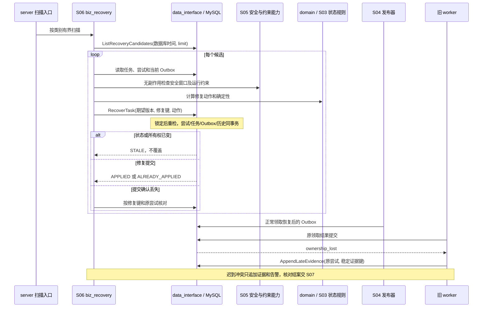

# S06 自动恢复

| 项目 | 内容 |
| --- | --- |
| 版本 / 状态 | v0.2 / 待实施 |
| 依据 | [技术方案](../TECH_DESIGN.md)第 8.5、9、11 节 |
| 依赖 | [S00](00-shared-contracts.md)、[S03](03-delivery-processing.spec.md)、[S04](04-reliable-dispatch.spec.md)、[S05](05-provider-runtime.spec.md) |
| 建议代码 | `internal/biz/biz_recovery` 编排，复用 `internal/domain` 状态规则；经 `internal/data_interface` 调用 `internal/data/mysql` 恢复事务 |

## 1. 目标与范围

以 MySQL 中未完成任务为基准恢复处理进度，覆盖丢失/停滞指令、过期领取、阻塞和 DLQ。恢复必须保留固定计划与发送证据，重复扫描可安全重试。

扫描器不重新运行路由或映射，不直接调用供应商业务 HTTP，不仅依靠 Redis 锁防重，也不以扫描游标前移代替任务实际修复。

## 2. 候选发现与并发控制

### RCV-C01：分别索引扫描

按状态与时间分别分批查找：

- 到期的 `PENDING / RETRY_WAIT`：`scheduled_at`。
- `PROCESSING` 领取过期：`lease_expires_at`。
- `BLOCKED` 待检查：`next_check_at`。
- 无有效领取且本轮已截止的任务：`round_deadline_at`。
- 需要恢复的 Outbox 发布领取及经过宽限仍无进展的当前指令。

使用数据库 UTC 时间、分页与批量上限，不能全表扫或一次持有大量任务锁。候选只是提示，进入修复事务后重新检查全部条件。

### RCV-C02：竞争中的唯一处置

扫描器和 worker 竞争同一任务时，通过任务锁及状态、轮次、调度版本、尝试 ID、token/行版本条件更新，只允许一个有效推进。多个扫描器无需依赖单实例运行保证正确性。

修复保存稳定写入标识、原因、前后状态、原/新调度版本、相关尝试/Outbox 和执行者。事务失败保留候选资格，下次继续，不记录虚假成功。

## 3. 恢复到期计划

### RCV-P01：已有指令优先

先核对当前任务状态、计划、预算、有效领取和 `(delivery_id, round_no, schedule_version)` 对应 Outbox。

| 情况 | 处置 |
| --- | --- |
| 已有有效处理者 | 不补发、不新建尝试，等待其完成或领取到期 |
| 本轮已截止且无有效处理者 | 按 S03 确定性结案，作废当前指令并记录历史 |
| 当前 Outbox 缺失 | 当前版本唯一插入指令及修复历史；并发插入命中唯一键后读取已有记录 |
| 当前 Outbox 未发布或发布领取过期 | 恢复其发布资格，不另造消息标识 |
| Outbox 已发布且仍在正常排队宽限内 | 保持原计划，观察积压，不误判丢失 |
| 已发布但宽限/冷却后仍无进展 | 按同一 Outbox 和 `message_id` 限频补发并追加修复历史 |

### RCV-P02：补发保护

默认额外宽限 5 分钟，结合任务计划时间、上次发布/补发、消费积压和部署恢复情况判断。补发必须有冷却和频率上限，依据持久化保存，不能重启后清零导致补发风暴。

宽限可根据积压在有界范围内增大，不能无限推迟并掩盖长期无进展。达到自动补发上限后保留任务和告警，等待人工处理，不偷偷丢弃或改为成功。

消息补发不增加业务尝试，不新增轮次或调度版本。改变执行时间、状态或新的业务重试计划时才使用 S03 的新计划规则。

## 4. 过期执行恢复

### RCV-L01：先核对结果

锁定任务后重新读取当前尝试是否已经结束及任务是否已推进。若结果事务实际已提交，则保留已有结果，不能因旧候选再次结束尝试或新增重试。

若数据库出现“当前任务仍在执行但尝试已结束且没有配套任务处置”等不符合原子事务约定的数据，记录一致性告警并停止盲目发送，按受控修复流程处理。

### RCV-L02：结束过期尝试

确认领取过期且仍是同一当前尝试后，在一个 `RecoverTask` 事务中：

1. 将原尝试结束为 `UNCERTAIN`，错误为 `LEASE_EXPIRED`，不能凭发送记录缺失推定未发送。
2. 保存恢复时间、`timing_incomplete`，无法还原的 HTTP/总尝试耗时为空。
3. 清空当前所有权，保留最近尝试，汇总未决证据。
4. 无安全重发依据，或预算/期限已耗尽且仍不确定时，转 `UNKNOWN`；不能因同时存在通道停用等运行阻塞而继续等待，也不能复用已被原尝试消耗的风险重投授权。
5. 供应商允许安全重发、预算有效且下一次允许发送时间早于本轮截止时，若当前约束允许，转 `RETRY_WAIT` 并创建新版本计划、Outbox 和历史；若仍有可恢复运行约束，按 S03 DLV-S02 转 `BLOCKED`，保存 `RETRY_WAIT` 恢复类别、最早允许发送时间及检查时间，暂不创建执行 Outbox。下一次允许时间已达到本轮截止时直接 `UNKNOWN`。尝试结束、所有权清空、版本推进和阻塞历史同事务提交。

领取过期不证明原 HTTP 已停止。新请求仍必须满足幂等或明确人工授权，不能仅靠数据库 token 防止供应商重复执行。

### RCV-L03：最低恢复能力

开发批次 1 即实现安全的过期处置：无法完成全面安全判断时结束尝试并进入 `UNKNOWN`，保留人工可查证据。完整自动重发和运行条件恢复可在后续批次补齐。

## 5. 阻塞与本轮截止

### RCV-B01：有界检查

阻塞记录至少有稳定原因码、脱敏说明、恢复类别、最早允许发送时间、检查时间及本轮截止。创建尝试前阻塞保留原 `PENDING / RETRY_WAIT` 类别；由已结束尝试进入阻塞的一律保存 `RETRY_WAIT`，不保存待恢复的 `PROCESSING` 或旧领取。只核验对应条件，例如通道重新启用、权限恢复、原配置/适配器可读，不通过实际业务发送探测。

每次检查同时复核预算、期限及未决结果的重发安全性，并复用 S03 DLV-E02 对尚未使用的本轮首次人工发送授权的检查；耗尽时按 RCV-B02 结案，无法通过安全/授权检查时进入 `UNKNOWN`。条件解除且检查通过时，保留原载荷、配置版本及次数，按 S03 DLV-S02 恢复保存的 `PENDING / RETRY_WAIT` 类别，计划时间不早于已保存最早时间与当前时间的较晚值；同事务清空阻塞字段、增加行/调度版本、建立新 Outbox 和恢复历史。恢复本身不增加尝试或轮次。条件未解除且仍允许等待时仅保存下次检查时间，不展示为下次发送时间。

### RCV-B02：截止结案

等待或阻塞持续到本轮截止时，无未决结果则 `FAILED`，有未决则 `UNKNOWN`。清空所有发送/检查计划并保存结案原因。

仍有有效在途领取时不能强制结案；先等待结果或领取过期恢复。没有业务尝试的限流/凭证等待也受截止限制，不无限等待。

## 6. 迟到结果与 DLQ

### RCV-E01：迟到证据

旧 worker 返回时不能改写已经结束的尝试最终结果或当前任务。以新的唯一 `write_id` 追加 `LATE_RESPONSE` 历史，关联原尝试，保留脱敏响应、发生与记录时间。

迟到证据与当前成功、失败或新轮次处置冲突时触发人工核对告警；任何结案由 S07 的授权核对事务完成。历史序号递增，不通过篡改旧历史伪装为当时已知道结果。

### RCV-D01：死信按任务修复

持续观察 Broker DLQ 数量、最老年龄及重复入死信。修复前验证消息版本、关联和当前任务：

- 已完成或旧版本死信只记录处置，不重发业务。
- 当前有效计划按相同 Outbox 协议恢复；不复制原始 HTTP 或重跑路由。
- 不合法消息与关联缺失记录明确原因，保留死信依据；不能无限自动补发。
- 反复进入死信或达到修复频率上限，升级人工处理。

人工触发的 DLQ 修复使用 S07/S00 的操作幂等与审计；自动修复保存扫描器身份及稳定修复键。无论入口都复用当前任务条件检查。

## 7. 扫描参数和修复数据

| 参数 | 默认 | 范围 / 规则 |
| --- | --- | --- |
| `RECOVERY_SCAN_INTERVAL` | 30 秒 | 1～300 秒；定时器只在上一批结束后启动下一轮，不堆叠同实例扫描 |
| `RECOVERY_BATCH_SIZE` | 每类 100 | 1～500；各候选类别独立配额，避免阻塞检查饿死过期领取 |
| `RECOVERY_PARALLELISM` | 4 | 1～32；同任务仍由数据库互斥 |
| `RECOVERY_TASK_TIMEOUT` | 5 秒 | 1～15 秒；包含前置读取，单事务仍受 S00 数据库预算约束 |
| `OUTBOX_GRACE_PERIOD` | 5 分钟 | 30 秒～1 小时；已有启动字段，用于正常积压保护 |
| `RECOVERY_MAX_GRACE` | 30 分钟 | 不小于基础宽限，最大 2 小时；根据可获得积压有界调整 |
| `RECOVERY_REPAIR_COOLDOWN` | 5 分钟 | 30 秒～1 小时；按任务当前指令持久化 |
| `RECOVERY_MAX_REPAIRS` | 每当前指令 12 次 | 1～100；达到后保留任务并升级人工 |
| `RECOVERY_ERROR_BACKOFF` | 5 秒 | 1～60 秒；基础设施故障的下一扫描退避 |
| `DELIVERY_BLOCKED_CHECK` | 60 秒 | 5～3600 秒；next_check_at 不晚于本轮截止 |
| `RECOVERY_DLQ_AUTO_REPAIRS` | 每当前指令 3 次 | 0～10；0 表示仅监控和人工修复 |

未执行指令的最早补发时刻为 `max(scheduled_at, last_published_at或created_at) + effective_grace`；同时满足 next_repair_at 才能补发。上次修复会更新 `last_repair_at / next_repair_at / repair_count`，与再次发布安排和 DISPATCH_REPAIRED 历史同事务。MQ 积压数据不可读时采用基础宽限和冷却，标记统计不可用；不得改为零宽限频繁补发。计数只在新调度版本时重新开始，同版本重启不清零。

候选分页键分别为 `(scheduled_at, delivery_id)`、`(lease_expires_at, delivery_id)`、`(next_check_at, delivery_id)`、`(round_deadline_at, delivery_id)`，并带明确状态。每轮从当前最早未处置候选开始，不以持久游标跳过前轮事务失败任务；使用轮询类别和每类限额避免单个热点任务独占全部槽位。截止扫描仅查非终结任务，PROCESSING 有效领取不能被到期扫描终结。

| 端口 / 结构 | 输入 | 返回 / 不变量 |
| --- | --- | --- |
| `ListRecoveryCandidates` | 类别、数据库 cutoff、limit、临时游标 | 候选 ID 和所见版本；不表示已获得处置权 |
| `InspectRecovery`（S06） | 当前 TaskSnapshot、尝试及 Outbox、S05 安全依据 | `NOOP / REPAIR_DISPATCH / EXPIRE_ATTEMPT / RECHECK_BLOCK / CLOSE_ROUND / ESCALATE` |
| `RecoverTask`（仓储） | 任务所见状态/版本/尝试、原因、NextAction、修复元组 | 事务重检，返回 APPLIED / STALE / ALREADY_APPLIED；失败整体回滚 |
| `AppendLateEvidence`（仓储） | 原 attempt_id、响应 hash、脱敏结果、发生时间 | LATE_RESPONSE；同内容重复追加只保留一次，不推进任务 |
| `InspectDlq / DisposeDlq` | Broker 原消息身份、命令版本、处置操作 | 只有修复或可见终止处置已保存后才能确认 DLQ 消费进度 |

稳定修复键包含 `delivery_id / round_no / schedule_version / recovery_kind / current_attempt_id或repair_count`。纯候选扫描重试沿用该元组；只有成功的新修复才分配下一个 repair_count。迟到证据键包含原 attempt_id、协议结果和已脱敏响应的 hash，不使用当前时间随机生成，以免旧 worker 重试追加重复证据。保存证据需校验其任务/账号归属；不可信输入不进入历史。

## 8. 恢复失败、DLQ 操作与升级

过期尝试的 S05 安全信息可在事务外读取，进入 RecoverTask 后必须复核对应通道版本、任务版本和数据库时间；若窗口已失效，则按 UNKNOWN 结案。缺少原适配器、无法取得安全声明时不猜测可重发，使用最低恢复能力。恢复本身不获取 Token、不扣限流令牌、不发送供应商请求；这些留给下一条正常指令。

| 失败类别 | 行为 |
| --- | --- |
| 数据库暂不可用、锁等待超时、确认已回滚的死锁 | 单任务有界重试/下轮继续，不提前记录修复成功 |
| 提交确认不确定 | 主库按修复键、尝试结果和当前任务核对；不可确认则保留候选，不盲目重建新计划 |
| 当前所有权/版本已变 | STALE，不再应用旧决策；不是业务失败，不覆盖当前错误 |
| 尝试与任务原子性矛盾或关联数据损坏 | `RECOVERY_INCONSISTENT` 告警；无有效领取时保守转 UNKNOWN、保留原尝试最终结果及证据，交 S07 核对，不盲目发送 |
| 原配置或适配器缺失 | 创建尝试前按 S03 BLOCK；过期尝试因无法证明安全重发按最低恢复能力转 UNKNOWN |
| 达到修复上限、反复 DLQ | `RECOVERY_MANUAL_REQUIRED` 告警；保留原计划和证据，到轮次截止仍按确定性结案 |

首版增加受控接口 `POST /v1/deliveries/{id}/repair-dispatch`，仅修复无有效领取的当前 `PENDING / RETRY_WAIT` 指令。请求为 `{operation_idempotency_key, expected_row_version, reason, dlq_message_id?}`，要求 `dlq:repair` 和任务调用方范围；操作类型 `dlq_repair`，成功 202 `{operation_id, delivery_id, outbox_id, message_id, publish_revision, status}`。同键重试返回原结果；成功/FAILED/UNKNOWN/BLOCKED 不借此创建新轮次。已过时死信仅记录处置并返回 200 `NOOP`，不唤醒新业务。

人工修复可解除本指令的自动补发升级标记，但必须记录原因；仍增加累计修复计数和遵守冷却，不能用接口无限放大消息。自动 DLQ 修复使用 Broker 消息身份和当前调度元组生成稳定操作键；源死信的读取进度与 MySQL 不构成跨系统事务，确认丢失时靠同键重放处置。Broker 原消息不可直接作为供应商请求重放。

## 9. 模块依赖序列图

## 10. 运行与实现任务

后台循环默认每 30 秒扫描，批量、并发、单次超时、冷却和错误退避可配置。某批失败不阻止其他候选；停止信号到来后停止新扫描并有界退出。

- [ ] 实现按状态时间索引扫描和候选事务重检。
- [ ] 实现当前计划补建、恢复发布、宽限与持久化补发冷却。
- [ ] 实现先核对已存结果的领取过期恢复。
- [ ] 实现阻塞条件/安全窗口检查、截止结案，以及尝试结束后阻塞的恢复类别和最早时间依据。
- [ ] 实现迟到证据、冲突告警、DLQ 修复及人工升级。
- [ ] 接入恢复失败、领取过期、到期未执行和长期阻塞指标。

## 11. 验收场景

| 编号 | Given / When | Then |
| --- | --- | --- |
| RCV-01 | 当前到期任务缺失 Outbox，两个扫描器同时修复 | 只建一条当前指令，修复历史不重复 |
| RCV-02 | Outbox 发布成功但任务仍在正常 MQ 积压中 | 宽限期内不补发，不增业务次数 |
| RCV-03 | 原指令长期无进展，多次扫描及重启 | 同标识限频补发，冷却和上限不因重启丢失 |
| RCV-04 | 领取后请求发出前/后进程崩溃 | 都保守记录过期不确定；无安全依据进入 `UNKNOWN` |
| RCV-05 | 结果已提交但确认丢失，旧扫描候选仍存在 | 保留已存结果，不新建尝试或重复重试计划 |
| RCV-06 | worker 与扫描器同时推进同一任务 | 只有当前所有权处置成功，旧结果不覆盖 |
| RCV-07 | 阻塞解除或持续到本轮截止 | 分别恢复原语义计划 / 按未决结果结案，时间字段正确 |
| RCV-08 | 恢复后旧响应迟到，内容与当前结论冲突 | 原结果不变，追加证据并触发核对告警 |
| RCV-09 | 成功任务对应消息进入 DLQ | 不重新发送，记录死信处置 |
| RCV-10 | 扫描批次中某事务失败 | 该任务仍可在后续扫描修复，其他候选可继续 |
| RCV-11 | 领取过期、供应商幂等及预算有效、下一允许时间早于截止，但通道已禁用 | 同事务结束原不确定尝试并转 `BLOCKED`，保留次数和未决证据，清空所有权，保存 `RETRY_WAIT` 恢复依据及检查时间，不创建执行 Outbox |
| RCV-12 | 上述通道恢复且幂等/预算仍有效，多个扫描器同时检查 | 只创建一个新版本计划/Outbox 和恢复历史；保持原载荷、配置版本和次数，不早于保存的允许时间，不复用旧领取 |
| RCV-13 | 领取过期且通道禁用，同时无安全幂等依据或预算/期限已耗尽 | 直接 `UNKNOWN`，不以 `BLOCKED` 延后结案，不复用原尝试已消耗的风险授权 |
| RCV-14 | 过期尝试转阻塞后幂等窗口失效，或任务持续阻塞到本轮截止 | 无安全依据时转 `UNKNOWN`；截止时按未决证据转 `FAILED / UNKNOWN`；清空发送/检查计划，不创建执行 Outbox |
| RCV-15 | 同一修复事务提交确认丢失，扫描器重启后重新发现候选 | 原修复键可核对，repair_count、历史和 Outbox 只推进一次 |
| RCV-16 | 自动修复达到上限，人工按同键修复当前指令 | 告警和原计划保留；人工操作有幂等结果、版本检查和冷却，不创建新轮次 |
| RCV-17 | 某类候选长期积压，另一类存在过期领取 | 分类限额仍使过期领取被及时检查，事务失败候选不会被游标永久跳过 |

## 12. 完成标准

真实进程中断、重复消息和并发扫描均有验证；所有修复可追溯并保持原事实与版本；不存在以清库、重跑路由或改写旧尝试完成“恢复”的路径。
