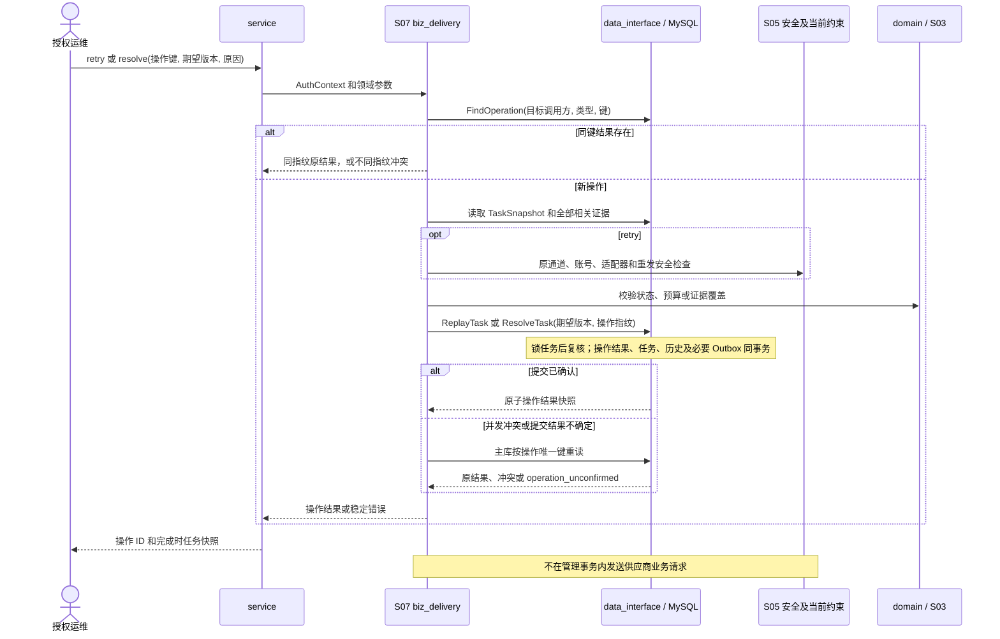

# S07 人工处置

| 项目 | 内容 |
| --- | --- |
| 版本 / 状态 | v0.2 / 待实施 |
| 依据 | [技术方案](../TECH_DESIGN.md)第 8.5、9.2、11、12 节 |
| 依赖 | [S00](00-shared-contracts.md)、[S03](03-delivery-processing.spec.md)、[S04](04-reliable-dispatch.spec.md)、[S05](05-provider-runtime.spec.md) |
| 建议代码 | `internal/service` 协议转换、`internal/biz/biz_delivery` 管理用例；经 `internal/data_interface` 调用 `internal/data/mysql` 原子操作 |

## 1. 目标与范围

授权人员能够对单项异常任务重投或依据证据结案；并发点击、客户端超时重试只能产生一次管理结果。所有操作保存原因、身份、版本及证据，不删除或重写原尝试。

首版不提供整个事件批量重投、不重投成功任务、不使用新路由重分发旧事件，也不提供任意修改任务状态接口。`BLOCKED` 的运行条件恢复按 S06 处理，不借用异常重投创建新轮次。

## 2. 身份与操作幂等

### OPS-I01：当前授权

每次操作先认证，确认操作者权限与目标调用方范围。重投、UNKNOWN 结案、跨调用方处理及风险重投为可区分权限；风险重投不能仅凭普通重投权限完成。

审计同时保存操作者、被操作任务所属调用方、操作类型与原因。对无访问范围的任务返回 404，不暴露其他调用方数据。

### OPS-I02：唯一范围与参数指纹

唯一键为 `(caller_scope, operation_type, idempotency_key)`；`caller_scope` 是目标任务所属调用方，不是操作者个人身份。任务 ID 属于参数指纹，因此同键误用于另一个任务也会冲突。

首版请求体使用 `operation_idempotency_key`；范围内唯一、大小写敏感。指纹覆盖目标任务、操作类型、期望版本、原因、风险确认及核对证据，使用 S02 同类确定性规范化并保存算法版本。

同键同参数返回原 `operation_id` 和原操作完成时的结果快照；同键不同参数返回 409。读取原结果仍要求当前权限，但不重新执行状态变化，也不因任务后来变化而再次检查原 `expected_row_version` 导致幂等重试失败。

只有成功提交的管理处置占用成功幂等记录。鉴权、参数、状态或版本错误不创建成功操作结果；审计失败请求如有需要采用独立安全日志，不伪装为成功操作。

## 3. 指定任务重投

### 3.1 接口

`POST /v1/deliveries/{id}/retry`，请求示例：

```json
{
  "operation_idempotency_key": "retry-crm-20261109-001",
  "expected_row_version": 18,
  "reason": "供应商故障已恢复，按原计划重新投递",
  "risk_acknowledged": false
}
```

成功返回 `202 Accepted`：`operation_id`、操作类型、任务 ID、新轮次、新 `row_version`、新状态及本次操作完成时的任务快照。响应不是供应商送达确认。

### OPS-R01：前置检查

仅允许 `FAILED / UNKNOWN` 且无有效领取者的任务。重新检查当前权限、通道、原配置/适配器可用性、供应商账号归属及重发安全性。

| 当前情况 | 行为 |
| --- | --- |
| `SUCCEEDED` | 409 `state_conflict`，不发起重投 |
| `PENDING / PROCESSING / RETRY_WAIT / BLOCKED` | 409 `state_conflict`，不创建重复活动轮次 |
| 行版本与请求不一致 | 409 `version_conflict`，操作者应重新读取任务 |
| 通道、权限或原版本条件阻止执行 | 拒绝并返回明确原因，不借人工操作绕过 |
| `FAILED` 且全部相关请求明确未接收 | 可按原语义新开轮次；仍遵守当前运行约束 |
| `UNKNOWN` 且当前幂等窗口足以安全覆盖未决结果 | 可重投，保留未决证据直到新证据消除 |
| `UNKNOWN` 且无法安全重发 | 默认 422 `unsafe_replay`；仅满足 OPS-R02 时可继续 |

已核对明确未接收的 UNKNOWN 可先通过 resolve 结案为 `FAILED`，再按正常重投处理；核对已接收则结案成功，不能再重投。

### OPS-R02：显式风险重投

无法保证安全重发时，必须同时满足：操作者具备风险重投权限、请求 `risk_acknowledged=true`、填写具体原因。服务端在操作结果和历史中记录确认时间、身份及“可能重复执行”的风险类别。

风险确认只授权当前指定任务新轮次的首次业务尝试；等待不消耗授权，创建尝试时按 S03 原子关联使用。后续自动重试仍须满足正常安全判断，不能重复复用该确认。

风险确认不允许切换载荷、账号、操作或业务幂等键，不清除未知结果，也不能越过当前访问安全约束或有效领取。

### OPS-R03：原子新轮次

在一个 `ReplayTask` 事务内重新检查前置条件并保存：

1. 操作幂等记录、指纹、审计和结果。
2. `round_no + 1`，本轮尝试数置 0，累计次数保持不变。
3. 原载荷、发布/映射/适配器版本、目标、账号和业务幂等键不变。
4. 按当前允许策略冻结新轮次预算和截止时间，审计原/新策略；不能修改旧轮次事实。
5. `PENDING`、新调度版本和行版本、当前计划及新 Outbox。
6. 清空当前结案时间与失效领取，追加重投与新计划历史。
7. 风险重投时保存本轮首次发送授权与操作引用，供 `StartAttempt` 原子校验和关联使用。

保留原轮次最近结果和历史；新轮次开始不意味着过去的未决请求已被证明失败。

## 4. UNKNOWN 核对结案

### 4.1 接口

`POST /v1/deliveries/{id}/resolve`，请求示例：

```json
{
  "operation_idempotency_key": "resolve-crm-20261109-001",
  "expected_row_version": 24,
  "resolution": "SUCCEEDED",
  "reason": "供应商人工确认该业务操作已受理",
  "evidence": {
    "type": "provider_confirmation",
    "reference": "ticket-5678",
    "summary": "已核对相同账号与业务幂等标识的受理记录",
    "covered_attempt_ids": ["4001", "4002"]
  }
}
```

成功返回 `200 OK`，内容包含 `operation_id` 与操作完成时的任务快照。

### OPS-V01：证据要求

仅允许无有效领取的 `UNKNOWN`。`resolution` 仅为 `SUCCEEDED / FAILED`，分别对应可靠已接收或明确未接收依据；必须与目标供应商账号、任务及业务操作相关。

证据至少包含类型、可核对引用和脱敏摘要，说明覆盖哪些未决尝试或同一业务幂等操作。仅填“已确认”或错误任务的供应商编号不足以结案。人工确认的真实性由具备核对权限的操作者负责，系统记录其确认和证据范围。

结案失败必须能够排除全部相关未决接收；覆盖不完整则 422 `evidence_insufficient` 并维持 `UNKNOWN`。核对成功也必须满足 S00 的证据范围规则，不能用不相关成功响应清除未决。

### OPS-V02：原子结案

`ResolveTask` 同事务保存操作结果、核对证据、任务状态与确定性、行/调度版本、结案时间和历史，清空发送/检查计划。不新增业务尝试，不修改原尝试最终结果，不创建 Outbox。

原尝试即使结果为 `UNCERTAIN` 也保持原记录，核对依据作为后续证据解释其当前任务结论。

## 5. 并发与提交不确定

- 先做当前授权和幂等结果读取，再检查新操作的期望版本。
- 进入写事务后重新检查任务状态与版本，遵循 S00 锁顺序；依靠管理唯一键防止同操作重复提交。
- 不同幂等键并发操作同一旧版本，至多一个推进；另一个得到版本或状态冲突。
- 相同幂等键并发提交，成功者记录完整结果，其他请求等待后读取原结果；不能新增两个轮次。
- 提交结果不确定时先读操作唯一键；不可确认返回 503，客户端使用同键同参数重试，不生成新键绕过。
- 处理期间的新响应、补偿或其他人工操作使前置条件变化时，当前事务失败并要求重新读取，不静默对新状态操作。

## 6. 审计与数据保护

审计至少保存操作 ID、调用方范围、任务 ID、类型、幂等键、指纹版本/值、期望/实际版本、操作者、原因、发生时间、前后轮次/状态、策略变化、风险确认及证据摘要。

证据和原因有字节上限并脱敏；不允许以任意原始响应、Token 或个人信息作为审计附件。查询权限及保留期遵循 S08，与任务证据协调保留。

配置发布、通道管理和人工 DLQ 修复采用相同操作幂等与审计原则，但具体行为分别由 S01、S05、S06 定义，不能使用人工重投实现。

## 7. 管理请求参数与响应结构

| 参数 | 类型 / 必填 | 约束 |
| --- | --- | --- |
| 路径 `id` | S00 内部 ID 字符串，必填 | 目标任务必须属于当前可管理范围 |
| `operation_idempotency_key` | 字符串，必填 | 1～191 字节；同调用方及操作类型内唯一，不隐含操作者身份 |
| `expected_row_version` | 正整数，必填 | 精确匹配当前任务；不接受 null、浮点、字符串或 0 |
| `reason` | UTF-8 字符串，必填 | 1～1024 字节且非纯空白；拒绝秘密字段，不静默裁剪 |
| `risk_acknowledged` | 布尔，retry 可选 | 默认 false；resolve 禁止此字段，避免误把确认风险当核对证据 |
| `resolution` | resolve 必填枚举 | `SUCCEEDED / FAILED`，不接受客户端指定 result_certainty |
| `evidence.type` | resolve 必填枚举 | `provider_confirmation / provider_query / manual_verification` |
| `evidence.reference` | 字符串，必填 | 1～191 字节；受理编号、查询凭据或外部工单引用，不能含访问 Token |
| `evidence.summary` | UTF-8 字符串，必填 | 1～2048 字节，非空白，按白名单规则校验脱敏 |
| `evidence.covered_attempt_ids` | ID 数组，条件必填 | 最多 256 个，不重复；逐次证据模式要求非空，均属于该任务所有历史轮次 |
| `evidence.idempotency_key` | 字符串，条件必填 | 业务操作模式使用，必须等于目标任务稳定业务键 |
| `evidence.scope` | 可选枚举 | `attempts / business_operation`；省略时若有 covered_attempt_ids 则推导 attempts，否则必须显式提供业务操作范围 |

选择 attempts 模式时禁止 idempotency_key，选择 business_operation 时禁止 covered_attempt_ids；不能用互相矛盾的两套范围。reference 不执行任意 URL 抓取，首版由具备权限的操作者依据线下核对提交。后续可接供应商查询适配，但不得在当前管理事务内做远程 HTTP。

操作结果统一为 `{operation_id, operation_type, delivery_id, completed_at, task}`；task 为操作完成时 S08 任务详情的脱敏快照，并包括新/原轮次和 row_version。retry 返回 202，resolve 返回 200。相同操作重放时返回原 HTTP 成功状态和原快照，可附响应头 `Idempotency-Replayed: true`；不是当前实时状态。请求格式、权限、版本错误不保存成功结果，message 不泄露目标调用方秘密。

操作类型固定为 `manual_retry / resolve`。S01 全局配置和 S05 通道管理使用 `__global__`，任务管理始终使用所属 caller_id；外部 caller_id 的 S00 格式不允许保留范围名。不同操作类型可复用相同文本键，不能绕过各操作自己的状态和授权。

## 8. 新轮次策略和证据校验步骤

retry 不接受载荷、账号、路由、适配器、幂等键或轮次预算覆盖。新轮次策略来源明确为原任务冻结 round_policy 与当前部署允许上限的交集：原 max_attempts/本轮时长不超过当前允许上限时沿用，超过时缩小至允许上限并审计；退避和强制等待仍保持原协议含义，无法满足当前限制则拒绝。不能读取最新路由策略替换原目标语义。

新轮次的 `scheduled_at = 本次操作数据库时间`、`round_deadline_at = scheduled_at + 新轮次时长`；次数清零仅限 round_attempt_count。保留 total_attempt_count、last_attempt_id、最近一次实际尝试结论及未决证据；blocked_reason、旧 resume 元数据、next_retry_at/next_check_at 和领取字段清空。新状态 PENDING，两个版本各加 1，round_finished_at=null。新建 S04 即时指令并记录 MANUAL_RETRY、SCHEDULE_CREATED；风险授权引用 operation_id，且首次 StartAttempt 原子标记已使用。

resolve 按以下顺序校验：

1. 当前权限和操作结果重放检查；新操作要求 UNKNOWN、无有效领取、期望版本一致。
2. 检查证据格式和账号/业务操作关联。attempts 模式所有 ID 必须存在且属于该任务，不能仅按数量判定覆盖。
3. 在锁定任务后读取全部未决尝试及后续证据，重新计算待覆盖集合。FAILED 必须排除全部可能接收；SUCCEEDED 必须有同一业务操作已接收依据且能解释全部相关未决，无冲突。
4. 对纯逐次确认，未覆盖集合非空则 `evidence_insufficient`；业务操作模式由具备权限的操作者明确确认该稳定键的完整范围。部分证据可在拒绝时记安全日志，但不能修改 task 或伪造成功核对历史。
5. 原子保存最终确定性 RECEIVED 或 NOT_RECEIVED、结案时间、版本、操作结果和 MANUAL_RESOLVE 历史。原尝试的 outcome/finished_at 不变。

| 错误码 | HTTP | 可重试含义 |
| --- | --- | --- |
| `version_conflict / state_conflict` | 409 | 先重读任务；不能自动换版本盲重投 |
| `idempotency_conflict` | 409 | 同键参数不同；核查原操作，不覆盖结果 |
| `unsafe_replay` | 422 | 缺安全依据或风险权限/确认；无副作用 |
| `evidence_insufficient / evidence_invalid` | 422 | 补充核对依据后作为新的明确管理意图提交 |
| `channel_blocked / configuration_unavailable` | 422 | 修复原条件后再提交，不切换目标或适配器 |
| `operation_unconfirmed` | 503 | 保留原键和全部原参数重试，不能新建操作键绕过 |

当同键并发事务已经存在成功结果时，优先读取原结果；不能先因 row_version 已变返回 409。唯一键被另一任务相同 caller_scope 的操作占用时，整个当前事务回滚，再按指纹返回原结果或冲突，不留下当前任务的新轮次。

## 9. 运行与持久化参数

| 参数 | 默认 | 范围 / 说明 |
| --- | --- | --- |
| `OPERATIONS_MAX_BODY_BYTES` | 16 KiB | 4～64 KiB；证据/原因包含在内 |
| `OPERATIONS_MAX_EVIDENCE_ATTEMPTS` | 256 | 1～1024；超过时要求按完整业务操作核对，不截断证据 |
| `OPERATIONS_TIMEOUT` | 5 秒 | 1～15 秒；单个事务受 S00 MYSQL_OPERATION_TIMEOUT 约束 |
| `OPERATIONS_CONFIRM_TIMEOUT` | 2 秒 | 100 毫秒～5 秒；提交不确定后的主库结果核对 |

管理结果完整保存到 management_events.result，最多 64 KiB；只保留任务摘要、关联标识、版本和预算，不复制固定业务载荷。操作 audit、幂等结果、风险授权及 task 统一保留，不能仅按操作创建时间提前清理。operation_id 用 32 位小写十六进制随机值，首次写入前生成，提交重试沿用，不使用新的随机值重复追加。

## 10. 模块依赖序列图



## 11. 实现任务

- [ ] 实现操作请求、稳定指纹、唯一键、原结果重放和期望版本检查。
- [ ] 实现重投权限、状态/安全检查、风险确认与新轮次事务。
- [ ] 实现核对证据校验、覆盖范围与结案事务。
- [ ] 复用 S03 状态、确定性和时间规则；复用 S04 指令创建约定。
- [ ] 保存完整脱敏审计并接入 S08 时间线。
- [ ] 验证提交确认丢失、不同键竞争和同键竞争。

## 12. 验收场景

| 编号 | Given / When | Then |
| --- | --- | --- |
| OPS-01 | 同任务同键同参数并发重投 | 一个操作、一个新轮次、一条新版本指令，响应返回同操作结果 |
| OPS-02 | 同键更改原因、任务、版本或风险确认 | 409，不产生新轮次 |
| OPS-03 | 两个不同键基于同旧版本重投 | 至多一个成功，另一个版本/状态冲突 |
| OPS-04 | 成功任务或仍有活动执行的任务请求重投 | 拒绝，供应商调用数不增加 |
| OPS-05 | UNKNOWN 无安全依据且未确认风险 / 缺风险权限 | 拒绝，任务仍为 `UNKNOWN` |
| OPS-06 | 有风险权限并明确确认重投 | 新轮次建立，原标识/载荷/累计次数/未决证据保留，风险审计完整 |
| OPS-07 | UNKNOWN 有充分已接收证据核对结案 | 转成功，保留原不确定尝试，不创建业务请求 |
| OPS-08 | 未接收证据只覆盖部分未决尝试 | 拒绝失败结案，仍为 `UNKNOWN` |
| OPS-09 | 操作提交后响应丢失，再用原参数重试 | 返回原结果，不因任务版本已更新而重复操作或错误冲突 |
| OPS-10 | 运维越权处理另一调用方，或请求记录秘密信息 | 分别拒绝越权 / 校验脱敏及上限，不泄露原始数据 |
| OPS-11 | 同一调用方两个不同任务并发使用同类型同操作键 | 至多一项成功，另一项整体回滚并返回幂等冲突，无孤立新轮次 |
| OPS-12 | 证据数组含另一任务的尝试、重复 ID 或业务键不匹配 | evidence_invalid，不修改当前任务、原尝试或成功操作记录 |
| OPS-13 | 新轮次当前允许上限缩小，但最新路由也已改变 | 仅缩小允许的轮次预算并审计，原路由/载荷不变；不可满足协议则拒绝 |

## 13. 完成标准

真实 MySQL 并发与断连验证通过；成功操作与状态、Outbox、审计原子提交；所有操作均能通过任务时间线定位，人工处理不能破坏自动流程不变量。
