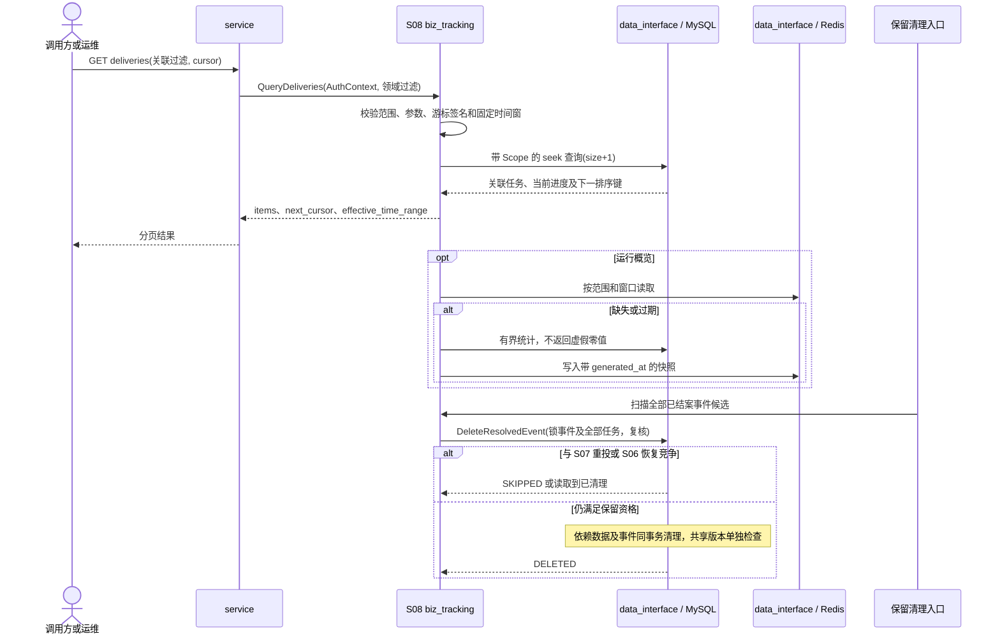

# S08 查询与运行可见性

| 项目 | 内容 |
| --- | --- |
| 版本 / 状态 | v0.2 / 待实施 |
| 依据 | [技术方案](../TECH_DESIGN.md)第 4、11～13 节 |
| 依赖 | [S00](00-shared-contracts.md)；S01～S07 的持久化实体及事务历史 |
| 建议代码 | `internal/service` 协议转换、`internal/biz/biz_tracking` 查询与清理用例；经 `internal/data_interface` 访问 `internal/data/mysql`，跨模块指标位于 `pkg/metrics` |

## 1. 目标与范围

用户能按业务关联定位事件与单项通知，看到当前进展、每次发送及完整处理时间线；运维能区分受理、发布、执行与人工待处理积压。日志关闭、采样或过期后，业务事实仍可从 MySQL 查询。

模块负责查询契约、指标和协调保留；历史写入由发生动作的模块同事务完成。查询不触发重发或供应商业务调用，不提供原始秘密报文下载。

## 2. 查询接口与权限

| 接口 | 输出 |
| --- | --- |
| `GET /v1/events/{id}` | 事件关联、原发布、固定目标列表、各任务状态与聚合数量 |
| `GET /v1/events` | 调用方范围内事件列表及聚合进展 |
| `GET /v1/deliveries` | 按业务关联和运行条件组合检索任务 |
| `GET /v1/deliveries/{id}` | 单项任务完整关联、状态、预算、计划、确定性和最近结果 |
| `GET /v1/deliveries/{id}/attempts` | 所有轮次逐次尝试，支持轮次过滤 |
| `GET /v1/deliveries/{id}/history` | 持久化全过程时间线 |
| `GET /v1/overview` | 分阶段积压、状态数量、异常与统计时间 |
| `GET /healthz` | 进程存活检查 |
| `GET /readyz` | 当前能否接管新事件及角色依赖状态 |

普通调用方仅能读取自身数据；运维跨调用方读取需要相应权限和明确范围。列表 SQL 必须包含范围限制，不能先全量查出再内存过滤；详情、attempts、history 同样检查父任务范围。

## 3. 列表过滤与稳定分页

### TRK-Q01：过滤

任务列表支持来源业务、来源事件 ID、内部事件 ID、业务对象类型/ID、供应商、任务状态和事件受理时间范围组合过滤。业务对象 ID 与类型可分别作为过滤条件，但对象精确关联建议同时提供两者；来源事件 ID 和对象 ID 均为字符串精确匹配。

使用 `accepted_from`（含）和 `accepted_to`（不含）表示时间范围。参数必须有限、范围合法；页大小、最大查询窗口、单次 SQL 时间及筛选长度在部署配置中明确。超限返回 400，不静默去掉过滤条件。

### TRK-Q02：游标

首版默认倒序：事件按 `(accepted_at, event_id)`，任务按所属事件的 `(accepted_at, delivery_id)`；游标包含完整排序键。相同时刻依靠唯一 ID 保证顺序。

尝试默认按 `(round_no, attempt_no)` 升序；历史按 `history_seq` 升序。响应统一包含 `items` 和 `next_cursor`，无后续页时后者为 null。

游标为不透明、带完整性保护的版本化编码，绑定调用方/运维查询范围、规范化过滤和排序。串改、跨范围或更改过滤后复用返回 `invalid_cursor`。不使用 Offset 扫描深页。

分页不承诺跨多次请求的数据库快照；复合游标避免仅因时间相同而漏项或重复，新数据和状态变化仍可能影响后续可见集合。首版不开放未配索引的任意排序。

### TRK-Q03：索引与一致性

至少具备技术方案第 11.3 节的事件对象、任务供应商状态、事件任务、计划/领取/检查/截止扫描索引，并为默认时间分页、常用组合过滤、Outbox 发布及尝试分页补充必要索引。

验收记录代表性查询的执行计划，避免凭字段组合无限增索引。单个事件详情的聚合及任务摘要采用同一一致性读取或标注一致统计点，避免一个响应内数量与明细矛盾。目标数大时明细可分页，但固定目标总数和聚合必须完整。

## 4. 响应字段

### TRK-D01：事件与任务

事件详情至少包含调用方/来源、来源事件 ID、事件类型和数据版本、发生/受理时间、业务对象关联、发布引用、固定目标及任务计数。

任务详情必须包含：

- `caller_id / source_business / source_event_id / event_id`。
- `business_object_type / business_object_id`。
- `provider_id / provider_account_id / route_target_id / delivery_id / operation`。
- 原发布、映射与适配器类型/版本引用；固定业务载荷按权限与字段白名单展示，不默认返回整个快照。
- `status / result_certainty / last_result_certainty`。
- 轮次、本轮/累计尝试数、最大尝试数、本轮截止、`row_version`。
- 当前 `scheduled_at / next_retry_at / next_check_at / round_finished_at`。
- 最近尝试、错误码/脱敏原因、阻塞原因及是否需要人工核对。

事件聚合保留各状态数量，不能用一个布尔 `success` 隐藏部分成功或未知。`BLOCKED / UNKNOWN` 的 `next_retry_at` 为空；UNKNOWN 明确显示待核对原因，不能统一展示为“发送中”。

### TRK-D02：尝试

逐次返回尝试/任务/轮次/序号/Outbox/trace/worker/部署关联，开始、HTTP 开始、响应、结束时间，HTTP 及总尝试耗时，`timing_incomplete`、`send_state`、脱敏方法/路径/请求大小与摘要、HTTP 状态、供应商码/编号、实际响应已读字节数/摘要/截断、标准结果、确定性、错误及等待建议。

空值保留真实含义：无响应不伪造状态码；未发送没有 HTTP 耗时；恢复无法还原耗时留空；未结束尝试的完成时间为空。摘要空、截断及读取失败分别表达。

### TRK-D03：时间线

按 S00 分配的 `history_seq` 顺序返回阶段、前后状态、原因、发生/记录时间、轮次、调度版本、尝试/Outbox/操作标识、执行者和脱敏证据。

至少覆盖建任务、建立调度、发布成功/失败、领取、尝试结束、重试、等待/阻塞、领取过期、补发、DLQ、人工重投、核对和迟到证据。迟到记录保留原发生时间但排在后来的记录序号，不改写当时的知识状态。

## 5. 概览、日志、指标与健康

### TRK-O01：运行概览

概览至少区分：待发布数量/最老年龄、到期未执行、过期领取、各状态数量、长期 `BLOCKED / UNKNOWN`、DLQ、补偿失败、成功率和耗时分布。响应包含 `generated_at`、范围、统计窗口以及每项数据的可用性。

数据库统计可缓存 5 秒；Redis 不可用时受控回源，不能无限高频聚合。Broker 等指标暂不可用时标记 unavailable，不返回虚假的 0。不得将部分过期统计伪装为当前全局精确值。

### TRK-O02：日志与告警

结构化日志和 trace 在适用处携带 `event_id / delivery_id / attempt_id / outbox_id / operation_id`。ACK 只记录调用事实，不能作为 Broker 确认的可靠证据。

指标标签只使用来源业务、供应商、状态、错误分类等受控低基数字段；事件、任务、业务对象和操作 ID 不作指标标签。成功率区分任务接收率和单次尝试结果，并标明时间窗与统计口径；耗时区分 HTTP、总尝试和端到端等待。

告警阈值可配置，覆盖积压最老年龄、过期领取、补偿失败、DLQ、长期阻塞/未知以及迟到证据冲突。告警能够通过查询定位具体任务，但不把敏感数据放入指标标签。

### TRK-O03：健康与就绪

`healthz` 只表达进程是否存活，不把供应商故障直接变成重启条件。`readyz` 有界检查 MySQL、迁移状态、当前发布可读取、基础执行注册及新受理积压保护是否满足。

MQ 暂停但 Outbox 积压在阈值内时 API 仍可就绪，同时返回后台消息链路降级状态；Redis 缓存故障可回源时也不能等同全服务停止。限流 Redis 不可用使相关执行暂停，不直接证明 API 不能接管事件。

健康响应仅暴露脱敏依赖类别与原因，不返回 DSN、密码、完整主机连接串或秘密配置。

## 6. 数据保留与协调清理

### TRK-R01：清理资格

事件清理由全部子任务共同决定。只有所有任务均为 `SUCCEEDED / FAILED`、没有活动轮次/有效领取/未决核对，且从最后一次相关结案经过保留期后，才可成为清理候选。

`PENDING / PROCESSING / RETRY_WAIT / BLOCKED / UNKNOWN` 及其事件、配置、尝试、历史、幂等和操作证据持续保留。UNKNOWN 即使有 `round_finished_at` 也不视为可普通清理。

人工重投清空当前结案时间并重新计算后续保留资格；不能仅按事件受理时间超过 30 天清理。幂等结果和其引用实体协调保留，不能出现返回旧幂等结果但目标任务已经丢失。

### TRK-R02：并发清理

批量发现候选后，在事务中按 S00 顺序锁定事件与其全部任务并重新检查资格，阻止与重投、核对和子任务状态变化竞争。数据量较小时可按单事件有界事务删除依赖实体，再删任务和事件。

若采用分批归档/删除，必须先建立受保护的清理标记与引用协议，并让受理幂等、人工操作和扫描器识别；未实现该协议前，不允许分批删除产生半套在线事实。

MQ 中残留消息在清理后可能到达：缺失任务不能直接证明该消息可信。保留有限的清理凭据或采用受控的 DLQ 处置，且不执行供应商业务请求；具体清理凭据生命周期与 Broker 保留范围在实施时记录。

### TRK-R03：配置与秘密

仅当版本不是当前发布，且没有保留中的事件/任务或其他配置引用时，才可清理不可变配置。共享版本不随单个事件删除。凭证生命周期独立遵循账号使用与撤销策略，不把秘密复制到业务归档。

配置清理与正在受理的引用建立必须通过实体锁/外键及同事务复核协调。S02 在保存计划时核验所选发布仍可引用；若已清理则明确受理失败，不静默切换到另一发布。不能仅凭缓存中的引用数为零删除实体。

清理后不再保证已删除事件和操作的历史去重，需在运维保留说明中明确；不能一边删除记录一边继续宣称永久幂等。

## 7. 查询参数和游标格式

| 查询参数 | 类型 / 默认 | 适用与校验 |
| --- | --- | --- |
| `caller_id` | S00 标识，可选 | 普通调用方只能省略或填自身；跨调用方查询需 ops:read 和明确授权范围 |
| `source_business / source_event_id / event_id` | 字符串，可选 | 事件/任务列表；来源授权检查后精确匹配 |
| `business_object_type / business_object_id` | 字符串，可选 | 事件/任务列表；不做模糊、前缀或数值转换 |
| `provider_id` | 标识，可选 | 任务列表直接过滤；事件列表为至少一个子任务匹配 |
| `status` | 逗号分隔 S03 状态，可选 | 最多 7 个，不重复；事件列表为至少一个子任务匹配，聚合仍涵盖全部子任务 |
| `accepted_from / accepted_to` | RFC 3339，可选 | 左闭右开；只能一起提供，from < to；超范围不截断 |
| `page_size` | 整数，默认 20 | 事件/任务 1～100；尝试/历史 1～200 |
| `cursor` | 不透明字符串，可选 | 最多 4096 字节；必须通过版本、签名、范围和参数检查 |
| `round_no` | 正整数，可选 | 仅 attempts；不存在的合法轮次返回空列表 |

event_id 或来源事件 ID 在明确单一 caller 范围内唯一过滤时，可以省略受理时间范围且不自动加默认时间窗；其余列表未传范围时固定使用 `[首次请求时间-7天, 首次请求时间)`，显式窗口最多 31 天。用户查更早的业务对象须传相应时间窗。参数同时存在按 AND 组合；事件 provider/status 条件必须由同一个子任务同时满足，不能由两个不同任务分别满足。

首版排序固定，禁止 `sort` 等任意排序参数。读取 size+1 条确定 next_cursor；对外仅返回 size 条。cursor payload 包含 `{version:1, key_id, caller_scope_hash, filter_sha256, order, last_sort_values, effective_time_range, issued_at, expires_at}`，对规范化字节做 HMAC-SHA256，再使用 base64url 编码。签名密钥从受保护引用读取，可轮换并在 24 小时内保留旧 key_id；不把秘密写入 GlobalConfig 日志。

后续请求沿用首次请求规范化的时间边界，不重新用当前时间计算默认窗口；游标绑定全部过滤、范围、page_size 和排序。带游标时省略的时间参数使用游标内原边界，显式不同参数则 400 invalid_cursor。expires_at 默认 issued_at+24小时，失效后重新开始查询；相同时间按唯一 ID 继续 seek。所有游标字段即使签名合法也验证类型和数值范围。

尝试 cursor 使用 `(round_no, attempt_no)`，历史使用 history_seq。详情只返回一个任务，不接受 cursor；事件详情最多 50 个任务摘要，超过时返回 `deliveries_next_cursor`，后续通过任务列表的 event_id 过滤遍历完整计划，不能遗漏聚合总数。

## 8. 返回模型与统计口径

| 模型 | 必须返回的字段组 | 说明 |
| --- | --- | --- |
| `EventView` | 事件全关联、事件/数据版本、occurred_at、accepted_at、routing_release_id、delivery_count、status_counts、deliveries | status_counts 固定返回所有 7 个状态，数量为 0 也保留 |
| `DeliveryView` | 第 4 节全部关联；channel_id、operation、status、result_certainty；版本、计数、策略、当前/最近尝试、错误、时间 | 必须有 created_at、updated_at、row_version、schedule_version；不返回 lease_token 或凭证句柄 |
| `AttemptView` | attempt_id、delivery_id、round_no、attempt_no、outbox_id、trace_id、worker_id、deployment_version、status | 加全部发送时间/耗时、send_state、请求/响应摘要、outcome、certainty、retryable、证据范围和等待建议 |
| `HistoryView` | history_seq、phase、from_status、to_status、reason_code、reason、occurred_at、recorded_at | 加轮次/调度/attempt/outbox/operation ID、actor、脱敏 evidence；不返回内部锁 token |
| `OverviewView` | generated_at、scope、window_from/to、stale、metrics | 每指标为 `{value, available, sampled_at}`；不可用时 value=null |

任务策略返回 `{max_attempts, round_timeout_seconds, backoff_initial_ms, backoff_cap_ms, server_wait_cap_seconds}`，本轮实际截止单独返回。`needs_manual_action` 在 UNKNOWN 或恢复升级标记存在时为 true，BLOCKED 明确返回阻塞原因和 next_check_at；最近错误清空只影响当前任务，不清除尝试或历史。业务载荷默认不返回；首版不提供原始数据导出或任意字段展开参数。

最小任务响应示例（实际还须包含第 4 节完整关联与策略字段）：

```json
{
  "delivery_id":"2001","event_id":"1001","caller_id":"caller-demo",
  "status":"RETRY_WAIT","result_certainty":"UNCERTAIN","last_result_certainty":"UNCERTAIN",
  "round_no":1,"round_attempt_count":1,"total_attempt_count":1,"max_attempts":8,
  "row_version":3,"schedule_version":2,"last_attempt_id":"4001","current_attempt_id":null,
  "scheduled_at":"2026-11-09T01:30:10Z","next_retry_at":"2026-11-09T01:30:10Z","next_check_at":null,
  "round_deadline_at":"2026-11-10T01:30:01Z","round_finished_at":null,
  "last_error_code":"HTTP_TIMEOUT","last_error_reason":"供应商响应超时","blocked_reason":null,"needs_manual_action":false
}
```

统计定义：待发布只计当前有效调度且状态 PENDING/PUBLISHING/FAILED 的 Outbox；到期未执行只计 PENDING/RETRY_WAIT 且 scheduled_at<=数据库当前时间；领取过期只计 PROCESSING 且 lease_expires_at<=当前时间。UNKNOWN 时长从当前 round_finished_at 计算；BLOCKED 时长从本次进入 BLOCKED 的持久化时间计算，重复检查不能重置起点。

概览窗口默认最近 15 分钟、允许 1 分钟～24 小时。任务接收率为窗口内受理任务当前 SUCCEEDED 数/该窗口受理任务总数，包含尚未完成任务并注明口径；尝试接收率为窗口内已结束 RECEIVED 尝试数/已结束尝试总数，无分母时 null。HTTP/尝试耗时只统计实际有值样本，timing_incomplete 单列计数；不能用 0 填充未知耗时。端到端等待为最近结案时刻减首次任务受理时刻，人工新轮次另提供本轮耗时。

普通调用方概览只含自有数据；无法按调用方隔离的 Broker DLQ 等全局指标仅对全局运维范围可用，其他范围返回 unavailable。缓存 key 包含权限范围 hash、过滤及窗口，不能用全局缓存裁剪后当作用户数据。

## 9. 查询、告警、健康和清理参数

| 参数 | 默认 | 范围 / 行为 |
| --- | --- | --- |
| `TRACKING_DEFAULT_PAGE_SIZE / TRACKING_MAX_PAGE_SIZE` | 20 / 100 | 正整数且默认不超过最大，最大配置值不超过 100；历史/尝试最大固定 200 |
| `TRACKING_DEFAULT_WINDOW / TRACKING_MAX_WINDOW` | 168 / 744 小时 | 默认不超过最大，最大配置值不超过 744 小时；唯一事件过滤例外见第 7 节 |
| `TRACKING_CURSOR_TTL` | 24 小时 | 5 分钟～24 小时；密钥保留至少同样时长 |
| `TRACKING_CURSOR_KEY_REF` | 无 | 部署必填；启动无法读取则查询不就绪 |
| `TRACKING_QUERY_TIMEOUT` | 2 秒 | 100 毫秒～5 秒；超时 503 `query_timeout`，不返回半页 |
| `RETENTION_OVERVIEW_CACHE` | 5 秒 | 0～60 秒；0 关闭缓存，仍要限并发 |
| `TRACKING_OVERVIEW_PARALLELISM` | 2 | 1～10；超载返回 503，不无限排队聚合 |
| `TRACKING_PROBE_TIMEOUT` | 500 毫秒 | 100 毫秒～2 秒；探针只做有界依赖检查 |
| `RETENTION_RESOLVED_AFTER` | 720 小时 | 24～8760 小时；从相关任务最后结案起算 |
| `RETENTION_SCAN_INTERVAL / RETENTION_BATCH_EVENTS` | 1 小时 / 100 | 1 分钟～24 小时 / 1～500；每事件独立事务 |
| `RETENTION_MAX_ROWS_PER_EVENT` | 5000 | 100～50000；超限保留并告警，首版不分批删除在线事实 |

首版告警默认：有效待发布最老年龄超过 5 分钟持续 1 分钟、过期领取或 DLQ 非零持续 1 分钟、补偿失败连续 3 批、BLOCKED 超过 15 分钟、UNKNOWN 超过 5 分钟；阈值均可配置。迟到冲突与数据一致性错误立即告警。告警发送通过部署监控平台完成，应用暴露指标和结构化事件，不在业务请求内发送外部通知。

`/healthz` 正常为 200 `{status:"ok"}`。`/readyz` 就绪为 200 `{status:"ready", admission:"open", components:{...}}`，准入暂停为 503 `{status:"not_ready", admission:"paused", reason_code}`。components 分开标明 API、发布器、消费者、恢复器的 ready/degraded/unavailable；缺身份配置、迁移未完成、主库不可用或当前发布缺失阻止新受理就绪，MQ 故障本身只使后台角色降级。探针不尝试发送供应商业务请求。

## 10. 索引和清理操作契约

除技术方案基础索引，补充事件 `(caller_id, accepted_at, event_id)`、`(caller_id, source_event_id)` 唯一索引，以及任务 `(event_id, delivery_id)`、尝试 `(delivery_id, round_no, attempt_no)` 和 S04 发布索引。供应商/状态及对象关联查询要用代表性分布验证 JOIN 和 seek，不按每种过滤排列机械添加索引。列表 SQL、COUNT 和详情都在进入仓储时携带 Scope；拒绝把 Scope 设为空解释为“全部调用方”。

`QueryDeliveries / QueryEvents` 返回 `{items, next_cursor, effective_time_range}`；`LoadEventView` 在一个一致性读取中完成聚合和本页任务；`ListAttempts / ListHistory` 先检查父任务范围，再按稳定键查询。不存在与越权都返回 404，SQL 超时为 query_timeout，不降级到全量读取。

`DeleteResolvedEvent` 输入 event_id、发现时的最后结案时间和保留 cutoff；事务内依次锁事件、全部任务，再复核状态、未决证据、有效领取、人工操作及保留资格，发现任何变化返回 SKIPPED。先删除尝试、历史、Outbox 和关联任务管理记录，再删除任务及事件；配置只减少引用，另行检查当前指针及其他引用后清理。超出单事件行数或事务预算则全部回滚并保留，不能留半套数据。

UNKNOWN、未结案任务、当前发布以及共享版本永不随候选事件删除。成功删除后残留 MQ 消息按 S04 有限重投/DLQ 处置，首版不额外维护永久去重墓碑；删除后不承诺原来源事件 ID 或管理键永远去重。全局配置/通道审计按相应版本最后被引用后的保留期单独清理，不能被某一事件级删除误删。

## 11. 模块依赖序列图



## 12. 实现任务

- [ ] 实现调用方隔离的事件/任务/尝试/历史查询及必需字段。
- [ ] 实现参数上限、签名游标、稳定排序和代表性查询索引。
- [ ] 校准写入模块的时间线覆盖、摘要截断标记和耗时空值。
- [ ] 实现分阶段概览、受控缓存、指标、告警与健康检查。
- [ ] 实现协调保留、清理事务和与人工重投的并发保护。
- [ ] 建立故障验收记录，覆盖 [索引中的完整矩阵](README.md)。

## 13. 验收场景

| 编号 | Given / When | Then |
| --- | --- | --- |
| TRK-01 | 按订单、来源事件、供应商和状态组合查询 | 精确定位任务；调用方不能读到他人数据 |
| TRK-02 | 多任务受理时间相同并连续分页 | 排序稳定；游标绑定过滤与范围，篡改或跨范围复用失败 |
| TRK-03 | 一个目标成功、另一个重试或未知 | 事件聚合保留各类数量，详情显示正确预算、原因和计划 |
| TRK-04 | 同任务连续超时、拒绝后成功并跨轮次 | 每次尝试和历史独立保留，不被最近一次结果覆盖 |
| TRK-05 | 未发送、无响应、响应体读取失败或崩溃恢复 | 状态码、耗时、摘要与空值符合真实情况 |
| TRK-06 | 日志被删除、trace 未采样或进程重启 | MySQL 仍能还原任务、各尝试及恢复过程 |
| TRK-07 | Redis 缓存丢失或 Broker 指标不可读取 | 分别受控回源 / 明确不可用，不展示虚假 0 |
| TRK-08 | 事件超过 30 天但仍有 BLOCKED/UNKNOWN | 事件及全部恢复依据不被清理 |
| TRK-09 | 已结案任务进入候选后发生人工重投 | 清理重检失败或重投读到已清理并拒绝，不产生悬空引用 |
| TRK-10 | 多事件共享旧配置，只有一个事件到期 | 共享配置仍保留，其他事件可按原版本恢复 |
| TRK-11 | MQ 不可用但积压可接管 / 已超过阈值 | 分别报告降级且可就绪 / 暂停新受理，存活检查不被误用 |
| TRK-12 | 超大、敏感或迟到响应进入追踪 | 脱敏有界、截断标记正确，迟到证据不覆盖原尝试 |
| TRK-13 | 使用默认时间窗翻页，期间当前时间前进或签名密钥轮换 | 沿用游标内固定边界；有效旧 key_id 仍可验证，过期游标明确拒绝 |
| TRK-14 | 事件有两个任务分别匹配 provider 和 status，但没有同一任务同时匹配 | 该事件不命中组合过滤；命中事件的聚合仍包含全部目标 |
| TRK-15 | 普通调用方查询 overview，或全局 Broker 指标不可读取 | 不泄露全局数量，不以缓存或虚假 0 代替权限/可用性语义 |
| TRK-16 | 已结案大事件超出单次清理行数或事务预算 | 整体保留并告警，不分批删除造成半套历史或幂等事实 |

## 14. 完成标准

查询、字段语义、范围隔离与分页可验证；真实数据执行计划满足有界查询；关闭日志仍能回答业务进展；清理与人工操作竞争验证通过且不删除未完结依据。
