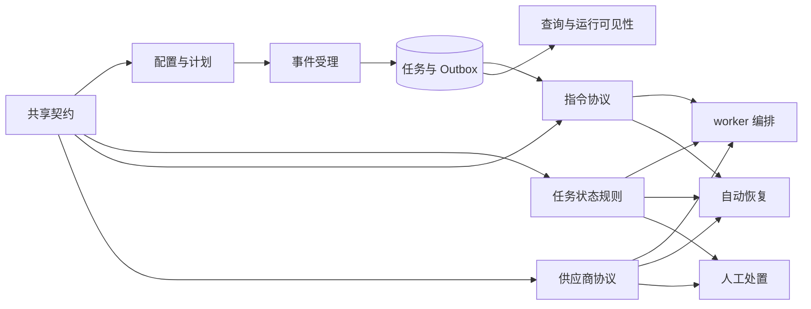
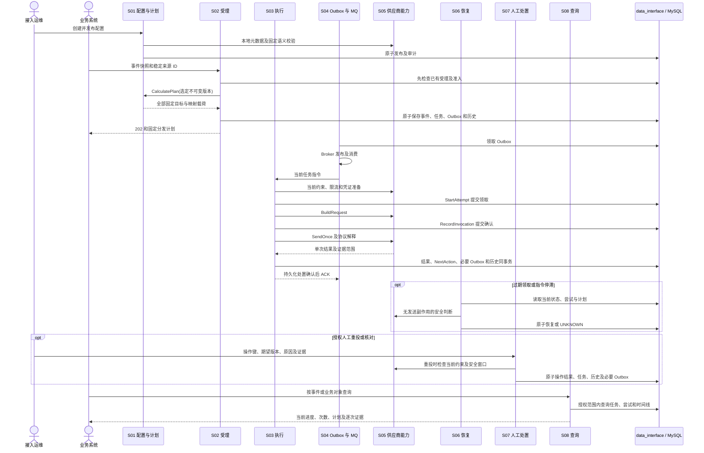

# 通知服务开发 Spec 索引

| 项目 | 内容 |
| --- | --- |
| 版本 | v0.2 |
| 状态 | 开发规格；仓库已有 S00～S08 对应实现与测试 |
| 依据 | [PRD v0.3](../PRD.md)、[TECH_DESIGN v0.6](../TECH_DESIGN.md) |
| 组织方式 | 1 份共享契约 + 8 份能力 spec；以开发批次交付完整链路 |

本目录集中保存首版开发规格。模块编号用于引用，不代表必须按编号逐个完整实现。文中的“必须”是实现及验收要求；HTTP 状态码、配置格式和内部操作名称等技术方案未展开的部分，是本次细化的首版拟定契约。

v0.2 将规格细化为字段/参数表、领域端口、完整事务、失败分支和模块依赖序列图。当前仓库已有 S00～S08 的业务模块、HTTP 入口、后台角色及对应测试；运行与验证入口见 [README](../README.md)。各规格中的完成标准仍是验收要求，实际执行结果以对应测试为准。涉及新接口和数据字段均属于原技术方案能力的具体化。

若实施中发现与 PRD、技术方案存在冲突，先记录并同步修订相关文档，不通过代码静默改变契约。

## 1. 文档与职责

| 编号 | 文档 | 负责的行为 | 建议代码位置 |
| --- | --- | --- | --- |
| S00 | [共享契约](00-shared-contracts.md) | 标识、快照、版本、结果、事务、权限、时间和通用错误 | 跨模块约定，不要求创建公共大包 |
| ERR | [错误码体系](09-error-codes.md) | 精确业务原因、统一分类与消息、HTTP 兼容及异步投递诊断 | `constant`、`domain`、`service` |
| S01 | [配置发布与计划计算](01-configuration-release.spec.md) | 不可变配置发布、路由、映射、固定计划计算 | `biz/biz_config`、`domain`、`data/mysql` |
| S02 | [事件受理](02-event-ingestion.spec.md) | 事件校验、提交幂等、原子保存分发计划 | `service`、`biz/biz_event`、`data/mysql` |
| S03 | [投递状态与执行](03-delivery-processing.spec.md) | 状态机、领取、尝试、预算、执行和 ACK 协调 | `server` 后台入口、`biz/biz_delivery`、`domain` |
| S04 | [可靠指令传递](04-reliable-dispatch.spec.md) | Outbox、发布领取、发布重试、消息协议和延迟消息 | `biz/biz_outbox`、`data/rocketmq`、`data/mysql` |
| S05 | [供应商执行边界](05-provider-runtime.spec.md) | 适配器、凭证、通道、限流和受控 HTTP | `biz/biz_provider`、`data/provider`、`data/redis` |
| S06 | [自动恢复](06-delivery-recovery.spec.md) | 过期领取、补发、阻塞检查、DLQ 和迟到证据 | `biz/biz_recovery`、`domain`、`data/mysql` |
| S07 | [人工处置](07-delivery-operations.spec.md) | 指定任务重投、UNKNOWN 核对、操作幂等和审计 | `service`、`biz/biz_delivery`、`data/mysql` |
| S08 | [查询与运行可见性](08-delivery-tracking.spec.md) | 查询、时间线、概览、告警和协调清理 | `service`、`biz/biz_tracking`、`data/mysql`、`pkg/metrics` |

表中路径均相对 `internal`（`pkg/metrics` 除外）。所有用例经 `data_interface` 使用仓储和外部能力，完整分层约束见 [技术方案第 12 节](../TECH_DESIGN.md#12-接口与代码组织)。路径是规格中的建议位置，实际目录以 [README 代码组织](../README.md#代码组织) 为准。

## 2. 依赖与边界

- S01 发布时依赖 S05 的适配器注册信息和凭证引用校验契约，不执行供应商业务请求。
- S02 复用 S03 的初始任务规则和 S04 的指令格式，在一个事务中保存，不同步调用 MQ 或供应商。
- S03 的任务状态规则是 worker、S06、S07 的唯一状态推进依据。S06、S07 不能各写一套预算或结果确定性算法。
- S08 定义追踪数据的读取及保留要求；S01～S07 各自负责在其事务中写入追踪记录。
- `server` 负责路由、中间件与后台入口，`service` 负责协议转换，`biz` 负责用例；`data/mysql` 经仓储接口负责完整事务和条件更新，`data/redis` 负责可重建缓存和限流。它们不单独成为业务能力 spec。
- 首版保持同仓库、同进程；API、发布器、worker、扫描器分别管理生命周期。目录随实现创建。

## 3. 开发批次

### 批次 0：共享契约与运行底座

- 明确 S00，校准迁移字段、约束、索引和事务操作。
- 锁定 Go 依赖、Goose 和容器版本，验证 RocketMQ Broker、Proxy 与 Go SDK 的组合。
- 真实 MySQL、Redis、RocketMQ、模拟供应商连通；显式执行迁移与 Topic 初始化。
- 实现基础依赖检查、启动失败处理和可停止后台循环；日志默认脱敏。
- 扩展模拟供应商，使其可记录稳定幂等键、请求次数并按场景返回响应。

**验收门槛**：空库可完成迁移，即时与延迟消息能够真实收发；依赖配置缺失会明确失败；持久卷重启后数据仍存在。

### 批次 1：最小完整链路

- 实现 S01 最小发布、无条件路由与简单映射，S02 事件受理。
- 实现 S04 即时 Outbox 发布，S03 领取、成功/失败结果和持久化后 ACK。
- 实现 S05 模拟适配器；接入 S08 基本事件/任务详情、逐次尝试与时间线。
- 接入 S06 最低恢复能力：过期尝试可在保守规则下结束为不确定结果，不永久卡在 `PROCESSING`。

**验收门槛**：一条事件生成两个任务并独立投递；并发提交只建一套计划；映射失败无半套数据；结果证据可从 MySQL 查询。

### 批次 2：独立重试与运行约束

- 完成 S01 的条件匹配、映射校验、版本保留和缓存回源。
- 完成 S03 结果确定性、退避、尝试上限、等待截止和阻塞语义。
- 完成 S04 延迟调度；实现 S05 凭证等待、按需刷新、通道限流与目标约束。

**验收门槛**：一个目标成功、另一个失败时只重试失败目标；新配置不改变旧任务；单纯等待不增加尝试；不确定结果不会被后续拒绝覆盖。

### 批次 3：自动恢复与人工处置

- 完成 S06 扫描、补发、过期领取、阻塞恢复、DLQ 和迟到证据。
- 完成 S07 重投、核对结案、操作幂等、版本校验、风险确认和审计。

**验收门槛**：在发布确认、HTTP、结果事务及 ACK 边界中断进程，恢复后不丢计划、不覆盖历史、不误重投成功目标；并发人工操作只产生一个结果。

### 批次 4：完整查询与运行验收

- 完成 S08 组合查询、稳定分页、概览、告警和保留清理。
- 在真实基础设施和独立模拟供应商中覆盖技术方案第 13 节全部场景。
- 执行适用的 `gofmt`、`go vet`、集成测试和并发路径 race 检查。

**验收门槛**：下方覆盖表对应场景全部有验证记录；不依赖日志留存即可查询和恢复；清理与重投并发不会删除恢复依据。

## 4. 技术方案验收覆盖

| 技术方案第 13 节场景 | 主责 spec | 联合验收 |
| --- | --- | --- |
| 多目标投递、部分失败独立重试 | S02、S03 | S01、S04、S05 |
| 重复/并发受理、单目标映射失败 | S02 | S00、S01 |
| 路由/映射更新、业务数据变化后重试 | S01、S03 | S02、S05 |
| 延迟后重新签名或刷新 Token | S05 | S03 |
| 配置缓存删除、Redis 重启 | S01、S05 | S03、S06 |
| 发布确认丢失、消费中断、ACK 失败 | S04、S03 | S06 |
| HTTP 200 业务拒绝、响应丢失、未决结果后拒绝 | S05、S03 | S06、S07 |
| 旧配置/适配器不可用、通道禁用 | S01、S05 | S03、S06 |
| 关联查询、连续多次发送及时间线 | S08 | 所有写入模块 |
| 限流、凭证等待、长期阻塞 | S03、S05 | S06 |
| 请求前后崩溃、结果提交确认丢失 | S03、S06 | S04 |
| 扫描器、重复消息与旧 worker 并发 | S03、S06 | S04 |
| 并发人工重投与核对结案 | S07 | S03、S08 |
| 敏感或超长响应、日志缺失、系统重启 | S05、S08 | S03、S06 |
| 超保留期仍有异常任务、重投后保留 | S08 | S01、S07 |

## 5. 实施与变更规则

- 每个 spec 的验收场景编号用于测试和交付记录；满足部分场景不等于整个模块完成。
- 提交功能时同步检查共享契约、接口示例、迁移、写入与读取字段是否一致。
- 每批必须跑通实际链路，数据库事务与 MQ 故障不能仅靠内存替身证明。
- 现有迁移若已在共享环境执行，使用增量迁移；不得通过清库验证恢复，也不得擅自改写已执行迁移。
- 若后续使用 OpenSpec，以批次建立 change，并在 change 中维护相关能力的 delta spec；验收归档后再形成已实现规格。本目录目前描述目标行为。

## 6. 开发依赖顺序与交付接口

| 顺序 | 需要先稳定的契约 | 可并行推进的模块工作 | 联合交付门槛 |
| --- | --- | --- | --- |
| 1 | S00 领域结构、认证 Scope、精确 JSON、错误、数据库事务及历史分配 | S03 纯状态/预算规则、S04 命令结构、S05 适配器元数据 | 对相同输入产生相同领域结果；无协议/驱动类型进入 domain |
| 2 | S05 ValidateTarget/ValidatePayload、通道和凭证引用读取 | S01 完整发布与 Plan，S04 发布仓储，S08 查询基础端口 | 可发布示例配置，读取旧版本，迁移保存全部固定语义 |
| 3 | S01 CalculatePlan、S03 初始任务、S04 首次 Outbox | S02 受理事务、S04 真 MQ 发布、S05 模拟接收端 | 真实基础设施上完成一次多目标受理及消费 |
| 4 | S05 Prepare/Build/Send/Interpret、S03 NextAction | S03 结果/等待/阻塞事务，S06 最低过期恢复 | 每次尝试一次调用，结果已存后 ACK，进程中断可恢复 |
| 5 | S03 统一状态及证据规则、S04 同指令再发布 | S06 全量恢复/DLQ，S07 重投/核对，S08 全量查询 | 并发、迟到、风险授权和未知结果均有持久化证据 |
| 6 | 所有写入模块的历史/操作/版本引用契约 | S08 概览、告警、清理及最终故障矩阵 | 关闭日志仍可回答进展；清理不破坏恢复或人工处置 |

表中顺序是接口和验收依赖，不要求一个模块完成全部功能后才启动下一个。S01 与 S05 互相需要的只是固定元数据和载荷校验契约；先交付这些端口可避免等整个供应商运行模块。S06/S07 只调用 S03 的共享领域规则，不通过一次真实业务调用探测可否恢复。

## 7. 全链路模块依赖序列图

各模块文档内进一步展示其局部序列和失败分支；图中的交互是运行时职责，不改变技术方案第 12 节的接口依赖方向。所有外部基础设施调用通过 data_interface 注入，跨表原子性由 data/mysql 的完整操作提供。

## 8. 参数归属与接口索引

| 契约来源 | 决定的参数 | 修改时必须联查 |
| --- | --- | --- |
| S00 | 标识/JSON/时间、身份 Scope、公共 HTTP/数据库预算、领域结构、迁移补充 | 全部模块 |
| S01 | JSON 配置格式、schema/条件/映射、发布 API、冻结轮次策略、配置缓存 | S02、S03、S05 |
| S02 | 接入字段、指纹、大小/扇出/积压门槛、稳定业务键 | S01、S04、S08 |
| S03 | worker 并行/领取/HTTP/ACK 预算、状态和下一步判定、执行端口 | S04、S05、S06、S07 |
| S04 | 消息/发布状态、publish_revision、发布超时/退避、Broker 能力 | S03、S06 |
| S05 | 通道/凭证/限流/传输、适配器和模拟协议、重发窗口 | S01、S03、S06、S07 |
| S06 | 分类扫描、补发宽限/冷却/上限、DLQ 操作 | S03、S04、S07、S08 |
| S07 | 管理请求/结果、证据范围、一次性授权、幂等及策略上限 | S03、S05、S08 |
| S08 | 过滤/游标/返回模型、统计、告警/探针、保留清理 | 全部写入模块 |

技术方案接口细化之外增加的具体管理路径为 S01 的 releases 校验/草稿/发布、S05 的 channels CRUD 子集，以及 S06 的 `POST /v1/deliveries/{id}/repair-dispatch`。后者只修复当前任务指令，不创建业务新轮次。对外协议字段使用 snake_case；领域结构采用 Go 命名；环境变量使用大写下划线。文档声明的默认值统一进入 conf，发布内容和每轮策略显式落库，执行时不读取新的默认值替代旧策略。
